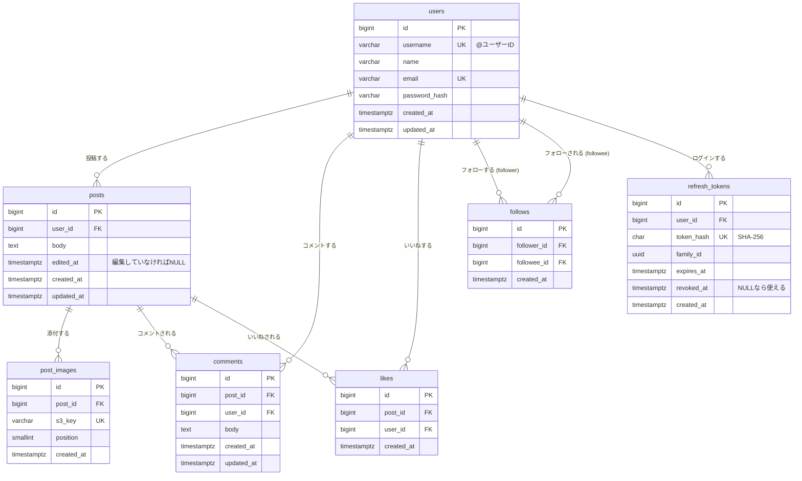

# ER図

[← 要件定義に戻る](./要件定義.md)

DB は **PostgreSQL**。データ型は PostgreSQL の型で書いている。

- `id` はすべて `bigint GENERATED ALWAYS AS IDENTITY`（自動採番）にする。MyBatis では Mapper XML の `useGeneratedKeys="true" keyProperty="id"` で、採番された id を受け取る
- 日時はタイムゾーン付きの `timestamptz` にする
- `id` は作成順に増えるため、「新しい順」の並べ替えとカーソル方式のページングには `id` を使う（[共通仕様 4章](./機能定義書/00_共通仕様.md#4-ページング)）

## 1. ER図



### リレーションのポイント（学習メモ）

| 関係 | 種類 | 実現方法 |
|---|---|---|
| ユーザー → 投稿 | 1対多 | `posts.user_id` |
| 投稿 → 画像 | 1対多 | `post_images.post_id`（1投稿に複数枚付けられるよう別テーブルにしている） |
| ユーザー ⇔ 投稿（いいね） | 多対多 | 中間テーブル `likes` |
| ユーザー ⇔ 投稿（コメント） | 多対多（本文あり） | `comments` は中間テーブルに本文が付いたものと考えられる |
| ユーザー ⇔ ユーザー（フォロー） | 多対多（自己参照） | 中間テーブル `follows` に、`users` を参照する外部キーを2つ持たせる |

## 2. テーブル定義

### users（ユーザー）

| カラム | 型 | NULL | 制約・既定値 | 説明 |
|---|---|:-:|---|---|
| id | bigint | × | PK（IDENTITY） | |
| username | varchar(15) | × | UNIQUE、CHECK(username ~ '^[a-z0-9_]{3,15}$') | @ユーザーID。画面の URL や API のパスに使う。登録後は変更できない（F-01） |
| name | varchar(50) | × | | 表示名。重複してもよい |
| email | varchar(255) | × | UNIQUE | ログインID。小文字にそろえてから保存する（F-01） |
| password_hash | varchar(255) | × | | BCrypt でハッシュ化したパスワード |
| created_at | timestamptz | × | DEFAULT now() | |
| updated_at | timestamptz | × | DEFAULT now() | |

### refresh_tokens（リフレッシュトークン）

ログイン状態を保つためのリフレッシュトークン（[F-02](./機能定義書/F-02_ログイン・ログアウト.md)）。トークンそのものは保存せず、ハッシュだけを保存する（DB が漏れてもトークンとして使えないようにするため）。

| カラム | 型 | NULL | 制約・既定値 | 説明 |
|---|---|:-:|---|---|
| id | bigint | × | PK（IDENTITY） | |
| user_id | bigint | × | FK → users.id（ON DELETE CASCADE） | トークンの持ち主 |
| token_hash | char(64) | × | UNIQUE | トークンの SHA-256（16進数64文字） |
| family_id | uuid | × | | ログイン1回ごとの系列。交換しても引き継ぐ。使用済みのトークンが再び使われたら、この系列をまとめて無効にする |
| expires_at | timestamptz | × | | 有効期限（発行から7日） |
| revoked_at | timestamptz | ○ | | 交換・ログアウト・無効化された日時。NULL なら使える |
| created_at | timestamptz | × | DEFAULT now() | |

- 期限切れの行は、毎日4時（UTC）にアプリが削除する

### posts（投稿）

| カラム | 型 | NULL | 制約・既定値 | 説明 |
|---|---|:-:|---|---|
| id | bigint | × | PK（IDENTITY） | |
| user_id | bigint | × | FK → users.id | 投稿者 |
| body | text | × | CHECK(char_length(body) BETWEEN 1 AND 280) | 本文 |
| edited_at | timestamptz | ○ | | 投稿者が最後に編集した日時。編集していなければ NULL。値があれば「編集済み」と表示する（F-10） |
| created_at | timestamptz | × | DEFAULT now() | 投稿日時 |
| updated_at | timestamptz | × | DEFAULT now() | |

### post_images（投稿画像）

| カラム | 型 | NULL | 制約・既定値 | 説明 |
|---|---|:-:|---|---|
| id | bigint | × | PK（IDENTITY） | |
| post_id | bigint | × | FK → posts.id | |
| s3_key | varchar(255) | × | UNIQUE | S3 のオブジェクトキー（例：`posts/{post_id}/{uuid}.jpg`） |
| position | smallint | × | CHECK(position BETWEEN 1 AND 4)、UNIQUE(post_id, position) DEFERRABLE | 表示順。UNIQUE は「遅らせてチェックできる」制約にしてあり、投稿編集（F-10）で並べ替えるときだけコミット時にまとめてチェックする（ふだんはすぐチェックする） |
| created_at | timestamptz | × | DEFAULT now() | |

> 画像ファイルそのものは **AWS S3** に置き、DB には S3 のオブジェクトキーだけを保存する。URL（ドメインやバケット名を含む）をそのまま保存しないのは、CloudFront のドメインを変えたり、署名付き URL に切り替えたりしても、DB のデータを直さずに済むようにするため。表示するときにキーから URL を組み立てる。

### comments（コメント）

| カラム | 型 | NULL | 制約・既定値 | 説明 |
|---|---|:-:|---|---|
| id | bigint | × | PK（IDENTITY） | |
| post_id | bigint | × | FK → posts.id | コメント先の投稿 |
| user_id | bigint | × | FK → users.id | コメントした人 |
| body | text | × | CHECK(char_length(body) BETWEEN 1 AND 280) | 本文 |
| created_at | timestamptz | × | DEFAULT now() | |
| updated_at | timestamptz | × | DEFAULT now() | |

### likes（いいね）

| カラム | 型 | NULL | 制約・既定値 | 説明 |
|---|---|:-:|---|---|
| id | bigint | × | PK（IDENTITY） | |
| post_id | bigint | × | FK → posts.id | |
| user_id | bigint | × | FK → users.id | いいねした人 |
| created_at | timestamptz | × | DEFAULT now() | |

- **UNIQUE(user_id, post_id)**：同じ人が同じ投稿に2回いいねできないようにする（F-06）

### follows（フォロー）

| カラム | 型 | NULL | 制約・既定値 | 説明 |
|---|---|:-:|---|---|
| id | bigint | × | PK（IDENTITY） | |
| follower_id | bigint | × | FK → users.id | フォローする人 |
| followee_id | bigint | × | FK → users.id | フォローされる人 |
| created_at | timestamptz | × | DEFAULT now() | |

- **UNIQUE(follower_id, followee_id)**：同じ人を2回フォローできないようにする（F-07）
- **CHECK(follower_id <> followee_id)**：自分自身をフォローできないようにする（F-07）

### 削除時の扱い

投稿の削除（F-11）は**物理削除**にする（「削除済み」フラグを立てて残す論理削除はしない）。

| 外部キー | ON DELETE | 動き |
|---|---|---|
| post_images.post_id → posts.id | CASCADE | 投稿を消すと画像の行も消える |
| comments.post_id → posts.id | CASCADE | 投稿を消すとコメントも消える |
| likes.post_id → posts.id | CASCADE | 投稿を消すといいねも消える |
| refresh_tokens.user_id / posts.user_id / comments.user_id / likes.user_id / follows.* → users.id | CASCADE | ユーザー削除は今回作らないが、将来に備えて付けておく |

- DB の CASCADE では S3 上の画像ファイルは消えない。アプリで削除前に画像の S3 キーを取得しておき、DB の削除が成功してから S3 の画像を消す（[F-11](./機能定義書/F-11_投稿削除.md)）
- 投稿の編集（F-10）で外した画像も同じく、DB の更新が成功してから S3 から消す

## 3. インデックス

| テーブル | インデックス | 用途 |
|---|---|---|
| users | UNIQUE(username) | ユーザーページ・API のパスからの検索、登録時の重複防止 |
| users | UNIQUE(email) | ログイン時の検索、登録時の重複防止 |
| users | GIN(username gin_trgm_ops) | ユーザー検索の部分一致（F-09） |
| users | GIN(name gin_trgm_ops) | ユーザー検索の部分一致（F-09） |
| refresh_tokens | UNIQUE(token_hash) | トークンの検索（refresh・logout） |
| refresh_tokens | (family_id) | 系列をまとめて無効にする |
| refresh_tokens | (expires_at) | 期限切れの削除 |
| posts | (user_id, id DESC) | タイムライン・ユーザーページの投稿取得 |
| post_images | UNIQUE(post_id, position) | 投稿の画像を順番に取得 |
| comments | (post_id, id) | 投稿詳細のコメント一覧、コメント数 |
| likes | UNIQUE(user_id, post_id) | 重複防止、自分がいいね済みかの判定 |
| likes | (post_id) | いいね数の集計 |
| follows | UNIQUE(follower_id, followee_id) | 重複防止、フォロー中ユーザーの取得、フォロー数の集計 |
| follows | (followee_id) | フォロワー数の集計 |

> `ILIKE '%taro%'` のような部分一致は、通常の B-tree インデックスが効かない。PostgreSQL の `pg_trgm` 拡張（`CREATE EXTENSION pg_trgm;`）を入れ、GIN インデックスを作ると速く検索できる。Amazon RDS for PostgreSQL でも使える。

## 4. 主要なクエリ（イメージ）

### タイムライン（F-03）

```sql
SELECT p.*
FROM posts p
WHERE (p.user_id = :me
       OR p.user_id IN (SELECT followee_id FROM follows WHERE follower_id = :me))
  AND (:before IS NULL OR p.id < :before)
ORDER BY p.id DESC
LIMIT 20;
```

### いいね数・コメント数

最初は、表示するときに20件分をまとめて集計する（シンプルで、数がずれる心配がない）。

```sql
SELECT post_id, COUNT(*) AS like_count
FROM likes
WHERE post_id IN (:post_ids)
GROUP BY post_id;
```

> 投稿が増えて集計が遅くなったら、`posts` に `like_count` / `comment_count` カラムを追加し、いいね・コメントのたびに増減させる（カウンターキャッシュ）方法を検討する。今回は採用しない。

### ユーザー検索（F-09）

```sql
-- :q は前後の空白と先頭の@を除き、% と _ をエスケープ済みのキーワード
SELECT u.username, u.name
FROM users u
WHERE u.username ILIKE '%' || :q || '%'
   OR u.name     ILIKE '%' || :q || '%'
ORDER BY
  CASE
    WHEN u.username = lower(:q)          THEN 0  -- 完全一致
    WHEN u.username LIKE lower(:q) || '%' THEN 1  -- 前方一致
    ELSE 2                                        -- 部分一致
  END,
  u.username
LIMIT 20 OFFSET :offset;
```

## 5. 作らないテーブル

コンセプト（[要件定義 4章](./要件定義.md#4-コンセプトと差別化)）に合わせて、次のテーブルは作らない。

- インプレッション（表示回数）を記録するテーブル
- リツイート／引用を記録するテーブル
