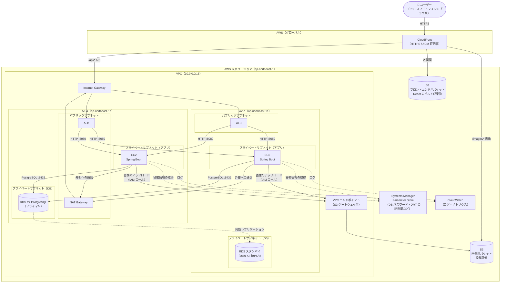

# インフラ構成図

[← 要件定義に戻る](./要件定義.md)

> インフラ構築工程では、この構成を**節約案**（6章：EC2 1台・RDS Single-AZ・NAT Gateway なし）で作ることに決まっている。構築方法（手作業か Terraform か）・独自ドメイン・デプロイ方法は、その工程の最初に決める（[要件定義 14章](./要件定義.md#14-未決事項)）。
> 決まっていること：画像の保存先に S3 を使う。構築する場合は EC2・RDS・ALB を使う。

## 1. 構成図

## 2. 構成要素

| サービス | 役割 | 設定のポイント |
|---|---|---|
| CloudFront | 入口。画面・画像・API を**同じドメイン**から配信する | パスごとに振り分ける（下の表）。HTTPS 証明書は ACM（us-east-1 で発行） |
| S3（フロントエンド用） | React のビルド成果物（HTML / JS / CSS）を置く | 非公開にし、CloudFront からだけ読めるようにする（OAC） |
| S3（画像用） | 投稿画像を置く | 非公開にし、CloudFront からだけ読めるようにする（OAC）。書き込みは EC2 の IAM ロールから |
| ALB | API のリクエストを EC2 に振り分ける | 2つの AZ のパブリックサブネットに置く（ALB は2つ以上の AZ が必須）。ヘルスチェック先は `/actuator/health` |
| EC2 | Spring Boot（jar）を動かす | プライベートサブネットに置く。最初は1台でもよい。Auto Scaling グループにすると台数を増減できる |
| RDS for PostgreSQL | データベース | DB 用のプライベートサブネットに置く。学習中は Single-AZ で費用を抑え、必要になったら Multi-AZ にする |
| VPC エンドポイント（S3） | EC2 から S3 へ、インターネットを通らずにアクセスする | ゲートウェイ型は無料 |
| NAT Gateway | プライベートサブネットの EC2 から外部（OS の更新など）へ通信する | 費用がかかる（→ 6章） |
| Systems Manager Parameter Store | DB のパスワード・JWT の署名用の秘密鍵（`JWT_SECRET`）などの秘密情報を保存する | Spring Boot の起動時に読み込む。コードや Git に秘密情報を置かない |
| CloudWatch | ログ・メトリクスの収集 | Spring Boot のログを送る |

### CloudFront の振り分け（ビヘイビア）

| パス | 転送先 | キャッシュ |
|---|---|---|
| `/api/*` | ALB → EC2（Spring Boot） | しない（Cookie・Authorization ヘッダー・クエリ文字列をそのまま転送する） |
| `/images/*` | S3（画像用バケット） | する（画像は一度保存したら変わらないため長めにする） |
| `/*`（それ以外すべて） | S3（フロントエンド用バケット） | する（`index.html` だけは短めにする） |

- 画面と API を同じドメインから配信するため、CORS の設定が要らず、Cookie も使いやすい
- React は SPA のため、`/users/taro_dev` のような URL を直接開いたときに S3 から 403/404 が返る。CloudFront のカスタムエラーレスポンスで `index.html` を返すように設定する

## 3. ネットワーク

| サブネット | AZ-a | AZ-c | 置くもの |
|---|---|---|---|
| パブリック | 10.0.1.0/24 | 10.0.2.0/24 | ALB、NAT Gateway |
| プライベート（アプリ） | 10.0.11.0/24 | 10.0.12.0/24 | EC2 |
| プライベート（DB） | 10.0.21.0/24 | 10.0.22.0/24 | RDS |

### セキュリティグループ

| 名前 | 受け付ける通信（インバウンド） | 送信元 |
|---|---|---|
| alb-sg | HTTPS 443（または HTTP 80） | CloudFront のマネージドプレフィックスリスト（CloudFront 以外からのアクセスを防ぐ） |
| app-sg | HTTP 8080 | alb-sg |
| db-sg | PostgreSQL 5432 | app-sg |

- EC2 には SSH（22番）を開けず、Systems Manager Session Manager で接続する
- RDS はインターネットから直接つながらないようにする（パブリックアクセス：なし）

## 4. 権限（IAM）

| 対象 | 権限 |
|---|---|
| EC2 の IAM ロール | 画像用バケットの `posts/*` への `s3:PutObject`・`s3:DeleteObject`、Parameter Store の読み取り、CloudWatch Logs への書き込み、Session Manager の利用 |

- AWS のアクセスキーは発行しない。EC2 上の Spring Boot（AWS SDK）は IAM ロールの権限を自動で使う

## 5. リクエストの流れ

### 画面を開く

1. ブラウザ → CloudFront → S3（フロントエンド用）から React を読み込む
2. React が `/api/...` を呼ぶ → CloudFront → ALB → EC2 → RDS

### 画像付きで投稿する（F-04）

1. React → CloudFront → ALB → EC2 に `multipart/form-data` で送る
2. EC2 が S3（画像用）に画像を保存する（VPC エンドポイント経由）
3. EC2 が RDS に投稿と S3 のキーを保存する

### 画像を表示する

1. API のレスポンスに `https://{CloudFront のドメイン}/images/posts/...` の URL が入っている
2. ブラウザ → CloudFront → S3（画像用）から画像を読み込む（2回目以降は CloudFront のキャッシュから返る）

## 6. 費用を抑える工夫（学習用）

止めていても費用がかかるサービスがあるため、学習中は次のように調整する。

| 項目 | 本番に近い構成 | 学習中の節約案 |
|---|---|---|
| NAT Gateway | 置く（止めていても時間単位で費用がかかる） | 置かない。S3 は VPC エンドポイント、Systems Manager は VPC インターフェースエンドポイントで代わりにするか、EC2 をパブリックサブネットに置いて app-sg で ALB からの通信だけに絞る |
| EC2 | 2台（AZ ごとに1台） | 1台 |
| RDS | Multi-AZ | Single-AZ。使わない日は停止する（最大7日で自動的に再開される点に注意） |
| ALB | 置く | 置く（止められないため、使わない期間は削除して作り直す） |

- 無料利用枠の対象と範囲は、アカウント作成時期によって変わるため、構築前に AWS の料金ページと料金計算ツールで確認する
- AWS Budgets で予算アラートを設定しておく

## 7. 今後決めること

- AWS 上に構築するかどうか
- 独自ドメインを使うか（使う場合は Route 53 と ACM を追加する）
- デプロイの方法（手動、GitHub Actions など）
- 構築の方法（マネジメントコンソールで手作業、Terraform / CloudFormation でコード化）
- リクエストの大きさの上限：アプリ側では JSON の大きさに上限をかけていない（巨大なリクエストも一度読み込んでから 400 を返す）。ALB の前に AWS WAF を置いて本文サイズを制限するなど、インフラ側で上限をかける（画像つきの投稿は 21MB まで受け付ける必要がある）。品質チェック（issue #27）で見つかった点
