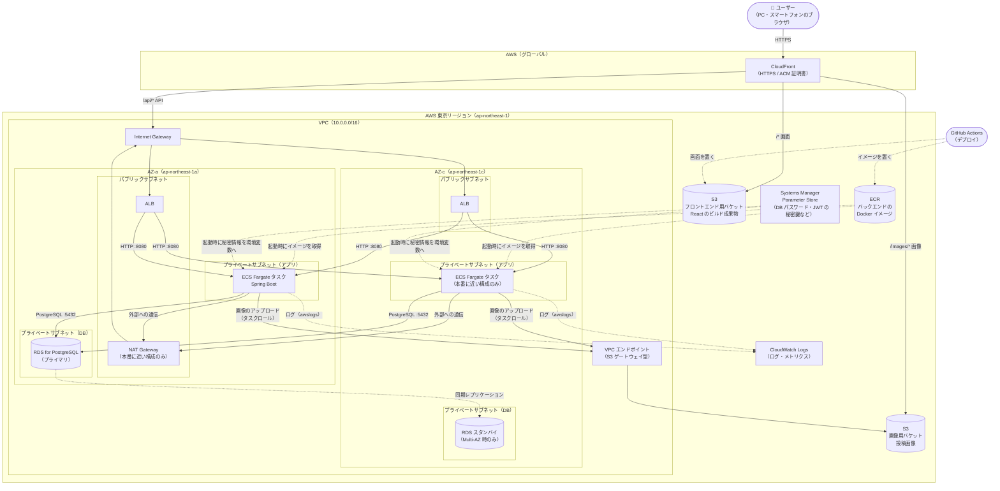

# インフラ構成図

[← 要件定義に戻る](./要件定義.md)

> インフラ構築工程では、この構成を**節約案**（6章：Fargate のタスク1つ・RDS Single-AZ・NAT Gateway なし）で作ることに決まっている。構築は Terraform、独自ドメインは使わない、デプロイは GitHub Actions で行う（7章・[デプロイ](./デプロイ.md)）。
> 決まっていること：フロントエンドは S3 ＋ CloudFront で配る。バックエンドは **ECS Fargate**（EC2 は使わない）で動かし、ALB を前に置く。DB は RDS、画像の保存先は S3。
> ※当初はバックエンドを EC2 で動かす案だったが、インフラ構築の前に ECS Fargate へ変更した（issue #76）。サーバー（OS）の管理が要らず、手元と同じ Docker イメージをそのまま動かせるため。

## 1. 構成図

学習中の節約案（6章）では、Fargate のタスクを**パブリックサブネットに1つ**だけ置き、NAT Gateway を置かない。

## 2. 構成要素

| サービス | 役割 | 設定のポイント |
|---|---|---|
| CloudFront | 入口。画面・画像・API を**同じドメイン**から配信する | パスごとに振り分ける（下の表）。HTTPS 証明書は ACM（us-east-1 で発行） |
| S3（フロントエンド用） | React のビルド成果物（HTML / JS / CSS）を置く | 非公開にし、CloudFront からだけ読めるようにする（OAC） |
| S3（画像用） | 投稿画像を置く | 非公開にし、CloudFront からだけ読めるようにする（OAC）。書き込みは Fargate のタスクロールから |
| ALB | API のリクエストを Fargate のタスクに振り分ける | 2つの AZ のパブリックサブネットに置く（ALB は2つ以上の AZ が必須）。ターゲットグループは **IP タイプ**（Fargate のタスクは IP アドレスで登録される）、ポート 8080。ヘルスチェック先は `/actuator/health` |
| ECR | バックエンドの Docker イメージ（`backend/Dockerfile` で作る）を置く | イメージのタグはコミット。古いイメージはライフサイクルポリシーで消す（例：新しい10個だけ残す） |
| ECS（Fargate） | Spring Boot のコンテナを動かす。サーバー（OS）の管理は AWS が行う | クラスター1つ・サービス1つ。タスクの大きさは 0.5 vCPU・1GB から始める。**タスクの数は1つに固定**（下の注意）。デプロイは「新しいタスクが動いてから古いタスクを止める」形にし、デプロイのサーキットブレーカー（失敗したら前の版に戻す）を有効にする（[デプロイ](./デプロイ.md) 3章） |
| RDS for PostgreSQL | データベース | DB 用のプライベートサブネットに置く。学習中は Single-AZ で費用を抑え、必要になったら Multi-AZ にする |
| VPC エンドポイント（S3） | Fargate のタスクから S3 へ、インターネットを通らずにアクセスする | ゲートウェイ型は無料 |
| NAT Gateway | プライベートサブネットのタスクから外部（ECR・CloudWatch Logs・Parameter Store など）へ通信する | 費用がかかる（→ 6章） |
| Systems Manager Parameter Store | DB のパスワード・JWT の署名用の秘密鍵（`JWT_SECRET`）などの秘密情報を保存する | タスク定義の `secrets` で指定すると、ECS がタスクの起動時に取り出して環境変数として渡す。コードや Git、タスク定義の `environment` に秘密情報を置かない |
| CloudWatch Logs | ログの収集 | タスク定義のログドライバー `awslogs` で、コンテナの標準出力（JSON の構造化ログ）を送る。何をログに出し、何を監視するかは [ログ・監視設計](./ログ・監視設計.md) を参照（Datadog を使う場合は、Datadog Agent をサイドカーのコンテナとして同じタスクに置く） |

**タスクの数を1つに固定する理由**：今のバックエンドは、1つのプログラムが動き続けることを前提にした作りが2つある。タスクを増やす（Auto Scaling にする）前に、これらを DB などに移す必要がある。

- ログインの総当たり対策（`LoginAttemptService`）は、失敗の回数をメモリに数えている。タスクが2つあると、回数がタスクごとに分かれ、上限の2倍まで試せてしまう
- 期限切れのリフレッシュトークンの削除などの定期処理（`@Scheduled`）は、タスクごとに動く（今の処理は2回動いても害はないが、増やすときは確かめる）

デプロイの間だけは、新しいタスクと古いタスクが短い時間2つ動く。このときも上の2つは害がない（回数はタスクを入れ替えると数え直しになる。EC2 で再起動したときと同じ）。

### CloudFront の振り分け（ビヘイビア）

| パス | 転送先 | キャッシュ |
|---|---|---|
| `/api/*` | ALB → ECS Fargate（Spring Boot） | しない（Cookie・Authorization ヘッダー・クエリ文字列をそのまま転送する） |
| `/images/*` | S3（画像用バケット） | する（画像は一度保存したら変わらないため長めにする） |
| `/*`（それ以外すべて） | S3（フロントエンド用バケット） | する（`index.html` だけは短めにする） |

- 画面と API を同じドメインから配信するため、CORS の設定が要らず、Cookie も使いやすい
- React は SPA のため、`/users/taro_dev` のような URL を直接開いたときに S3 から 403/404 が返る。CloudFront のカスタムエラーレスポンスで `index.html` を返すように設定する

## 3. ネットワーク

| サブネット | AZ-a | AZ-c | 置くもの |
|---|---|---|---|
| パブリック | 10.0.1.0/24 | 10.0.2.0/24 | ALB、NAT Gateway（本番に近い構成）、Fargate のタスク（節約案） |
| プライベート（アプリ） | 10.0.11.0/24 | 10.0.12.0/24 | Fargate のタスク（本番に近い構成） |
| プライベート（DB） | 10.0.21.0/24 | 10.0.22.0/24 | RDS |

- ECS のサービスには、2つの AZ のサブネットを指定する（タスクが1つでも、AZ に障害があれば別の AZ で起動し直せる）
- Fargate のタスクは、起動のときに ECR（イメージ）・Parameter Store（秘密情報）へ、動いている間は CloudWatch Logs へ通信する。そのため、外へ出る道（NAT Gateway・VPC エンドポイント・パブリック IP のどれか）が必ず要る（6章）

### セキュリティグループ

| 名前 | 受け付ける通信（インバウンド） | 送信元 |
|---|---|---|
| alb-sg | HTTPS 443（または HTTP 80） | CloudFront のマネージドプレフィックスリスト（CloudFront 以外からのアクセスを防ぐ） |
| app-sg | HTTP 8080 | alb-sg |
| db-sg | PostgreSQL 5432 | app-sg |

- Fargate のタスクには SSH で入れない。調べるときは CloudWatch Logs のログを見る。コンテナの中でコマンドを動かす必要があれば、ECS Exec を使う（タスクロールに Systems Manager の権限を足し、サービスで有効にする）
- タスクをパブリックサブネットに置く節約案でも、app-sg が ALB からの 8080 番しか受け付けないので、インターネットから直接はつながらない
- RDS はインターネットから直接つながらないようにする（パブリックアクセス：なし）

## 4. 権限（IAM）

Fargate では、役割の違う2つのロールをタスク定義に付ける。

| 対象 | 使う人 | 権限 |
|---|---|---|
| タスク実行ロール（Task execution role） | ECS（タスクを起動するとき） | ECR からのイメージの取得（`AmazonECSTaskExecutionRolePolicy`）、CloudWatch Logs への書き込み、Parameter Store の秘密情報の読み取り（`ssm:GetParameters`。SecureString の場合は KMS の復号も） |
| タスクロール（Task role） | Spring Boot（動いている間） | 画像用バケットの `posts/*`・`avatars/*` への `s3:PutObject`・`s3:DeleteObject`。ECS Exec を使う場合は Systems Manager の権限も |
| デプロイ用ロール | GitHub Actions | [デプロイ](./デプロイ.md) 4.1 |

- AWS のアクセスキーは発行しない。Fargate 上の Spring Boot（AWS SDK）は、タスクロールの権限を自動で使う

## 5. リクエストの流れ

### 画面を開く

1. ブラウザ → CloudFront → S3（フロントエンド用）から React を読み込む
2. React が `/api/...` を呼ぶ → CloudFront → ALB → Fargate のタスク → RDS

### 画像付きで投稿する（F-04）

1. React → CloudFront → ALB → Fargate のタスクに `multipart/form-data` で送る
2. タスクが S3（画像用）に画像を保存する（VPC エンドポイント経由）
3. タスクが RDS に投稿と S3 のキーを保存する

### 画像を表示する

1. API のレスポンスに `https://{CloudFront のドメイン}/images/posts/...` の URL が入っている
2. ブラウザ → CloudFront → S3（画像用）から画像を読み込む（2回目以降は CloudFront のキャッシュから返る）

## 6. 費用を抑える工夫（学習用）

止めていても費用がかかるサービスがあるため、学習中は次のように調整する。

| 項目 | 本番に近い構成 | 学習中の節約案 |
|---|---|---|
| NAT Gateway | 置く（止めていても時間単位で費用がかかる） | 置かない。Fargate のタスクを**パブリックサブネットに置いてパブリック IP を付け**、app-sg で ALB からの通信だけに絞る（パブリック IP は時間単位で少し費用がかかるが、NAT Gateway よりずっと安い）。代わりに VPC インターフェースエンドポイント（ECR・CloudWatch Logs・Systems Manager）を置く方法もあるが、1つごと・AZ ごとに費用がかかる |
| Fargate のタスク | 2つ以上（AZ ごとに1つ。先に 2章の注意を直す） | 1つ。使わない間はサービスのタスク数（desired count）を 0 にすると、Fargate の費用は止まる |
| RDS | Multi-AZ | Single-AZ。使わない日は停止する（最大7日で自動的に再開される点に注意） |
| ALB | 置く | 置く（止められないため、使わない期間は削除して作り直す） |

- **Fargate には無料利用枠がない**（動かした時間の vCPU とメモリの量で費用がかかる）。EC2 の t3.micro より高くなりやすいので、構築前に AWS の料金計算ツールで、Fargate（0.5 vCPU・1GB を1つ）・ALB・RDS・パブリック IP の月額を確かめる
- 無料利用枠の対象と範囲は、アカウント作成時期によって変わるため、構築前に AWS の料金ページで確認する
- AWS Budgets で予算アラートを設定しておく
- 長く使わない期間は、`terraform destroy` で丸ごと消す（ALB・RDS は、タスク数を 0 にしても費用がかかり続けるため）

## 7. 今後決めること

決まったこと（issue #76）：

- 構築の方法：**Terraform** でコード化する
- 独自ドメイン：**使わない**（CloudFront のアドレスと、AWS の証明書を使う）
- バックエンドの動かし方：**ECS Fargate**（EC2 は使わない）。イメージは `backend/Dockerfile` で作り、ECR に置く
- デプロイの方法：**GitHub Actions**。main で CI が成功したら自動（リポジトリ変数 `DEPLOY_ENABLED` が `true` のときだけ）。仕組みと、Terraform で用意するもの（GitHub Actions 用の IAM ロール・ECR・ECS のタスク定義とサービス）は [デプロイ](./デプロイ.md)
- ALB → タスクの 8080 番：アプリの標準のポートは 8081 なので、イメージの中で環境変数 `SERVER_PORT=8080` にしている（`backend/Dockerfile`）

まだ決めていないこと：

- AWS 上に実際に構築する時期
- リクエストの大きさの上限：アプリ側では JSON の大きさに上限をかけていない（巨大なリクエストも一度読み込んでから 400 を返す）。ALB の前に AWS WAF を置いて本文サイズを制限するなど、インフラ側で上限をかける（画像つきの投稿は 21MB まで受け付ける必要がある）。品質チェック（issue #27）で見つかった点
- 利用者の IP アドレスの受け渡し：ログインの総当たり対策（F-02）は IP アドレスごとにも失敗回数を数える。アプリは ALB が付ける `X-Forwarded-For` を見るが、CloudFront を通すと ALB から見た送信元は CloudFront になる。CloudFront の `CloudFront-Viewer-Address` ヘッダーを転送してアプリで読む、などの方法を構築時に決める。品質チェック（issue #45）で見つかった点
- Content-Security-Policy（読み込めるスクリプトなどを制限するヘッダー）：画面（HTML）は CloudFront から配るため、CloudFront のレスポンスヘッダーポリシーで付ける。品質チェック（issue #45）で見つかった点
- 監視サービス（Datadog か、CloudWatch だけか）：[ログ・監視設計](./ログ・監視設計.md) は Datadog を前提に書き、CloudWatch だけの場合の実現方法も載せた（第2部 8章）。費用を見て構築時に決める。Datadog を使う場合は、Datadog Agent をサイドカーとしてタスクに足し、タスクから外向きの HTTPS 通信が必要になる（6章の節約案のパブリック IP で足りる）
- タスクを2つ以上にするか：2章の注意（ログインの失敗回数・定期処理）を DB などに移してから決める
