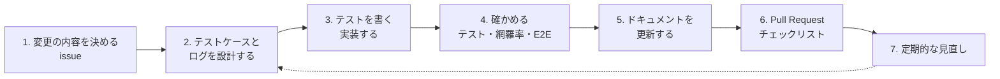

# テスト・ログの運用ルール - RaiseTime Line

機能を足す・直すたびに、テストの設計とログの設計を**続けていく**ための決まり。一度作った設計書は、放っておくと実装とずれて役に立たなくなる。「いつ・何を・どこに」を決めておく。

- 考え方と今の設計は、[テスト設計書](./テスト設計書.md)（技法から導いたケース）・[テスト観点表](./テスト観点表.md)（機能ごとの観点）・[テスト仕様書](./テスト仕様書.md)（画面のシナリオと E2E）・[ログ・監視設計](./ログ・監視設計.md)
- Pull Request を作るときは、テンプレート（`.github/pull_request_template.md`）のチェックリストで確かめる

## 1. 全体の流れ

設計（2）を実装（3）より先にする。先にケースを書き出すと、仕様の抜け（「このときはどうなる？」）に実装の前に気づける。

## 2. 変更の種類ごとに、やること

当てはまる行を全部やる。

| 変更の内容 | テストの設計（[テスト設計書](./テスト設計書.md) のどこを更新するか） | 書くテスト | ログ（[ログ・監視設計](./ログ・監視設計.md)） |
|---|---|---|---|
| **入力の項目を足す・上限を変える** | 2.1 に行を足す：有効・無効のグループと、境界値（下限・上限・その±1） | 境界値ごとのテスト。フロントとバックの両方 | 利用者が送った値をログに出すなら、L-3・L-4 を確かめる（隠す・長さ・改行） |
| **条件によって結果が変わる処理を足す**（権限・状態のチェックなど） | 2.2 にデシジョンテーブルを足す：条件の組み合わせを全部と、確かめる順番 | 表の1行につき1つ | 拒否する場合は、記録するか・レベルを L-1 に足す |
| **状態を持つものを足す**（トークン・ロック・下書きなど） | 2.3 に状態遷移の表を足す：すべてのマス（できない操作も） | マスごとのテスト | 状態が変わる瞬間を記録するか決める（`login_locked` のように、変わった瞬間に1回） |
| **API を足す・変える** | 観点表のチェックリスト（正常・400・401・403・404・冪等）を当てはめる | Controller・Service・Mapper のテスト | アクセスログは自動で出る。`./gradlew generateOpenApi` で API 仕様書を作り直す |
| **画面を足す・変える** | [テスト仕様書](./テスト仕様書.md) にシナリオの手順を足す | 部品のテスト（Vitest）。主な流れは E2E（`frontend/e2e/`） | − |
| **ログを足す・変える** | 2.6 の L-1（いつ・どのレベルで出るか）に行を足す | `LogCapture` で、`event`・項目・レベル・出してはいけないものを確かめる | ログ・監視設計の 3.2 の一覧に足す。`LogEvents` に名前を足す。監視（4章）に使うなら、そこにも書く |
| **外部とのやり取りを足す**（S3 など） | 失敗したときの動きを 2.2 に足す（途中で失敗・後始末） | 失敗させるテスト | 失敗を ERROR（人が対応する）か WARN（続くと問題）で記録する |
| **バグを直す** | 5章に記録する。2.5（エラー推測）に「原因の種類」と「ほかに怪しい場所」を足す | **先に、バグを再現するテストを書く**（失敗することを確かめてから直す） | 気づけなかった理由がログ・監視の不足なら、足す |

### ログを足すときの決まり

1. `event` の名前を [LogEvents](../backend/src/main/java/com/example/raisetime/logging/LogEvents.java) に足す（snake_case）
2. `log.atInfo().addKeyValue(LogContext.EVENT, LogEvents.XXX).addKeyValue("項目", 値).log("説明")` の形で書く。項目名は snake_case
3. レベルを決める：ERROR＝人が対応する／WARN＝続くと問題・おかしい／INFO＝正常な出来事。**利用者の入力の誤り（400・404）は WARN・ERROR にしない**
4. 出してはいけないもの（パスワード・トークン・Cookie・メールアドレスそのもの・本文）が入らないことを確かめる。利用者が送った値を出すときは、隠す（`LogMasks`）・長さ・改行を考える
5. テストを書く（`LogCapture`）：出るべきときに出る／出ないべきときに出ない／項目とレベル／秘密が出ない

## 3. 完了の基準（Pull Request を出す前に）

| 確かめること | コマンド・基準 |
|---|---|
| バックエンドのテストと書き方 | `cd backend && ./gradlew checkstyleMain test`（PostgreSQL が必要） |
| フロントエンドのテスト・静的解析・ビルド | `cd frontend && npm test && npm run lint && npm run build` |
| 網羅率 | `./gradlew test coverageSummary`・`npm run coverage`。**業務のルールを持つクラス（`service`・`validation`・`LoginAttemptService`・`storage` の画像処理）は分岐網羅（C1）100%**。それ以外で通っていない分岐は、テスト設計書 3.3・3.4 に理由を書く |
| E2E（画面・API の動きを変えたとき） | `cd frontend && npm run e2e`（Chromium・WebKit・Edge） |
| API 仕様書（API を変えたとき） | `./gradlew generateOpenApi`（作り直し忘れは `OpenApiDocumentTest` が失敗して知らせる） |
| ライブラリの脆弱性（ライブラリを足した・更新したとき） | `npm audit` |
| 性能（SQL・一覧の取得・インデックス・全リクエストが通る処理を変えたとき） | `perf/run.sh explain`。速さが大きく変わりそうなら `perf/run.sh load` も。結果を [パフォーマンステスト](./パフォーマンステスト.md) 7章に記録する（手順は同 6章。毎回の自動実行には入れていない） |
| ドキュメント | 仕様を変えたら機能定義書など。テストを足したらテスト設計書・テスト観点表。ログを足したらログ・監視設計 |

網羅率は「**下げない**」を基準にする。数字を上げるためだけのテストは書かない（何を確かめるテストかを、技法の言葉で説明できること）。

## 4. バグ・問題を見つけたときの流れ

1. **再現する**：どの入力・操作で起きるかを確かめる（本番なら、`request_id` でログをたどる）
2. **再現するテストを書く**：今のコードで失敗することを確かめる
3. **直す**：テストが通ることを確かめる
4. **似た場所を探す**：同じ種類の間違いが、ほかに無いか（テスト設計書 2.5 の表に足す）
5. **記録する**：テスト設計書 5章に、内容・見つけた技法・直し方を書く
6. **気づけた理由・気づけなかった理由を考える**：テスト・ログ・監視のどこを足せば、次はもっと早く気づけるか

## 5. 定期的な見直し

| いつ | やること |
|---|---|
| 機能を1つ作り終えるたび | テスト設計書・テスト観点表が、実装とずれていないか。網羅率の一覧（`coverageSummary`）を見る |
| 月に1回 | `npm audit`、ライブラリの更新。E2E を3つのブラウザで実行。テスト設計書 2.5（エラー推測）に、最近のバグ・ほかのサービスの事故から学んだ入力を足す |
| リリースの前 | テスト仕様書のシナリオ（手動）のうち、E2E にしていない手順と、本物の Safari（iPhone）での確認。性能テスト（`perf/run.sh smoke`・`load`・`stress`）を実行し、前回の結果と比べる |
| 運用を始めたあと、月に1回 | ログ・監視設計の見直し：鳴ったアラート（対応したか・しなかったか）、SLO の達成状況、ログの量と費用。鳴ったのに何もしなかったアラートは、しきい値を変えるか消す |
| 障害のあと | 4章の流れ。振り返りの結果を、テスト・ログ・監視・ランブックに足す |

## 6. どの文書に何を書くか

| 文書 | 書くこと | 更新するとき |
|---|---|---|
| [機能定義書](./機能定義書/) | 仕様（入力項目・処理の流れ・業務ルール・エラー） | 仕様を変えたとき |
| [テスト設計書](./テスト設計書.md) | 技法から導いたケースの表、通っていない分岐の判断、見つかった不具合 | 2章の表のとおり |
| [テスト観点表](./テスト観点表.md) | 機能ごとの観点と、確かめているテスト | テストを足したとき |
| [テスト仕様書](./テスト仕様書.md) | 画面を操作するシナリオ、E2E との対応、実施の記録 | 画面の流れを変えたとき・実施したとき |
| [ログ・監視設計](./ログ・監視設計.md) | 出すログの一覧、監視・アラート、ランブック | ログ・監視を変えたとき |
| [パフォーマンステスト](./パフォーマンステスト.md) | 性能テストの想定・合格ライン・データ・シナリオ・手順・結果の記録・見つかったこと | 性能テストを実行したとき（結果を記録）・シナリオや合格ラインを変えたとき・mapper の SQL を変えたとき（`perf/sql/explain.sql` も合わせる） |
| この文書 | 進め方の決まり | 進め方を変えたとき |
