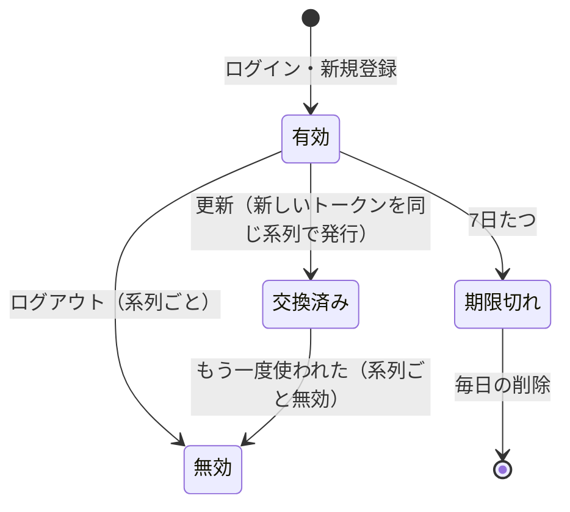

# テスト設計書 - RaiseTime Line

テスト技法（ブラックボックス・ホワイトボックス）を1つずつ当てはめてテストケースを導き出し、今あるテストと照らし合わせて抜けを見つけるための文書。

- [テスト観点表](./テスト観点表.md)：機能ごとに「何を確かめるか」を並べたもの（観点から考える）
- [テスト仕様書](./テスト仕様書.md)：画面を操作するシナリオと実施結果
- **この文書**：技法のルールに従って、ケースを機械的に書き出したもの（技法から考える）。思いつきに頼らないので、抜けに気づきやすい

## 1. 技法と、この文書での使い方

| 分類 | 技法 | 考え方 | 章 |
|---|---|---|---|
| ブラックボックス（仕様だけを見る） | 同値分割 | 入力を「同じ結果になるグループ」に分け、各グループから1つ試す | 2.1 |
| | 境界値分析 | グループの境目（上限ちょうど・上限+1 など）を試す。バグは境目に集まる | 2.1 |
| | デシジョンテーブル | 条件の組み合わせをすべて書き出し、結果を決める | 2.2 |
| | 状態遷移 | 状態ごとに、すべての操作を試す（できないはずの操作も） | 2.3 |
| | ペアワイズ | 条件が多いとき、「2つずつの組み合わせ」が全部出るように絞る | 2.4 |
| | エラー推測 | 過去のバグ・経験から、怪しい入力や操作を狙う | 2.5 |
| ホワイトボックス（コードを見る） | 命令網羅（C0） | すべての行を1回は通す | 3 |
| | 分岐網羅（C1） | if などの分かれ道を、両方とも通す | 3 |
| | 条件網羅 | `A かつ B` のような条件で、A・B それぞれが結果を変えるケースを通す | 3 |

### 状態の記号

| 記号 | 意味 |
|---|---|
| ✅ | 今あるテストで確かめている |
| ➕ | 抜けている。テストを足す（4章の一覧に載せる） |
| − | テストしない（理由を書く） |

テストの場所の書き方（BE・FE・E2E）は、テスト観点表と同じ。

---

## 2. ブラックボックステスト

### 2.1 同値分割・境界値分析

入力ごとに「有効なグループ」「無効なグループ」に分け、境目の値を並べる。**太字**が境界値。

#### 文字数

文字数は、絵文字も1文字と数える（コードポイント）。改行（CRLF）は1文字。

| 入力 | 有効 | 無効 | 境界値のケース | 状態 |
|---|---|---|---|---|
| 名前（新規登録・プロフィール） | 1〜50文字 | 0文字（空白だけ・見えない文字だけを含む）、51文字以上、改行・タブ・制御文字を含む | 0 → NG、**50 → OK、51 → NG** | ✅ BE: `SignupRequestValidationTest`、`UserServiceProfileEditTest`、FE: `validation/signup.test.js` |
| @ユーザーID | 3〜15文字の半角英小文字・数字・`_` | 2文字以下、16文字以上、大文字・記号を含む | **2 → NG、3 → OK**、**15 → OK**、**16 → NG** | 2・3・16 は ✅。**15 → OK は ➕（T-01）** |
| メールアドレス | 形式が正しく 255文字以内 | 形式が違う、空、256文字以上 | **255 → OK、256 → NG** | 形式・空は ✅。**255・256 は ➕（T-02）** |
| パスワード | 8〜64文字 かつ UTF-8 で72バイト以内 | 7文字以下、65文字以上、73バイト以上 | **7 → NG**、**8 → OK**、**64 → OK、65 → NG**、**72バイト → OK、75バイト → NG** | 7・64・65・72・75 は ✅。**8 → OK は ➕（T-03）** |
| 投稿の本文 | 1〜280文字 | 0文字（空白だけ・見えない文字だけ）、281文字以上 | 0 → NG、**280 → OK、281 → NG** | ✅ BE: `PostServiceTest`、`PostMapperTest`、FE: `validation/post.test.js`、E2E: `post.spec.js` |
| コメントの本文 | 1〜280文字 | 同上 | 0 → NG、**280 → OK、281 → NG** | ✅ BE: `CommentServiceTest`、FE: `CommentForm.test.jsx` |
| 自己紹介 | 0〜160文字 | 161文字以上 | **0 → OK**、**160 → OK、161 → NG** | ✅ BE: `UserServiceProfileEditTest`、E2E: `profile.spec.js` |
| 検索キーワード（前後の空白と先頭の @ を取ったあと） | 1〜50文字 | 0文字、51文字以上 | 0 → NG、**50 → OK、51 → NG** | ✅ BE: `UserServiceSearchTest` |

#### 件数・大きさ・回数

| 入力 | 有効 | 無効 | 境界値のケース | 状態 |
|---|---|---|---|---|
| 投稿の画像の枚数 | 0〜4枚 | 5枚以上 | **0 → OK**、**4 → OK、5 → NG** | ✅ BE: `PostServiceTest`、FE・E2E |
| 編集後の画像の枚数（残す＋足す） | 0〜4枚 | 5枚以上 | **4 → OK、5 → NG** | 5 は ✅。**残す2＋足す2＝4 → OK は ➕（T-04）** |
| 投稿の画像の大きさ | 5MB 以内 | 5MB を超える | **5MB ちょうど → OK、5MB+1バイト → NG** | 5MB+1 は ✅。**5MB ちょうどは ➕（T-05）** |
| プロフィール画像の大きさ | 2MB 以内 | 2MB を超える | **2MB ちょうど → OK、2MB+1バイト → NG** | ✅ BE: `UserServiceProfileEditTest` |
| 一覧の件数（タイムライン・ユーザーの投稿・コメント・検索。20件ずつ） | − | − | **20件 → 続きなし、21件 → 20件＋続きあり** | 21 は ✅。**ちょうど20件（続きなし）は ➕（T-06）** |
| ページングのパラメーター（`before`・`after`・`offset`） | 数字（`offset` は 0 以上） | 数字でない、`offset` が負 | **offset 0 → OK、-1 → NG** | ✅ BE: 各 `*ControllerTest`、`UserServiceSearchTest` |
| 投稿の id（URL） | 数字 | 数字でない、大きすぎる数（Long の範囲を超える） | `/api/posts/abc` → 400 | abc は ✅。**大きすぎる数 → 400 は ➕（T-07）** |
| ログインの失敗（同じメールアドレス・15分） | 4回まで | 5回目からロック | **4回 → まだ OK、5回 → ロック** | ✅ BE: `LoginAttemptServiceTest` |
| ログインの失敗（同じ IP・15分） | 49回まで | 50回目からロック | **49回 → まだ OK、50回 → ロック** | 50 は ✅。**49回 → まだ OK は ➕（T-08）** |
| ロックの時間 | − | − | **15分ちょうど → 解除**、その直前 → ロック中 | ✅（10分後はロック中、15分後は解除） |
| リフレッシュトークンの期限 | 期限より前 | 期限ちょうど・期限のあと | **期限ちょうど → 使えない** | ✅ BE: `RefreshTokenServiceTest`、`RefreshTokenMapperTest`（削除も「ちょうど」を含む） |

### 2.2 デシジョンテーブル

条件の組み合わせを全部書き出す。「−」は、その条件を見る前に結果が決まること。

#### D-1 投稿の編集・削除（`PATCH`・`DELETE /api/posts/{postId}`）

確かめる順番は、CSRF → ログイン → 存在 → 持ち主。

| # | CSRF トークン | ログイン | 投稿がある | 自分の投稿 | 結果 | 状態 |
|---|---|---|---|---|---|---|
| 1 | 無い | − | − | − | 403 | ✅ `PostControllerTest`（`createAndDelete_withoutCsrf_return403`） |
| 2 | ある | していない | − | − | 401 | ✅ `PostControllerTest`（`allApis_withoutLogin_return401`） |
| 3 | ある | している | 無い | − | 404 | ✅ `PostControllerTest`・`PostServiceTest` |
| 4 | ある | している | ある | 他人の | 403 | ✅ `PostControllerTest`・`PostServiceTest` |
| 5 | ある | している | ある | 自分の | 200／204 | ✅ |
| 6 | **無い** | **していない** | − | − | 403（CSRF を先に確かめる） | **➕（T-09）**。順番が入れ替わると、未ログインの人に 401 と 403 のどちらが返るかが変わる |

#### D-2 ログイン（`POST /api/auth/login`）

| # | ロック中 | メールアドレスが登録済み | パスワードが正しい | 結果 | 失敗の回数 | 状態 |
|---|---|---|---|---|---|---|
| 1 | はい | − | − | 429 | 増えない | ✅ `AuthControllerTest`（`login_whileLocked_returns429_withoutCheckingPassword`） |
| 2 | いいえ | いいえ | − | 401（#3 と同じメッセージ） | 増える | ✅ |
| 3 | いいえ | はい | いいえ | 401 | 増える | ✅ |
| 4 | いいえ | はい | はい | 200 | メールアドレスの回数を消す | ✅ |

#### D-3 画像の受け付け（投稿・プロフィール画像）

| # | 中身が画像 | 形式 | 大きさ | 枚数 | 結果 | 状態 |
|---|---|---|---|---|---|---|
| 1 | いいえ（拡張子だけ .jpg） | − | − | − | 400「JPEG・PNG・GIF・WebP の画像を選んでください」 | ✅ `PostServiceTest`・`UserServiceProfileEditTest`・E2E |
| 2 | はい | 対象外（BMP など） | − | − | 400 | ✅ `ImageTypeTest` |
| 3 | はい | 対象 | 上限を超える | − | 413 | ✅ |
| 4 | はい | 対象 | 上限以内 | 5枚以上 | 400 | ✅ |
| 5 | はい | 対象 | 上限以内 | 上限以内 | 保存する（位置情報などは消す） | ✅ |
| 6 | 途中で切れている（先頭は画像の形だが、中身が壊れている） | 対象 | − | − | 400 | `ImageMetadataStripperTest` は ✅。**投稿の保存で 400 になることは ➕（T-10）** |
| 7 | 空のファイル（0バイト） | − | − | − | 画像なしとして扱う | ✅ `PostServiceTest`（`create_emptyFilePartsAreIgnored`） |

#### D-4 プロフィール編集（`PATCH /api/users/me`）

| # | @ID | 新しい画像 | 「画像を外す」 | 今の画像 | 結果 | 状態 |
|---|---|---|---|---|---|---|
| 1 | 変えない | 無し | いいえ | − | 重複を確かめずに保存。画像はそのまま | ✅ |
| 2 | 変える（空いている） | 無し | いいえ | − | 保存。アクセストークンを作り直す | ✅ |
| 3 | 変える（使われている） | − | − | − | 409 | ✅ |
| 4 | − | あり | いいえ | ある | 新しい画像を保存し、古い画像を消す | ✅ |
| 5 | − | 無し | はい | ある | 画像を外し、古い画像を消す | ✅ |
| 6 | − | **あり** | **はい** | ある | 新しい画像を優先する（外さない） | **➕（T-11）** |
| 7 | − | 無し | はい | **無い** | 何も消さない（S3 を呼ばない） | **➕（T-12）** |
| 8 | （ユーザーが削除されていた） | − | − | − | 404 | **➕（T-13）** |

#### D-5 新規登録の重複（`POST /api/auth/signup`）

| # | @ID が使われている | メールアドレスが使われている | 結果 | 状態 |
|---|---|---|---|---|
| 1 | いいえ | いいえ | 201 | ✅ |
| 2 | はい | いいえ | 409（`username` だけ） | **➕（T-14）** |
| 3 | いいえ | はい | 409（`email` だけ） | **➕（T-14）** |
| 4 | はい | はい | 409（両方） | ✅ |
| 5 | 確認のあと、同時に登録された（@ID） | | 409（`username`） | ✅ |
| 6 | 確認のあと、同時に登録された（メールアドレス） | | 409（`email`） | **➕（T-14）** |

### 2.3 状態遷移

状態と操作の表を作り、**すべてのマス**（できないはずの操作も）を確かめる。

#### S-1 リフレッシュトークン

| 状態＼操作 | 更新（`/refresh`） | ログアウト | 7日たつ |
|---|---|---|---|
| 有効 | 新しいトークンを発行し、古いものは交換済みに ✅ | 系列ごと無効 ✅ | 期限切れ ✅ |
| 交換済み（使用済み） | 401。**系列ごと無効**にする（盗まれた可能性）✅ | 系列ごと無効 ✅ | − |
| 期限切れ | 401（新しいトークンは出さない）✅ | 系列ごと無効 | 毎日の削除で消える ✅（Mapper）。**削除の処理（スケジュール）そのものは ➕（T-15）** |
| 知らないトークン | 401 ✅ | 何もしない ✅ | − |
| 同時に2つのリクエストが同じトークンを使った | 片方だけ成功。もう片方は 401 で系列ごと無効 ✅ | − | − |
| 使用済み かつ 期限切れ | 401。系列ごと無効にする（使用済みを先に確かめる） | − | − |

- 最後の行（使用済み かつ 期限切れ）は **➕（T-16）**。確かめる順番が逆だと、盗まれたトークンが期限切れのあとに使われたとき、系列が無効にならない

#### S-2 ログインのロック（メールアドレスごと）

| 状態＼出来事 | ログイン失敗 | ログイン成功 | 15分たつ |
|---|---|---|---|
| 通常（失敗 0〜3回） | 回数+1 ✅ | 回数を消す ✅ | 回数が消える ✅ |
| 通常（失敗 4回） | **ロック**。`login_locked` を1回記録 ✅ | 回数を消す | 回数が消える |
| ロック中 | 429（パスワードは確かめない・回数は増えない）✅ | できない（429）✅ | 通常に戻る ✅ |

#### S-3 フォロー・いいね（どちらも同じ形）

| 状態＼操作 | する（PUT） | やめる（DELETE） |
|---|---|---|
| していない | する ✅ | 何も変わらず成功 ✅ |
| している | 何も変わらず成功（1件のまま）✅ | やめる ✅ |
| 相手・投稿が無い | 404 ✅ | 404 ✅ |
| 自分自身（フォローだけ） | 400 ✅ | 400 ✅ |

#### S-4 投稿のライフサイクル

| 状態＼操作 | 見る | いいね | コメント | 編集 | 削除 |
|---|---|---|---|---|---|
| ある（自分の） | ✅ | ✅ | ✅ | ✅ | ✅ |
| ある（他人の） | ✅ | ✅ | ✅ | 403 ✅ | 403 ✅ |
| 削除済み | 404 ✅ | 404 ✅ | 404 ✅ | 404 ✅ | 404（画面は一覧から消す）✅ |
| 操作の途中で削除された | − | 404 ✅ | 404 ✅ | − | − |

#### S-5 画面の状態（送信ボタン）

| 状態＼操作 | 入力する | 送信を押す | 通信が終わる |
|---|---|---|---|
| 入力が正しくない | 正しくなれば押せる ✅ | 押せない ✅ | − |
| 入力が正しい | − | 送信中になる ✅ | − |
| 送信中 | − | **押せない（2重送信を防ぐ）** | 成功：閉じる・消す ✅／失敗：メッセージを出し、もう一度押せる ✅ |

- 「送信中は押せない」は、コメント・いいね・フォロー・投稿は ✅。**ログイン・新規登録・投稿の削除は ➕（T-17）**

### 2.4 ペアワイズ（組み合わせ）

「ブラウザ × 画面幅 × 配色 × 画像の形式」を全部試すと 3×2×2×4＝48通り。2つずつの組み合わせが全部出るように絞ると、12通りで足りる。今の E2E テストとの対応：

| 条件 | 値 | 今の状態 |
|---|---|---|
| ブラウザ | Chromium・WebKit・Edge | ✅ すべての E2E を3つで実行 |
| 画面幅 | PC（1280px）・スマホ（375px） | ✅ `responsive.spec.js`（3つのブラウザで） |
| 配色 | ライト・ダーク | ライトだけ。**ダークモードは ➕（T-18）**：主な画面を開き、文字と背景の色が読める差になっていること |
| 画像の形式 | PNG・JPEG・GIF・WebP | 単体テストは4形式とも ✅（`ImageTypeTest`・`ImageMetadataStripperTest`）。E2E は PNG だけ。**JPEG・GIF を実際のブラウザで選んで投稿するのは ➕（T-19）**（縮小・作り直しの処理はブラウザごとに違いが出やすい） |

### 2.5 エラー推測

過去に見つかったバグを一覧にし、「同じ種類の間違いが、ほかの場所にも無いか」を探す。

| 過去のバグ | 原因の種類 | ほかに怪しい場所 | 結果 |
|---|---|---|---|
| 改行が2文字と数えられた（multipart の CRLF） | 送り方による文字の違い | multipart で受け取る文字：投稿の本文・名前・自己紹介 | ✅ 3つとも `LineBreaks` を通している |
| `_` で検索すると全員が出た | 入力が特別な意味を持つ（LIKE） | LIKE を使うのは検索だけ。`%`・`\` も | ✅ `UserSearchMapperTest` |
| 絵文字が2文字と数えられた | 文字の数え方 | 文字数を数える全入力（名前・本文・コメント・自己紹介・検索） | ✅ 2.1 のとおり |
| 見えない文字だけの投稿ができた | 「空」の判定 | 本文・コメント・名前。**検索キーワードがゼロ幅スペースだけ**のとき | 本文・コメント・名前は ✅。**検索は ➕（T-20）** |
| 古いタブから編集すると画像が消えた | 2つの場所から同時に操作 | 投稿の編集・プロフィール編集・削除済みの投稿への操作 | ✅ |
| ボタンの連打で2重に送られた | 送信中の状態 | S-5 のとおり | 一部 ➕（T-17） |
| マウスを乗せている間、読み上げ名が変わった | CSS で表示を切り替える部品 | hover で表示を切り替えるのはフォローボタンだけ | ✅ E2E で確認 |
| 見えないファイル選択欄にフォーカスしようとした | 隠した部品 | `hidden` の入力欄があるモーダル2つ | ✅ |
| テストが開発用の DB の中身に左右された（期限切れのトークン） | テストの独立性 | 件数を数える Mapper のテスト | ✅ 直した（`RefreshTokenMapperTest`）。ほかは、テストの中で作ったデータだけを数えている |

さらに、「どの Web アプリでも怪しい入力」を当てはめた。

| 怪しい入力 | 試した結果 | 状態 |
|---|---|---|
| **NUL 文字（`\u0000`）を含む文字** | **不具合 B-1（5章）**：投稿の本文・自己紹介・検索キーワードで 500、コメントで 404（間違ったメッセージ）。PostgreSQL が NUL 文字を保存できないため | **➕（T-21）＋修正** |
| HTML・スクリプト（`<script>` など） | 文字のまま表示される | ✅ |
| SQL の一部（`' OR '1'='1`） | ただの文字として扱われる | ✅ |
| とても長い文字（数MB の JSON） | アプリでは上限をかけていない（インフラで制限する。[インフラ構成図](./インフラ構成図.md) 7章） | −（インフラの工程） |
| 大きすぎる数の id（`/api/posts/99999999999999999999`） | 400 のはず | ➕（T-07） |
| 前後の空白 | 名前は取り除く。本文・コメントはそのまま（仕様） | ✅ |
| 大文字・小文字の違い（メールアドレス・@ID・検索） | 区別しない | ✅ |
| 同じ操作を2回（連打・再送） | 冪等（フォロー・いいね） | ✅ |

---

## 3. ホワイトボックステスト

### 3.1 基準

| 対象 | 目標 | 理由 |
|---|---|---|
| 業務のルールを持つクラス（`service`・`validation`・`security/LoginAttemptService`・`storage/ImageMetadataStripper`・`storage/ImageType`） | **分岐網羅（C1）100%** | 間違えると、データや安全性に影響する |
| 入口・設定（`controller`・`exception`・`config`・`security` のその他） | 通っていない分岐の理由を、1つずつ説明できる | フレームワークの決まりで書くコードが多く、通せない・通す意味が薄いものがある |
| 入れ物（`entity`・`dto`） | 目標なし | 値を持つだけ |

測り方：

- バックエンド：`cd backend && ./gradlew test coverageSummary`（クラスごとの C0・C1 と、通っていない行・分岐の数）。詳細は `backend/build/reports/jacoco/test/html/index.html`
- フロントエンド：`cd frontend && npm run coverage`。詳細は `frontend/coverage/index.html`

### 3.2 今の数字（2026-10-07）

| | C0（命令網羅・行） | C1（分岐網羅） |
|---|---|---|
| バックエンド | 94.8% | 87.7% |
| フロントエンド | 93.2% | 90.5% |

### 3.3 バックエンド：通っていない分岐の判断

| クラス | C1 | 通っていない処理 | 判断 |
|---|---|---|---|
| `storage/ImageMetadataStripper` | 80.0% | 壊れた画像の読み取り：JPEG のマーカーが途中で切れる・埋め草の 0xFF・長さを持たないマーカー（RST など）・セグメントの長さが不正、PNG・WebP のチャンクの長さが不正、WebP の VP8X が空 | **➕（T-22）**。利用者が送る、信用できないデータを読む処理なので、100% を目標にする |
| `service/AuthService` | 70.0% | `findUser`・`describe`（プロフィール画像のあり・なし）、同時に登録されたときにメールアドレスの重複と判断する分岐 | **➕（T-14・T-23）** |
| `service/UserService` | 93.3% | ユーザーが削除されていた（404）、名前が送られていない、画像の読み込みに失敗（IOException）、古いプロフィール画像を S3 から消せなかったとき | **➕（T-13・T-24）** |
| `service/PostService` | 96.3% | 画像の一覧に null が入っている、中身が壊れた画像（D-3 #6）、画像の読み込みに失敗（IOException） | **➕（T-10・T-25）** |
| `service/RefreshTokenService` | 100%（C0 83.7%） | 期限切れの削除（スケジュール）、SHA-256 が使えない場合 | 削除は **➕（T-15）**。SHA-256 は −（Java に必ず入っているので起きない） |
| `service/EmailNormalizer` | 50.0% | null のとき | **➕（T-26）** |
| `validation/*Validator`（3つ） | 75〜83% | 値が null のとき（「未入力」は別の決まりで確かめるので、ここでは OK を返す） | **➕（T-26）** |
| `config/AuthProperties` | 75.0% | 秘密鍵が null のとき | **➕（T-26）** |
| `config/StorageConfig`・`StorageProperties` | 50.0% | **保存先の URL（endpoint）が空のとき＝本番の設定**（AWS S3 に、IAM ロールでつなぐ） | **➕（T-27）**。本番でだけ通る道が、今は一度もテストされていない |
| `security/AuthCookies`・`CookieBearerTokenResolver` | 62.5〜70% | Cookie はあるが、目的の Cookie が無い・値が空 | **➕（T-28）** |
| `security/JsonAccessDeniedHandler` | 50.0% | CSRF 以外の理由で拒否されたとき | **➕（T-29）**。今の設定では起きないが、将来、権限の設定を足したときに通る |
| `security/UserIdLoggingFilter`・`logging/LogContext` | 50〜75% | 認証の情報が無いとき、ユーザーの id が null のとき | **➕（T-29）** |
| `security/AuthTokenIssuer` | −（C0 87.5%） | プロフィール編集のあとの、アクセストークンの作り直し | **➕（T-29）**（Controller のテストではモックにしている） |
| `exception/GlobalExceptionHandler` | 50.0% | リクエスト全体が大きすぎる（413）、Spring Security の権限エラー（403）、存在しない URL（404）、`ResponseStatusException` | **➕（T-30）** |
| `config/OpenApiConfig` | 85.7% | 開発者の書き間違いを知らせるための確認（`@ApiErrors` に知らないステータスを書いた、など） | −（正しく書いている限り通らない。API 仕様書のテストが全体を確かめている） |
| `mapper/typehandler/UuidTypeHandler` | −（C0 66.7%） | MyBatis の決まりで用意するが、使っていない取り出し方（列の番号・ストアドプロシージャ） | − |
| `RaisetimeApplication` | −（C0 33.3%） | `main`（起動） | −（`@SpringBootTest` は別の入口から起動する。実際の起動は E2E で確かめている） |
| `entity/*` | −（C0 95〜97%） | 使っていない getter・setter | − |
| `ImageMetadataStripper.InvalidImageException` | −（C0 50%） | 原因つきのコンストラクタ（1か所で使用） | T-22 で通る |

### 3.4 フロントエンド：通っていない分岐の判断

| ファイル | 分岐 | 通っていない処理 | 判断 |
|---|---|---|---|
| `utils/image.js` | 33.3% | canvas で画像を縮める・切り抜く処理（jsdom では canvas が動かない） | −（単体テストでは通せない）。E2E（`post.spec.js`・`profile.spec.js`）が、本物のブラウザ3つで画像を選んで投稿している。JPEG・GIF は T-19 |
| `pages/UserPage.jsx` | 77.5% | 続きの読み込みに失敗したときの「再読み込み」、プロフィール編集のあとの細かい分岐 | **➕（T-31）** |
| `auth/AuthProvider.jsx` | 50.0% | 読み込みの途中で画面が閉じられたとき（結果を捨てる） | −（React の決まりの書き方。画面には影響しない） |
| `components/Modal.jsx`・`CommentForm.jsx`・`Avatar.jsx`・`hooks/useInfiniteScroll.js` など | 85〜95% | 1〜2行ずつ（フォーカスできる部品が1つも無い、など） | −（防御のための分岐。影響が小さい） |
| `pages/SearchPage.jsx`・`PostDetailPage.jsx`・`TimelinePage.jsx` | 88〜94% | 1〜3行ずつ（続きの読み込みの失敗後のもう一度、など） | **➕（T-31）** のうち、利用者に見える動きだけ |

### 3.5 条件網羅

条件が2つ以上つながった判定は、それぞれの条件が単独で結果を変えるケースを確かめる。

| 判定 | 条件 | 状態 |
|---|---|---|
| 名前の入力チェック（`UserService`） | null／見える文字が無い／50文字を超える／制御文字を含む | 見える文字・50文字・制御文字は ✅。null は ➕（T-24） |
| 画像として受け付けるか（`PostService`・`UserService`） | null／空のファイル | 空は ✅。null は ➕（T-25） |
| トークンの Cookie を読む（`AuthCookies`・`CookieBearerTokenResolver`） | Cookie が1つも無い／名前が違う／値が空 | 1つも無いは ✅。名前が違う・値が空は ➕（T-28） |
| タイムラインに出す投稿（SQL） | 自分の投稿／フォロー中の人の投稿／それ以外 | ✅ `PostMapperTest` |
| ログインできるか（`LoginAttemptService`） | 記録が無い／期限切れ／上限より少ない／上限に達した（メールアドレス・IP のそれぞれ） | ✅（分岐網羅 100%） |

---

## 4. 追加するテストの一覧

| # | 内容 | 技法 | 場所 |
|---|---|---|---|
| T-01 | @ID 15文字は OK（新規登録・プロフィール） | 境界値 | BE: `SignupRequestValidationTest`・`UserServiceProfileEditTest` |
| T-02 | メールアドレス 255文字は OK、256文字は NG | 境界値 | BE: `SignupRequestValidationTest` |
| T-03 | パスワード 8文字は OK | 境界値 | BE: `SignupRequestValidationTest`、FE: `validation/signup.test.js` |
| T-04 | 編集で、残す2枚＋足す2枚＝4枚は OK | 境界値 | BE: `PostServiceTest` |
| T-05 | 画像がちょうど 5MB は OK | 境界値 | BE: `PostServiceTest` |
| T-06 | 一覧がちょうど20件なら、続きは無い（タイムライン・コメント・検索） | 境界値 | BE: `PostServiceTest`・`CommentServiceTest`・`UserServiceSearchTest` |
| T-07 | 大きすぎる数の id は 400 | 境界値・エラー推測 | BE: `PostControllerTest` |
| T-08 | 同じ IP からの失敗 49回は、まだロックしない | 境界値 | BE: `LoginAttemptServiceTest` |
| T-09 | 未ログイン かつ CSRF なしは 403 | デシジョンテーブル | BE: `PostControllerTest` |
| T-10 | 途中で切れた画像は 400 | デシジョンテーブル | BE: `PostServiceTest` |
| T-11 | 新しい画像と「画像を外す」の両方が来たら、新しい画像を優先 | デシジョンテーブル | BE: `UserServiceProfileEditTest` |
| T-12 | 画像が無いのに「画像を外す」は、S3 を呼ばない | デシジョンテーブル | BE: `UserServiceProfileEditTest` |
| T-13 | プロフィール編集で、ユーザーが削除されていたら 404 | デシジョンテーブル | BE: `UserServiceProfileEditTest` |
| T-14 | 新規登録の重複：@ID だけ・メールアドレスだけ・同時登録（メールアドレス） | デシジョンテーブル | BE: `AuthServiceTest` |
| T-15 | 期限切れトークンの削除（スケジュールの処理）と、そのログ | 状態遷移 | BE: `RefreshTokenServiceTest` |
| T-16 | 使用済み かつ 期限切れのトークンでも、系列ごと無効にする | 状態遷移 | BE: `RefreshTokenServiceTest` |
| T-17 | 送信中は押せない（ログイン・新規登録・投稿の削除） | 状態遷移 | FE: `LoginPage.test.jsx`・`SignupPage.test.jsx`・`DeleteConfirmModal.test.jsx` |
| T-18 | ダークモードで主な画面を開き、文字と背景の差が読める範囲にある | ペアワイズ | E2E |
| T-19 | JPEG・GIF を実際のブラウザで選んで投稿できる | ペアワイズ | E2E: `post.spec.js` |
| T-20 | 検索キーワードが見えない文字だけなら 400 | エラー推測 | BE: `UserServiceSearchTest` |
| T-21 | NUL 文字を含む本文・コメント・自己紹介・検索キーワードは 400（**B-1 の修正と一緒に**） | エラー推測 | BE: 各 Service・Controller のテスト |
| T-22 | 壊れた画像の読み取り（`ImageMetadataStripper` の分岐網羅 100%） | 分岐網羅 | BE: `ImageMetadataStripperTest` |
| T-23 | `AuthService.findUser`・`describe`（画像あり・なし・ユーザーなし） | 分岐網羅 | BE: `AuthServiceTest` |
| T-24 | `UserService`：名前が null、画像の読み込み失敗、古い画像を消せなかったとき（編集は成功・ログを出す） | 分岐網羅・条件網羅 | BE: `UserServiceProfileEditTest` |
| T-25 | `PostService`：画像の一覧に null、画像の読み込み失敗 | 分岐網羅・条件網羅 | BE: `PostServiceTest` |
| T-26 | null の扱い（`EmailNormalizer`・入力チェック3つ・`AuthProperties`） | 分岐網羅 | BE |
| T-27 | **本番の設定**（保存先の URL が空）で S3 のクライアントを作れる。`usesCustomEndpoint` の判定 | 分岐網羅 | BE: `StorageConfigTest`（新規） |
| T-28 | 目的の Cookie が無い・値が空のとき（アクセストークン・リフレッシュトークン） | 条件網羅 | BE: `AuthControllerTest` |
| T-29 | `JsonAccessDeniedHandler`（CSRF 以外）・`UserIdLoggingFilter`・`LogContext`・`AuthTokenIssuer` | 分岐網羅 | BE |
| T-30 | `GlobalExceptionHandler`：リクエストが大きすぎる（413）・権限エラー・存在しない URL（404）・`ResponseStatusException` | 分岐網羅 | BE |
| T-31 | フロントエンドの、利用者に見える分岐（ユーザーページの続きの読み込み失敗 など） | 分岐網羅 | FE |

## 5. 見つかった不具合

| ID | 内容 | 見つけた技法 | 状態 |
|---|---|---|---|
| **B-1** | NUL 文字（`\u0000`）を含む文字を送ると、投稿の本文・自己紹介・検索キーワードで 500（想定外のエラー）、コメントで 404「投稿が見つかりません」（間違ったメッセージ）になる。PostgreSQL は NUL 文字を保存できない。普通の利用者は入力しないが、わざと送ればエラーのログと 5xx のアラートを増やせる | エラー推測 | 未修正（T-21 と一緒に直す）。直し方：NUL などの制御文字（改行・タブを除く）を含む入力は 400 にする |
| B-2 | `RefreshTokenMapperTest` の「期限切れを削除」のテストが、開発用の DB にある本当に期限切れのトークンも数えて失敗した（テストがほかのデータに左右される） | 境界値のテストを見直す途中 | 修正済み（テストの基準の時刻を昔にし、期限ちょうどの境界値も足した） |
