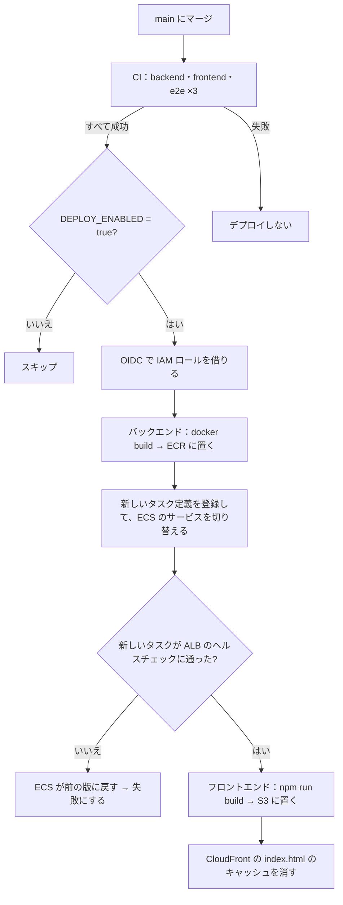

# デプロイ - RaiseTime Line

main で CI がすべて成功したら、GitHub Actions（`.github/workflows/deploy.yml`）が AWS へ自動でデプロイする。構成は [インフラ構成図](./インフラ構成図.md) の節約案（フロントエンドは S3 ＋ CloudFront、バックエンドは ECS Fargate のタスク1つ、RDS Single-AZ、NAT Gateway なし）。

> **状態（2026-11-18）**：デプロイの設定と手順、バックエンドの Docker イメージ（`backend/Dockerfile`）ができている。AWS のインフラはまだ作っていない（インフラ構築の工程で Terraform で作る）。そのため、リポジトリ変数 `DEPLOY_ENABLED` は設定しておらず、デプロイは毎回スキップになる。実際の AWS での動作は、インフラを作ってから 8章の手順で確かめる。

## 1. 決めたこと

| 項目 | 決めたこと | 理由 |
|---|---|---|
| 構築の方法 | Terraform | 使わない間は `terraform destroy` で丸ごと消して料金を止め、また同じものを作れる。デプロイに必要な権限も一緒に作れる |
| 独自ドメイン | 使わない（CloudFront のアドレス `xxxx.cloudfront.net`） | 証明書も AWS のものを使え、追加の費用と手続きが要らない |
| タイミング | main で CI が成功したら自動。Actions の画面の「Run workflow」からも実行できる | マージしたものが、テストを通った状態ですぐ使えるようにする |
| 切り替え | リポジトリ変数 `DEPLOY_ENABLED` が `true` のときだけ動く | 節約のためにインフラを消している間、毎回失敗が出ないようにする |
| AWS への認証 | OIDC（GitHub が発行する一時的な証明書で IAM ロールを借りる） | アクセスキー（長く使える秘密）を GitHub に置かずに済む |
| バックエンドの動かし方 | ECS Fargate。Docker イメージを ECR に置き、ECS のサービスのタスク定義を新しい版に切り替える | サーバー（OS）の管理が要らない。手元で確かめたものと同じイメージが動く |

## 2. 流れ



- **バックエンドを先に出す**：新しい画面が、まだ古い API を呼ぶ時間を作らないため。API を変えるときは「足す → 画面を切り替える → 古いものを消す」の順に、別々のデプロイに分ける
- 1つのデプロイが終わるまで、次のデプロイは始めない（途中で止めると、バックエンドとフロントエンドの版がずれるため）
- CI が確かめたコミット（`workflow_run` の `head_sha`）をそのままデプロイする

## 3. バックエンドの切り替え（ECS のローリングデプロイ）

### 3.1 イメージ（`backend/Dockerfile`）

| 項目 | 内容 |
|---|---|
| 作り方 | 2段階。1段目（JDK）で `./gradlew bootJar` を実行して jar を作り、2段目（JRE だけ）に jar をコピーする。テストは CI で済んでいるので動かさない |
| 動かすユーザー | root ではないユーザー `raisetime` |
| ポート | 8080（`SERVER_PORT=8080`。アプリの標準は 8081 だが、ALB に合わせる） |
| メモリ | JVM が使うメモリを、タスクのメモリの 75% までにする（`-XX:MaxRAMPercentage=75`） |
| タグ | コミット（例：`<ECR の URI>:3f2a…`）。どの版が動いているかが分かり、前の版にも戻せる |

手元で作って動かす方法は 7章。

### 3.2 切り替えの手順（`deploy.yml`）

1. イメージを作って ECR に置く
2. 今のタスク定義（ファミリーの最新の版）を取ってきて、バックエンドのコンテナの**イメージ**と環境変数 **`APP_VERSION`**（コミット。ログに出る）だけを差し替え、新しい版として登録する
3. ECS のサービスを、新しいタスク定義に切り替える
4. ECS が新しいタスクを起動し、ALB のヘルスチェック（`/actuator/health`）が通ったら、古いタスクを止める（最小ヘルス率 100%・最大 200%。短い間だけタスクが2つになる）
5. `aws ecs wait services-stable` で終わるのを待つ（最大10分）。そのあと、動いているのが新しいタスク定義かを確かめる

**起動しなかったとき**：サービスのデプロイのサーキットブレーカー（ロールバックあり）が、新しいタスクが何度も起動に失敗したことを見つけて、**前のタスク定義に戻す**。古いタスクはずっと動いているので、利用者からは止まって見えない。GitHub Actions は「新しい版が動いていない」ことを見つけて**失敗として終わる**（フロントエンドは更新しない）。原因は CloudWatch Logs のログと、ECS のサービスのイベント（失敗のときに Actions のログにも出す）で確かめる。

**DB のマイグレーションは戻らない**：前のタスク定義に戻っても、新しい版の起動時に Flyway が適用したマイグレーションはそのまま残る。前の版は、自分の知らない新しいマイグレーションを無視して起動する（Flyway の標準の設定）。そのため、**マイグレーションは前の版のアプリでも動く形にする**（列を足すのはよいが、使っている列を消す・名前を変えるのは、アプリを切り替えたあとの別のデプロイで行う）。デプロイの間は新しい版と古い版が同時に動くので、この決まりはロールバックがなくても必要になる。

## 4. インフラ構築のときに用意するもの（Terraform）

### 4.1 GitHub Actions 用の権限

| もの | 内容 |
|---|---|
| OIDC プロバイダー | `token.actions.githubusercontent.com`（AWS アカウントに1つ） |
| IAM ロール（デプロイ用：`raisetime-github-deploy`） | 上限のポリシー（permissions boundary）`raisetime-boundary` を付ける（[terraform/iam/](../terraform/iam/README.md)）。信頼する相手：このリポジトリの `production` 環境だけ（OIDC の `sub` が `repo:takeuchikoutagg/RaiseTime-Line:environment:production`、`aud` が `sts.amazonaws.com`） |
| ロールの権限 | ECR：`ecr:GetAuthorizationToken`（リソースは `*`）、バックエンドのリポジトリへのイメージの push（`ecr:BatchCheckLayerAvailability`・`ecr:InitiateLayerUpload`・`ecr:UploadLayerPart`・`ecr:CompleteLayerUpload`・`ecr:PutImage`・`ecr:BatchGetImage`）<br>ECS：`ecs:DescribeTaskDefinition`・`ecs:RegisterTaskDefinition`（リソースは `*`）、バックエンドのサービスへの `ecs:UpdateService`・`ecs:DescribeServices`<br>IAM：タスク実行ロールとタスクロールへの `iam:PassRole`（条件：`iam:PassedToService` が `ecs-tasks.amazonaws.com`。新しいタスク定義にロールを付けるため）<br>S3：フロントエンド用バケットへの `s3:PutObject`・`s3:ListBucket`<br>CloudFront：その配信への `cloudfront:CreateInvalidation`・`cloudfront:GetInvalidation` |

### 4.2 S3

| バケット | 用途 | 設定 |
|---|---|---|
| フロントエンド用 | React のビルド結果 | 構成図のとおり。非公開で、CloudFront からだけ読める（OAC） |
| 画像用 | 投稿画像・アイコン | 構成図のとおり |

### 4.3 ECR

| 項目 | 内容 |
|---|---|
| リポジトリ | 1つ（例：`raisetime-backend`） |
| ライフサイクルポリシー | 新しいイメージを10個だけ残し、それより古いものは消す（保存の費用を抑える。前の版に戻すのは数個前までで足りる） |
| イメージスキャン | push のときにスキャンする（無料の基本スキャン） |

### 4.4 ECS

| もの | 内容 |
|---|---|
| クラスター | 1つ（例：`raisetime`） |
| タスク定義（ファミリー：例 `raisetime-backend`） | 起動タイプ Fargate、ネットワークモード `awsvpc`、0.5 vCPU・1GB、CPU アーキテクチャ X86_64（GitHub Actions の実行環境と同じ）<br>コンテナ：名前 `backend`、ポート 8080、ログドライバー `awslogs`（ロググループ `/ecs/raisetime-backend`）<br>タスク実行ロール・タスクロール（[インフラ構成図](./インフラ構成図.md) 4章）<br>環境変数・秘密情報は 4.5 |
| サービス | タスク数 1（[インフラ構成図](./インフラ構成図.md) 2章の注意）、2つの AZ のサブネット、セキュリティグループ app-sg、パブリック IP あり（節約案）<br>ALB のターゲットグループ（IP タイプ・ポート 8080・ヘルスチェック `/actuator/health`）につなぐ<br>デプロイ：最小ヘルス率 100%・最大 200%、サーキットブレーカー（ロールバックあり）を有効にする<br>ヘルスチェックの猶予期間：120秒（Spring Boot の起動と Flyway のマイグレーションを待つ） |
| CloudWatch Logs のロググループ | `/ecs/raisetime-backend`。保持期間は [ログ・監視設計](./ログ・監視設計.md) に合わせる |

**Terraform と GitHub Actions の分担**：タスク定義の新しい版は、デプロイのたびに GitHub Actions が作る。Terraform がサービスを古い版に戻さないように、サービスの `task_definition` を Terraform の変更の対象から外す（`lifecycle { ignore_changes = [task_definition] }`）。環境変数などを Terraform で変えたときは、Terraform がタスク定義の新しい版を作るので、そのあとのデプロイ（Run workflow）で、その版を元にした新しいイメージの版が動く。

### 4.5 アプリに渡す環境変数（タスク定義）

本番は dev プロファイルを使わない（[要件定義](./要件定義.md) 11章）。秘密の値は、タスク定義の `secrets` で Parameter Store を指定する（ECS が起動時に取り出して、環境変数として渡す）。秘密でない値は `environment` に書く。

| 環境変数 | 置き場所 | 値 | 注意 |
|---|---|---|---|
| `SPRING_DATASOURCE_URL` | environment | `jdbc:postgresql://<RDS のエンドポイント>:5432/raisetime` | 設定しないと、開発用の `127.0.0.1:5434` につなごうとして起動に失敗する |
| `SPRING_DATASOURCE_USERNAME` | environment | RDS のユーザー | |
| `SPRING_DATASOURCE_PASSWORD` | **secrets** | RDS のパスワード（Parameter Store） | |
| `JWT_SECRET` | **secrets** | 32バイト以上のランダムな値（Parameter Store） | **開発用の値（公開リポジトリに載っている）を使わない**。設定しないと起動しない |
| `STORAGE_BUCKET` | environment | 画像用バケットの名前 | |
| `STORAGE_ENDPOINT` | environment | 空（値を `""` にする） | **空にしないと S3Mock（localhost:9090）につなごうとする**。空なら AWS の S3 を使う |
| `STORAGE_PUBLIC_BASE_URL` | environment | `https://<CloudFront のドメイン>/images` | |
| `APP_ENV` | environment | `production` | ログに出る |
| `APP_VERSION` | environment | （デプロイのたびに GitHub Actions がコミットを書く） | ログに出る |
| `CLIENT_IP_HEADER` | （書かない） | 既定の `CloudFront-Viewer-Address` を使う | 利用者の IP アドレスを取るヘッダー（[インフラ構成図](./インフラ構成図.md) 7章）。CloudFront を通さずに動かすときだけ、空にする |

`SERVER_PORT=8080` は、イメージ（`backend/Dockerfile`）の中で設定しているので、タスク定義には書かない。

## 5. GitHub に設定するもの

インフラを作ったら、Terraform の出力の値を、リポジトリ変数（Settings → Secrets and variables → Actions → Variables）に入れる。どれも秘密ではない（権限は OIDC と IAM ロールで守る）。

| 変数 | 値 |
|---|---|
| `DEPLOY_ENABLED` | `true`（デプロイを動かす）。インフラを消したら `false` にするか、変数を消す |
| `AWS_REGION` | `ap-northeast-1`（設定しなければこの値） |
| `AWS_DEPLOY_ROLE_ARN` | デプロイ用 IAM ロールの ARN |
| `ECR_REPOSITORY_URI` | ECR のリポジトリの URI（例：`123456789012.dkr.ecr.ap-northeast-1.amazonaws.com/raisetime-backend`） |
| `ECS_CLUSTER` | ECS のクラスターの名前 |
| `ECS_SERVICE` | ECS のサービスの名前 |
| `ECS_TASK_FAMILY` | タスク定義のファミリーの名前 |
| `ECS_CONTAINER_NAME` | タスク定義の中のバックエンドのコンテナの名前（設定しなければ `backend`） |
| `FRONTEND_BUCKET` | フロントエンド用バケットの名前 |
| `CLOUDFRONT_DISTRIBUTION_ID` | CloudFront の配信の ID |
| `APP_URL` | `https://<CloudFront のドメイン>`（デプロイの結果に表示する） |

コマンドで入れる場合：`gh variable set DEPLOY_ENABLED --body true` など。

GitHub の環境 `production` は、最初にデプロイが動いたときに自動で作られる。デプロイの履歴は、リポジトリの「Environments」から見られる。

## 6. 運用

| やりたいこと | 方法 |
|---|---|
| デプロイを止めておく（インフラを消している間など） | `DEPLOY_ENABLED` を `false` にする |
| 使わない間、バックエンドの費用を止める | ECS のサービスのタスク数を 0 にする（Terraform の値を変えて apply）。ALB・RDS の費用は止まらない（[インフラ構成図](./インフラ構成図.md) 6章） |
| もう一度デプロイする（失敗をやり直す・インフラを作り直した直後） | Actions → Deploy → Run workflow（main を選ぶ） |
| 前の版に戻す | 戻したい内容を Pull Request で main に入れ直す（revert）。CI のあとに自動でデプロイされる。急ぐときは、ECS のサービスを前のタスク定義の版に切り替える（ECR に前のイメージが残っている間だけ） |
| デプロイの失敗の原因を見る | Actions の実行結果（ECS のサービスのイベントも表示される）と、CloudWatch Logs の `/ecs/raisetime-backend` |

## 7. 確かめたこと（インフラが無い状態で）

| 確かめたこと | 方法 | 結果 |
|---|---|---|
| ワークフローの書き方 | [actionlint](https://github.com/rhysd/actionlint)（Docker の `rhysd/actionlint:1.7.7`。中のシェルは ShellCheck でも確かめる） | 指摘0件 |
| Dockerfile の書き方 | [hadolint](https://github.com/hadolint/hadolint)（Docker の `hadolint/hadolint:v2.12.0`） | 指摘0件 |
| イメージを作れるか | `cd backend && docker build -t raisetime-backend:local .` | 成功（約1分半。2回目からは依存のキャッシュで速くなる） |
| イメージが本番と同じ設定で動くか | 下のコマンドで、手元の PostgreSQL・S3Mock につないで起動し、`/actuator/health`・新規登録・画像つきの投稿を試す | `UP`。ログは JSON。root ではないユーザーで動く。新規登録・画像つきの投稿（S3Mock への保存）も成功 |
| タスク定義の差し替え（jq） | 見本のタスク定義（環境変数あり・なし、サイドカーあり）で、ワークフローと同じ jq を実行する | イメージと `APP_VERSION` だけが変わり、登録できない項目が消え、他のコンテナはそのまま |
| インフラが無いときにスキップになるか | main へのマージのあと、Deploy がスキップになることを Actions の画面で確かめる | （マージのあとに確かめる） |

手元でイメージを動かすコマンド（`docker compose up -d` で PostgreSQL・S3Mock を起動しておく。ホストの 8080 番は Taskmanagement が使うので 18080 番につなぐ）：

```bash
docker run --rm -p 18080:8080 \
  -e SPRING_DATASOURCE_URL=jdbc:postgresql://host.docker.internal:5434/raisetime \
  -e SPRING_DATASOURCE_USERNAME=raisetime -e SPRING_DATASOURCE_PASSWORD=raisetime \
  -e JWT_SECRET="$(openssl rand -base64 48)" \
  -e STORAGE_ENDPOINT=http://host.docker.internal:9090 \
  raisetime-backend:local
# 別のターミナルで：curl http://localhost:18080/actuator/health
```

## 8. 初めて AWS にデプロイするときの確認（インフラ構築の工程で行う）

最初は ECR にイメージが無いので、サービスのタスク数を 0 で作ってから、デプロイでイメージを置き、そのあとでタスク数を 1 にする。

1. Terraform で 4章のものを作る。ECS のサービスは**タスク数 0** で作る（イメージが無いため）。Parameter Store に `SPRING_DATASOURCE_PASSWORD`・`JWT_SECRET` の値を入れる
2. 5章の変数を GitHub に入れる（`DEPLOY_ENABLED` は最後に `true`）
3. Actions → Deploy → Run workflow で動かす（イメージが ECR に置かれ、新しいタスク定義ができる。タスク数 0 なので、タスクはまだ起動しない）
4. Terraform でサービスのタスク数を **1** にして apply する。タスクが起動し、ALB のターゲットが healthy になることを確かめる
5. `APP_URL` を開き、ログイン・投稿（画像つき）・タイムラインが動くことを確かめる（テスト仕様書 SC-01・SC-02 の主な手順）
6. わざと起動しない版（例：タスク定義の `JWT_SECRET` を一時的に外す）でデプロイし、ECS が前の版に戻すこと、Actions が失敗になることを確かめる
7. 結果をこの表に記録する
