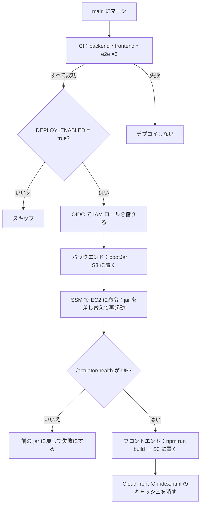

# デプロイ - RaiseTime Line

main で CI がすべて成功したら、GitHub Actions（`.github/workflows/deploy.yml`）が AWS へ自動でデプロイする。構成は [インフラ構成図](./インフラ構成図.md) の節約案（EC2 1台・RDS Single-AZ・NAT Gateway なし）。

> **状態（2026-11-16）**：デプロイの設定と手順だけができている。AWS のインフラはまだ作っていない（インフラ構築の工程で Terraform で作る）。そのため、リポジトリ変数 `DEPLOY_ENABLED` は設定しておらず、デプロイは毎回スキップになる。実際の AWS での動作は、インフラを作ってから 8章の手順で確かめる。

## 1. 決めたこと

| 項目 | 決めたこと | 理由 |
|---|---|---|
| 構築の方法 | Terraform | 使わない間は `terraform destroy` で丸ごと消して料金を止め、また同じものを作れる。デプロイに必要な権限も一緒に作れる |
| 独自ドメイン | 使わない（CloudFront のアドレス `xxxx.cloudfront.net`） | 証明書も AWS のものを使え、追加の費用と手続きが要らない |
| タイミング | main で CI が成功したら自動。Actions の画面の「Run workflow」からも実行できる | マージしたものが、テストを通った状態ですぐ使えるようにする |
| 切り替え | リポジトリ変数 `DEPLOY_ENABLED` が `true` のときだけ動く | 節約のためにインフラを消している間、毎回失敗が出ないようにする |
| AWS への認証 | OIDC（GitHub が発行する一時的な証明書で IAM ロールを借りる） | アクセスキー（長く使える秘密）を GitHub に置かずに済む |
| EC2 への命令 | SSM（Systems Manager）の Run Command | SSH の鍵もポートも要らない |

## 2. 流れ



- **バックエンドを先に出す**：新しい画面が、まだ古い API を呼ぶ時間を作らないため。API を変えるときは「足す → 画面を切り替える → 古いものを消す」の順に、別々のデプロイに分ける
- 1つのデプロイが終わるまで、次のデプロイは始めない（途中で止めると、バックエンドとフロントエンドの版がずれるため）
- CI が確かめたコミット（`workflow_run` の `head_sha`）をそのままデプロイする

## 3. バックエンドの差し替え（`deploy/backend-release.sh`）

GitHub Actions が jar とこのスクリプトをデプロイ用の S3 バケット（`backend/<コミット>/`）に置き、SSM でタグ `Role=raisetime-backend` の EC2 に、次を実行させる。

1. 新しい jar を取ってきて、今の jar を `app.jar.previous` として残してから差し替える。版を `version.env`（`APP_VERSION=<コミット>`）に書く
2. `systemctl restart raisetime` で再起動し、`http://localhost:8080/actuator/health` が `UP` になるまで最大180秒待つ
3. `UP` にならなければ、直近のログを出し、前の jar に戻して再起動して、**失敗として終わる**（GitHub Actions のデプロイも失敗になり、フロントエンドは更新しない）

**DB のマイグレーションは戻らない**：jar を前の版に戻しても、新しい版の起動時に Flyway が適用したマイグレーションはそのまま残る。前の版は、自分の知らない新しいマイグレーションを無視して起動する（Flyway の標準の設定）。そのため、**マイグレーションは前の版のアプリでも動く形にする**（列を足すのはよいが、使っている列を消す・名前を変えるのは、アプリを切り替えたあとの別のデプロイで行う）。

## 4. インフラ構築のときに用意するもの（Terraform）

### 4.1 GitHub Actions 用の権限

| もの | 内容 |
|---|---|
| OIDC プロバイダー | `token.actions.githubusercontent.com`（AWS アカウントに1つ） |
| IAM ロール（デプロイ用） | 信頼する相手：このリポジトリの `production` 環境だけ（OIDC の `sub` が `repo:takeuchikoutagg/RaiseTime-Line:environment:production`、`aud` が `sts.amazonaws.com`） |
| ロールの権限 | デプロイ用バケットへの `s3:PutObject`、フロントエンド用バケットへの `s3:PutObject`・`s3:ListBucket`、タグ `Role=raisetime-backend` の EC2 と文書 `AWS-RunShellScript` への `ssm:SendCommand`、`ssm:ListCommandInvocations`、その配信への `cloudfront:CreateInvalidation`・`cloudfront:GetInvalidation` |

### 4.2 S3

| バケット | 用途 | 設定 |
|---|---|---|
| デプロイ用（新しく足す） | jar とスクリプトを置く | 非公開。古いものはライフサイクルで自動で消す（例：30日） |
| フロントエンド用 | React のビルド結果 | 構成図のとおり。非公開で、CloudFront からだけ読める（OAC） |
| 画像用 | 投稿画像 | 構成図のとおり |

### 4.3 EC2

| 項目 | 内容 |
|---|---|
| タグ | `Role=raisetime-backend`（デプロイの命令先を、このタグで選ぶ） |
| SSM | SSM エージェントが動き、SSM に届くこと。NAT Gateway を置かないので、EC2 をパブリックサブネットに置いてセキュリティグループで ALB からの通信だけを受けるか、VPC エンドポイント（`ssm`・`ssmmessages`・`ec2messages`）を置く（[インフラ構成図](./インフラ構成図.md) 6章） |
| インスタンスの IAM ロール | `AmazonSSMManagedInstanceCore`、デプロイ用バケットの `s3:GetObject`、画像用バケットの読み書き、Parameter Store の秘密の読み取り |
| 入れておくもの | Java 25（Temurin など）、AWS CLI、`curl` |
| 置き場所 | `/opt/raisetime/`（`app.jar`・`version.env`・`app.env`）。持ち主はユーザー `raisetime` |
| サービス | systemd の `raisetime`（下の例） |

`/etc/systemd/system/raisetime.service` の例：

```ini
[Unit]
Description=RaiseTime Line backend
After=network-online.target

[Service]
User=raisetime
WorkingDirectory=/opt/raisetime
# 環境ごとの設定（4.4）と、デプロイが書く版
EnvironmentFile=/opt/raisetime/app.env
EnvironmentFile=-/opt/raisetime/version.env
ExecStart=/usr/bin/java -jar /opt/raisetime/app.jar
Restart=on-failure

[Install]
WantedBy=multi-user.target
```

### 4.4 アプリに渡す環境変数（`/opt/raisetime/app.env`）

本番は dev プロファイルを使わない（[要件定義](./要件定義.md) 11章）。秘密は Parameter Store から取り、起動の前に `app.env` を作る（作り方はインフラ構築のときに決める）。

| 環境変数 | 値 | 注意 |
|---|---|---|
| `SERVER_PORT` | `8080` | アプリの標準は 8081（手元の Taskmanagement と重ならないため）。ALB は 8080 に送る（インフラ構成図）ので合わせる |
| `SPRING_DATASOURCE_URL`・`_USERNAME`・`_PASSWORD` | RDS の接続先・ユーザー・パスワード | 設定しないと、開発用の `127.0.0.1:5434` につなごうとして起動に失敗する |
| `JWT_SECRET` | 32バイト以上のランダムな値 | **開発用の値（公開リポジトリに載っている）を使わない**。設定しないと起動しない |
| `STORAGE_BUCKET` | 画像用バケットの名前 | |
| `STORAGE_ENDPOINT` | 空（`STORAGE_ENDPOINT=`） | **空にしないと S3Mock（localhost:9090）につなごうとする**。空なら AWS の S3 を使う |
| `STORAGE_PUBLIC_BASE_URL` | `https://<CloudFront のドメイン>/images` | |
| `APP_ENV` | `production` | ログに出る |
| `APP_VERSION` | （`version.env` にデプロイが書く） | ログに出る |

## 5. GitHub に設定するもの

インフラを作ったら、Terraform の出力の値を、リポジトリ変数（Settings → Secrets and variables → Actions → Variables）に入れる。どれも秘密ではない（権限は OIDC と IAM ロールで守る）。

| 変数 | 値 |
|---|---|
| `DEPLOY_ENABLED` | `true`（デプロイを動かす）。インフラを消したら `false` にするか、変数を消す |
| `AWS_REGION` | `ap-northeast-1`（設定しなければこの値） |
| `AWS_DEPLOY_ROLE_ARN` | デプロイ用 IAM ロールの ARN |
| `DEPLOY_ARTIFACT_BUCKET` | デプロイ用バケットの名前 |
| `FRONTEND_BUCKET` | フロントエンド用バケットの名前 |
| `CLOUDFRONT_DISTRIBUTION_ID` | CloudFront の配信の ID |
| `APP_URL` | `https://<CloudFront のドメイン>`（デプロイの結果に表示する） |

コマンドで入れる場合：`gh variable set DEPLOY_ENABLED --body true` など。

GitHub の環境 `production` は、最初にデプロイが動いたときに自動で作られる。デプロイの履歴は、リポジトリの「Environments」から見られる。

## 6. 運用

| やりたいこと | 方法 |
|---|---|
| デプロイを止めておく（インフラを消している間など） | `DEPLOY_ENABLED` を `false` にする |
| もう一度デプロイする（失敗をやり直す・インフラを作り直した直後） | Actions → Deploy → Run workflow（main を選ぶ） |
| 前の版に戻す | 戻したい内容を Pull Request で main に入れ直す（revert）。CI のあとに自動でデプロイされる |
| デプロイの失敗の原因を見る | Actions の実行結果。SSM の出力（EC2 のログの最後の50行）も表示される |

## 7. 確かめたこと（インフラが無い状態で）

| 確かめたこと | 方法 | 結果 |
|---|---|---|
| ワークフローの書き方 | [actionlint](https://github.com/rhysd/actionlint)（Docker の `rhysd/actionlint:1.7.7`） | 指摘0件 |
| シェルスクリプト | [ShellCheck](https://www.shellcheck.net/)（Docker の `koalaman/shellcheck:v0.10.0`） | `deploy/backend-release.sh` は指摘0件 |
| `backend-release.sh` の動き | AWS・systemd の代わりをする偽物のコマンドで、Docker の中で実行（`APP_DIR` などを環境変数で変える） | 初めてのデプロイ・2回目のデプロイ（前の版を残す）・起動しない版（前の版に戻して失敗で終わる）の3つとも想定どおり |
| インフラが無いときにスキップになるか | main へのマージのあと、Deploy がスキップになることを Actions の画面で確かめる | （マージのあとに確かめる） |

## 8. 初めて AWS にデプロイするときの確認（インフラ構築の工程で行う）

1. Terraform で 4章のものを作り、EC2 に 4.3・4.4 の準備をする
2. 5章の変数を GitHub に入れる（`DEPLOY_ENABLED` は最後に `true`）
3. Actions → Deploy → Run workflow で動かし、すべての段階が成功することを確かめる
4. `APP_URL` を開き、ログイン・投稿（画像つき）・タイムラインが動くことを確かめる（テスト仕様書 SC-01・SC-02 の主な手順）
5. わざと起動しない版（例：`JWT_SECRET` を一時的に外す）で、前の版に戻ることを確かめる
6. 結果をこの表に記録する
