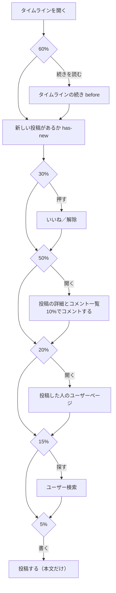

# パフォーマンステスト - RaiseTime Line

大量のデータと、同時に多くの人が使う状況で、API が十分に速いかを確かめる。**毎回の自動実行（`./gradlew test`・CI）には入れず、必要なときに手で実行する**。

- 道具：[k6](https://grafana.com/docs/k6/)（シナリオは JavaScript）。Docker Compose から動かすので、インストールは不要
- ファイル：`perf/`（実行の入口は `perf/run.sh`）
- 関連：[要件定義](./要件定義.md) 11章（非機能要件）、[テスト観点表](./テスト観点表.md) 4章、[テスト・ログの運用ルール](./テスト・ログの運用ルール.md) 3章

## 1. いつ実行するか

| 場面 | 実行するもの |
|---|---|
| SQL・一覧の取得・インデックスを変えたとき | `explain`（数秒）。速さが大きく変わりそうなら `load` も |
| 認証・ログ・フィルターなど、全リクエストが通る処理を変えたとき | `smoke` → `load` |
| インフラ構築の前後、リリースの前 | `smoke` → `load` → `stress` |
| 定期的な見直し（運用ルール 5章） | `explain` と `load`。前回の結果と比べる |

## 2. 想定と合格ライン

| 項目 | 値 | 根拠 |
|---|---|---|
| 同時に使う人数 | 50人 | 講座の受講生が同時に使う規模の**仮の想定**。変わったら `VUS=人数 perf/run.sh load` で試し、この表も直す |
| 読み取りの API | p95 が 300ms 未満 | 要件定義の「1回の表示で数百ミリ秒程度」。ブラウザ側の描画の時間も見込み、API は 300ms までにする |
| 書き込みの API | p95 が 500ms 未満 | いいねは楽観的更新（押した瞬間に見た目が変わる）なので、少し遅くても体感に響かない |
| エラー率 | 1% 未満 | |
| ログイン | p95 が 2000ms 未満（参考） | BCrypt でわざと重くしている（パスワードの総当たりを遅くするため）。1回の訪問で1回だけなので、合格ラインの主な対象にはしない |

- p95（95パーセンタイル）：100回のうち、速い方から95回目の時間。「ほとんどの人がこの時間以内」を表す。平均は一部の遅い応答に引っぱられるので使わない
- SQL 1本の目安：`explain` で 50ms 未満（API の 300ms のうち、DB に使ってよい分の目安）

## 3. データ（`perf/seed/seed.sql`）

開発用の DB（`raisetime`）とは別の、**性能テスト用の DB `raisetime_perf`**（同じ PostgreSQL のコンテナの中）に入れる。開発用のデータは変わらない。

| テーブル | 件数 | 作り方 |
|---|---|---|
| users | 10,007 | `perf_00001`〜`perf_10000`、パスワードは全員 `password123`。名前は検索用に taro・hanako・ichiro・sakura・kenta を混ぜる |
| follows | 約101万 | 1人100人をフォロー |
| posts | 50万 | 1人50件。1分おきに約1年分（id の順と作成日時の順をそろえる） |
| likes | 100万 | 1人100件 |
| comments | 20万 | 2万件の投稿に10件ずつ |

タイムラインの重さが違う、特別な利用者も作る：

| @ユーザーID | 特徴 | ねらい |
|---|---|---|
| `perf_heavy1`〜`5` | 2000人をフォロー | フォローが多い人 |
| `perf_few` | 3人だけフォロー | 該当する投稿が少ない人 |
| `perf_newbie` | 投稿もフォローもなし | **最悪ケース**。タイムラインは「新しい順に投稿を読み、自分かフォロー中の人のものを21件集める」ので、該当が無いと全投稿を読む |

## 4. シナリオ（`perf/k6/`）

| ファイル | 人数・時間 | 目的 | 合格ラインで判定 |
|---|---|---|---|
| `smoke.js` | 1人・1分 | スクリプトが正しく動くか。負荷が無いときの基準の値 | する |
| `load.js` | 2分で50人まで増やす → 5分保つ → 1分で減らす（約8分） | 想定の利用状況で合格ラインを満たすか | する |
| `stress.js` | 50 → 100 → 200人と段階的に増やす（約17分） | どこから遅くなるか・エラーが出始めるか（限界を知る） | しない（グラフで読む） |

1人の動き（`lib/scenario.js` の `visit`。1回の訪問は20秒前後）：



- 操作の間には、人が画面を読む時間（1〜8秒）を入れる。入れないと、実際よりずっと多くのリクエストを送ってしまう
- ログインは、仮想ユーザー（VU）ごとに最初の1回だけ。10人に1人は `perf_heavy*`、別の10人に1人は `perf_newbie`・`perf_few` にして、重いタイムラインも混ぜる
- 画面（`frontend/src/api/client.js`）と同じく、CSRF トークンをヘッダーで送り、401 のときはトークンを更新して1回だけ呼び直す
- 画像はアップロードしない（S3Mock を埋めないため）
- 結果は API ごと（`/api/posts/{postId}` のようにパスの形でまとめる）と、読み取り（read）・書き込み（write）ごとに集計する

## 5. SQL の確認（`perf/sql/explain.sql`）

主要な SQL を `EXPLAIN (ANALYZE, BUFFERS)` で実行し、実行時間と実行計画を見る。SQL は `backend/src/main/resources/mapper/` から写したもので、見出しに元の mapper の id を書いている。**mapper の SQL を変えたら、こちらも合わせる**。

見るところ：

- `Execution Time`：50ms 未満か
- 大きなテーブル（posts・likes・comments・follows）が `Seq Scan`（全件を順に読む）になっていないか
- `Rows Removed by Filter`：読んでから捨てた行の数。多いほど無駄に読んでいる

## 6. 手順

前提：Docker（`docker compose up -d` で PostgreSQL・S3Mock が起動している）。

```bash
# 1. 性能テスト用の DB でバックエンドを起動する（別のターミナルで、動かしたままにする）
#    初回は raisetime_perf を作り、Flyway がテーブルを作る。ポートは 8081（使用中なら止めてから起動する）
perf/run.sh backend

# 2. 大量のデータを入れる（約1分。入れ直すときも同じ）
perf/run.sh seed

# 3. SQL の確認（数秒）
perf/run.sh explain

# 4. k6 を実行する。実行中のグラフは http://localhost:5665
perf/run.sh smoke     # 1分
perf/run.sh load      # 約8分。人数を変えるとき：VUS=30 perf/run.sh load
perf/run.sh stress    # 約17分

# 5. 終わったら、バックエンドを Ctrl+C で止め、普段どおり起動し直す
cd backend && ./start.sh
#    性能テスト用の DB を消すとき（ディスクを空けたいときなど）
perf/run.sh reset
```

- 結果は `perf/results/`（Git には入れない）に、JSON（`--summary-export`）と HTML のレポート（k6 のウェブダッシュボード）で出る。**要点は下の 7章に記録する**
- テストを始める前に、`perf_00001` でログインできるかを確かめる。できなければ、バックエンドが `raisetime_perf` で動いていないか、データを入れていない
- 負荷テストで投稿・いいね・コメントが増えるので、前回と比べるときは `seed` で入れ直してから実行する

## 7. 結果の記録

手元の1台で、k6・バックエンド・PostgreSQL を同時に動かしたときの値。**本番の性能そのものではなく、変更の前後で比べるための値**として扱う。

### 7.1 SQL（`explain`）

| 日付 | コミット | SQL | 実行時間 | 気づいたこと |
|---|---|---|---|---|
| 2026-11-12 | （このドキュメントを足したコミット） | タイムライン（通常・100人フォロー） | 3.4ms | |
| | | タイムライン（2000人フォロー） | 1.6ms | 新しい投稿がすぐ見つかるので速い |
| | | タイムライン（3人だけフォロー） | 16.0ms | |
| | | **タイムライン（始めたばかりの人）** | **109.3ms** | 投稿50万件をすべて読んでいる（`Index Scan Backward using posts_pkey`、`Rows Removed by Filter: 500000`）。今は合格ラインの内側だが、**投稿の総数に比例して遅くなる**。→ 8章 |
| | | タイムラインの続き（3人だけフォロー） | 13.6ms | |
| | | 新しい投稿があるか（始めたばかりの人） | 0.1ms | |
| | | ユーザーページの投稿 | 1.9ms | |
| | | 投稿の詳細 | 0.2ms | |
| | | コメント一覧 | 0.1ms | |
| | | ユーザー検索（部分一致「taro」・2000人） | 8.8ms | users が1万人と小さいので、PostgreSQL は trigram の索引より全件を読む方を選んだ。人数が増えたら索引に切り替わるかを確かめる |
| | | ユーザー検索（前方一致「perf_0001」） | 9.0ms | 同上 |

### 7.2 API（k6）

| 日付 | コミット | シナリオ | 人数 | 1秒あたりの件数 | 読み取り p95 | 書き込み p95 | 最も遅い API（p95） | エラー率 | 判定 |
|---|---|---|---|---|---|---|---|---|---|
| 2026-11-12 | （同上） | smoke | 1 | 0.5 | 39ms | 59ms | タイムラインの続き 41ms | 0% | 合格 |
| 2026-11-12 | （同上） | load | 50 | 15.6 | 62ms | 14ms | タイムライン 95ms（p90 は 20ms）、新しい投稿があるか 69ms | 0%（7,643件中0件） | 合格 |

load の気づいたこと：

- タイムラインは、p90（20ms）と p95（95ms）の差が大きい。10人に1人混ぜた「始めたばかりの人」「3人だけフォローする人」の分が遅い（7.1 の SQL と同じ原因。8章）
- 新しい投稿があるか（has-new）も同じ傾向。3人だけフォローする人で、新しい投稿が無いと、それより新しい投稿をすべて読む
- 書き込み（いいね・投稿・コメント）は p95 20ms 未満で、余裕がある
- stress（限界を探すテスト）は、まだ実行していない

## 8. 見つかったこと・今後の改善

| 見つかったこと | 影響 | 改善の案 | 状態 |
|---|---|---|---|
| フォロー中の人の投稿が少ない人（特に始めたばかりの人）のタイムラインは、投稿を新しい順に全部読む（`PostMapper.findTimeline`） | 投稿の総数に比例して遅くなる。今は50万件で SQL が約110ms、load でタイムラインの p95 を 95ms に押し上げている | 「自分とフォロー中の人の id」ごとに `ix_posts_user_id_id`（user_id, id DESC）を使って新しい21件ずつを取り、まとめてから21件に絞る書き方にする | 未対応（別の issue で直す） |
| 新しい投稿があるか（`PostMapper.existsTimelineNewerThan`）も、同じ形の条件で、該当が無いと新しい投稿をすべて読む | 同上。load で p95 69ms | 上と同じく、フォロー中の人ごとに索引で調べる | 未対応（同上） |

## 9. 注意点

- **数字は比較に使う**：手元の1台で、k6 とサーバーと DB が CPU を取り合う。開発用の設定（dev プロファイル）では、ログが文章で1リクエストごとに出る。本番（EC2・RDS）とは条件が違う
- **本番環境には、事前の取り決めなしに負荷をかけない**。AWS の検証環境を作ったら、`BASE_URL=https://〜 perf/run.sh load` のように向け先を変えられる（そのときは CloudFront・ALB の設定と費用も確かめる）
- **ログインの回数制限**（同じメールアドレスで5回、同じ IP から50回の**失敗**で 429）：シナリオのログインは成功するので掛からない。パスワードを間違えるシナリオを足すときは、この制限に掛かる
- **アクセストークンは15分で切れる**：長いシナリオ（stress）では途中で切れるが、401 のときにトークンを更新する作りなので続けられる
- k6 の Cookie：k6 は標準では繰り返しのたびに Cookie を消すので、`noCookiesReset: true` でログイン状態を持ち続けている（`lib/scenario.js`）
