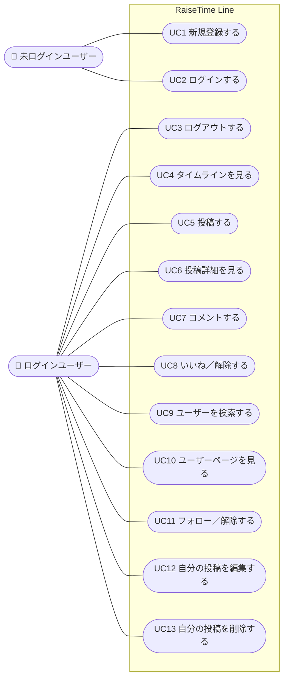

# ユースケース

[← 要件定義に戻る](./要件定義.md)

アクターは「未ログインユーザー」と「ログインユーザー」の2種類。

## 1. ユースケース図

## 2. ユースケース一覧

| No | ユースケース名 | アクター | 概要 | 関連機能 |
|---|---|---|---|---|
| UC1 | 新規登録する | 未ログインユーザー | 名前・@ユーザーID・メールアドレス・パスワードを入力してアカウントを作り、そのままログインする | F-01 |
| UC2 | ログインする | 未ログインユーザー | メールアドレスとパスワードでログインし、タイムラインを開く | F-02 |
| UC3 | ログアウトする | ログインユーザー | ヘッダーのボタンでログアウトし、ログイン画面に戻る | F-02 |
| UC4 | タイムラインを見る | ログインユーザー | 自分とフォロー中ユーザーの投稿を新しい順に読む | F-03 |
| UC5 | 投稿する | ログインユーザー | 280文字までのテキストと、最大4枚の画像を投稿する | F-04 |
| UC6 | 投稿詳細を見る | ログインユーザー | 投稿1件と、そのコメント一覧を読む | F-05 |
| UC7 | コメントする | ログインユーザー | 自分や他人の投稿にコメントを書き込む | F-05 |
| UC8 | いいね／解除する | ログインユーザー | 投稿にいいねする。もう一度押すと解除する | F-06 |
| UC9 | ユーザーを検索する | ログインユーザー | @ユーザーID や名前で、フォローしたいユーザーを探す | F-09 |
| UC10 | ユーザーページを見る | ログインユーザー | 特定ユーザーの投稿一覧とフォロー数・フォロワー数を見る | F-08 |
| UC11 | フォロー／解除する | ログインユーザー | 他のユーザーをフォローする。もう一度押すと解除する | F-07 |
| UC12 | 自分の投稿を編集する | ログインユーザー（投稿者本人） | 自分の投稿の本文や画像を直す | F-10 |
| UC13 | 自分の投稿を削除する | ログインユーザー（投稿者本人） | 確認のうえ、自分の投稿を削除する | F-11 |

## 3. 代表的な利用の流れ

### 初めて使う人

1. 新規登録する（UC1）→ そのままタイムラインが開く（まだ空）
2. ユーザーを検索する（UC9）→ 知っている受講生をフォローする（UC11）
3. タイムラインを見る（UC4）→ フォローした人の投稿が表示される
4. 学習の記録を投稿する（UC5）→ 誤字に気づいたら編集する（UC12）、不要になったら削除する（UC13）

### いつも使う人

1. ログインする（UC2）
2. タイムラインを見る（UC4）→ 気になった投稿にいいねする（UC8）
3. 投稿詳細を開いて（UC6）コメントする（UC7）
4. コメントした人のユーザーページを見て（UC10）フォローする（UC11）
