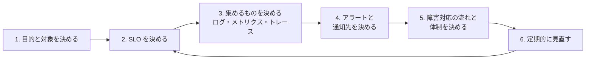
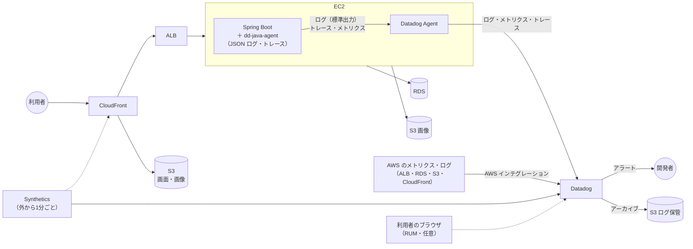

# ログ・監視設計 - RaiseTime Line

Web アプリを動かし続けるための「ログの運用」「監視」「運用方針」の考え方と、このアプリでの設計をまとめる。監視サービスは **Datadog** を前提にし、AWS 標準の CloudWatch だけで済ませる場合との違いも書く。

- **第1部**：考え方（どの Web アプリにも当てはまる一般論）
- **第2部**：このアプリへの当てはめ（何をログに出し、何を監視し、鳴ったらどうするか）
- この文書は設計まで。アプリのコードと AWS・Datadog の設定は、インフラ構築の工程で行う（→ 第2部 9章）

---

# 第1部 考え方

## 1. なぜログ・監視が必要か

本番で動いているアプリは、開発中と違って「画面を見ながら確かめる」ことができない。ログと監視は、次の4つのためにある。

| 目的 | 例 |
|---|---|
| **気づく**（検知） | サーバーが止まった、エラーが増えた、遅くなった。利用者に言われる前に知る |
| **調べる**（調査） | 「昨日の夜に投稿できなかった」と言われたとき、何が起きたかをたどる |
| **良くする**（改善） | どの API が遅いか、どの機能が使われているかを知る |
| **記録する**（監査・セキュリティ） | 誰がいつログインしたか、不正なアクセスの試みがあったか |

集める情報は3種類ある。まとめて「オブザーバビリティ（外から中の状態がわかること）の3本柱」と呼ぶ。

| 種類 | 何か | 向いていること | 例 |
|---|---|---|---|
| **ログ** | 出来事の記録（1件ずつ） | 「何が起きたか」を詳しく調べる | 「ユーザー42のログインが失敗した」 |
| **メトリクス** | 数値の時間変化 | 「今どうなっているか」を見る・アラートを鳴らす | CPU 使用率、1分あたりのリクエスト数、エラー率 |
| **トレース** | 1つのリクエストが通った道筋と、各所でかかった時間 | 「どこが遅いか」を調べる | タイムライン API：全体 180ms、うち SQL が 150ms |

## 2. ログの設計

### 2.1 ログの種類

| 種類 | 内容 | 主な使い道 |
|---|---|---|
| アプリケーションログ | アプリが自分で出す、業務の出来事とエラー | 調査 |
| アクセスログ | リクエスト1件ごとの記録（いつ・誰が・どのパス・結果・かかった時間） | 調査・集計（エラー率・速さ） |
| セキュリティ・監査ログ | ログインの成功・失敗、権限エラー、不審な操作 | 不正の検知・あとからの確認 |
| インフラのログ | ロードバランサー・DB・OS のログ | アプリの外で起きた問題の調査 |

### 2.2 ログレベルの基準

レベルは「**誰が、いつ見るか**」で決める。基準を決めておかないと、ERROR だらけになって本当の問題が埋もれる。

| レベル | 基準 | 例 | 本番で出すか |
|---|---|---|---|
| ERROR | **人が対応する必要がある**。放っておけない | 想定外の例外、DB につながらない、画像を保存できない | 出す（アラートの対象） |
| WARN | 今は動いているが、**続くと問題になる**・おかしい | 使用済みのトークンが使われた、S3 の画像を消せなかった、ログインの失敗が続いてロックした | 出す（件数を監視） |
| INFO | **正常な業務の出来事** | ログインした、投稿した、期限切れのトークンを削除した | 出す |
| DEBUG | 開発中に動きを追うための詳細 | SQL の中身、変数の値 | 出さない |

利用者の入力の誤り（400）や「見つからない」（404）は、アプリとしては正常な動きなので ERROR にしない（アクセスログのステータスでわかる）。

### 2.3 構造化ログ

ログを「人が読む文章」ではなく、「**項目名と値の組（JSON）**」で出す方法。

文章のログ：

```
2026-10-06T10:15:32.123+09:00  WARN 47096 --- [raisetime] [nio-8081-exec-3] c.e.r.service.RefreshTokenService : 使用済みのリフレッシュトークンが使われたため、系列を無効にしました（userId=42, 無効にした件数=3）
```

構造化ログ：

```json
{
  "timestamp": "2026-10-06T01:15:32.123Z",
  "level": "WARN",
  "service": "raisetime-backend",
  "env": "production",
  "logger": "RefreshTokenService",
  "message": "使用済みのリフレッシュトークンが使われたため、系列を無効にしました",
  "event": "refresh_token_reused",
  "user_id": 42,
  "revoked_count": 3,
  "request_id": "b7f3c1e2",
  "path": "/api/auth/refresh",
  "status": 401,
  "duration_ms": 18
}
```

| やりたいこと | 文章のログ | 構造化ログ |
|---|---|---|
| ユーザー42のログだけ見る | 「userId=42」を文字で探す（「userId=420」も引っかかる） | `user_id:42` で正確に絞れる |
| 500 エラーを数える | 文字の形を解析する仕組みを自分で作る | `status:500` を数えるだけ。そのままグラフ・アラートにできる |
| 1つのリクエストで起きたことを追う | 時刻が近いログを目で探す | `request_id` が同じログを並べる |

監視サービスは JSON の項目を自動で認識するので、**監視サービスを使うなら構造化ログが前提**になる。開発中は読みやすい文章のまま、本番だけ JSON にするのが一般的。

### 2.4 すべてのログに入れる項目

項目名は最初に決めてそろえる（ある場所は `userId`、別の場所は `user_id` だと検索で漏れる）。

| 項目 | 内容 | なぜ必要か |
|---|---|---|
| `timestamp` | 日時（UTC、ISO 8601） | 並べる・時間で絞る。タイムゾーンをそろえる |
| `level` | ログレベル | 重要なものだけ見る |
| `service` | サービス名 | 複数のサービスのログを分ける |
| `env` | 環境（production / staging / dev） | 本番と検証を混ぜない |
| `version` | アプリのバージョン（コミットなど） | 「どのリリースから起きたか」を知る |
| `request_id`（または trace_id） | リクエスト1件ごとの ID | 1つのリクエストのログをまとめる。利用者への問い合わせ対応にも使える |
| `user_id` | ログイン中のユーザーの id | 「この人に何が起きたか」を追う |
| `message` | 人が読む説明 | 内容を理解する |
| `event` | 出来事の種類（決まった名前） | 文言が変わっても同じ条件で集計できる |

アクセスログには、さらに `method`・`path`・`status`・`duration_ms`・`client_ip` を入れる。

### 2.5 ログに出してはいけないもの

ログは多くの人・サービスが見られる場所に保存される。漏れると困るものは、最初から出さない。

| 出さないもの | 理由 | 代わりに |
|---|---|---|
| パスワード（平文もハッシュも） | 漏れたら不正ログインにつながる | 出さない |
| アクセストークン・リフレッシュトークン・Cookie・CSRF トークン | そのままなりすましに使える | 出さない |
| `Authorization`・`Cookie`・`Set-Cookie` ヘッダーの中身 | 上と同じ | ヘッダー名だけ、または出さない |
| メールアドレスなどの個人情報 | 個人を特定できる | ユーザーの id を出す。必要なら一部を隠す（`t***@example.com`） |
| 投稿・コメントの本文の全文 | 利用者の書いた内容。量も多い | 投稿の id・文字数 |
| リクエストの本文をそのまま | 上のすべてが入りうる | 必要な項目だけを選んで出す |

### 2.6 保存期間と費用

ログの費用は「量 × 保存期間」で決まる。全部を長く持つと高いので、**すぐ検索できる期間**と**安く保管する期間**を分ける。

| 段階 | 期間の例 | 置き場所 | 使い道 |
|---|---|---|---|
| すぐ検索できる | 7〜15日 | 監視サービス | 障害の調査（ほとんどの調査は数日以内） |
| 保管（アーカイブ） | 3か月〜1年 | S3 などの安い保存先 | あとからの確認、セキュリティの調査 |
| 削除 | それ以降 | − | 持ち続けること自体がリスクと費用になる |

量を減らす工夫：ヘルスチェックのアクセスログは保存しない、DEBUG は本番で出さない、同じエラーを大量に出さない。

## 3. 監視の設計

### 3.1 何を見るか

「サーバーの CPU」から考え始めると、見るものが増えすぎる。まず**利用者から見た状態**を見る。目安になるのが「4つのゴールデンシグナル」。

| シグナル | 意味 | 例 |
|---|---|---|
| レイテンシ | 応答にかかる時間 | タイムライン API の p95（100回のうち遅いほうから5番目）が 500ms 以内 |
| トラフィック | どれだけ使われているか | 1分あたりのリクエスト数 |
| エラー | 失敗の割合 | 5xx の割合 |
| サチュレーション（飽和） | 資源がどれだけ埋まっているか | CPU・メモリ・ディスク・DB の接続数 |

平均ではなく **p95・p99**（パーセンタイル）で見る。平均は、一部の人だけが極端に遅い状態を隠してしまう。

### 3.2 SLI・SLO

| 言葉 | 意味 | 例 |
|---|---|---|
| SLI | サービスの良さを測る**指標** | 成功したリクエストの割合 |
| SLO | その指標の**目標** | 30日間で 99.5% 以上 |
| エラーバジェット | 目標から逆算した、**許される失敗の量** | 99.5% なら、30日で約3.6時間まで止まってよい |

SLO を決めると、「どこまで頑張るか」「いつアラートを鳴らすか」を数字で話せる。100% は目指さない（費用が際限なく増え、変更もできなくなる）。

### 3.3 アラートの設計

アラートで一番多い失敗は「鳴りすぎて誰も見なくなる」こと（アラート疲れ）。次の原則で設計する。

1. **症状で鳴らす**：「CPU が 80%」（原因の候補）より「エラー率が 5% を超えた」（利用者が困っている）を優先する
2. **鳴ったら、やることがある**：見ても何もしないアラートは作らない（ダッシュボードで見れば足りる）
3. **重要度を分ける**

| 重要度 | 基準 | 通知 | 例 |
|---|---|---|---|
| P1（緊急） | 利用者が使えない。すぐ対応する | 電話・即時の通知（夜間も） | サービスが応答しない、エラー率が高い |
| P2（警告） | 放っておくと P1 になる。営業時間内に対応する | チャット | ディスクが残り 20%、遅くなってきた |
| P3（情報） | 知っておく | 週次の確認・ダッシュボード | 証明書の期限が30日後 |

4. **一瞬の揺れで鳴らさない**：「5分間続いたら」のように、時間の条件を付ける
5. **ランブック（対応手順）を付ける**：アラートに「まず何を見るか・どう直すか」へのリンクを付ける。夜中に起こされた人が、考えなくても動けるようにする
6. **定期的に見直す**：鳴ったが何もしなかったアラートは、しきい値を変えるか消す

### 3.4 ダッシュボード

「概要 → 詳細」の順に作る。1枚目は、開いて5秒で「大丈夫かどうか」がわかるようにする。

1. **概要**：SLO の達成状況、リクエスト数・エラー率・p95 レイテンシ、鳴っているアラート
2. **詳細**：API ごと、DB、インフラ、セキュリティなど、原因を調べるための画面

## 4. 運用方針の決め方（手順）



| 手順 | 決めること | 問い |
|---|---|---|
| 1. 目的と対象 | 何を守るか、誰が使うか、止まると何が困るか | 夜中に止まったら、朝まで待てるか？ |
| 2. SLO | 可用性・速さの目標 | 利用者が「遅い」「使えない」と感じる線はどこか？ |
| 3. 集めるもの | ログの項目・レベル、メトリクス、トレース、保存期間 | 障害が起きたとき、何があれば調べられるか？ |
| 4. アラート | 条件・しきい値・重要度・通知先・ランブック | これが鳴ったら、誰が何をするか？ |
| 5. 障害対応 | 検知 → 一次対応 → 連絡 → 復旧 → 振り返り。担当と連絡先 | 最初の10分で誰が何をするか？ |
| 6. 見直し | 月に1回、アラート・SLO・費用を振り返る | 鳴ったのに何もしなかったアラートは無いか？ |

障害の**振り返り（ポストモーテム）**は、人を責めずに「なぜ気づけなかったか・なぜ起きたか・次にどう防ぐか」を書く。見つかった不足を、ログ・監視・テストに足していく。

## 5. Datadog での実現

### 5.1 部品

| 部品 | 役割 | このアプリでの使い道 |
|---|---|---|
| **Agent** | サーバーに入れる常駐のプログラム。メトリクス・ログ・トレースを Datadog へ送る | EC2 に入れる |
| **インテグレーション（AWS）** | AWS のサービスのメトリクス・ログを取り込む | ALB・RDS・S3・CloudFront |
| **Logs** | ログの検索・集計。パイプライン（項目の取り出し・整形・マスク）、ファセット（絞り込みの項目） | アプリのログ・アクセスログ |
| **APM**（トレース） | リクエストごとの道筋と時間。Java は `dd-java-agent` を付けるだけで、Spring MVC・JDBC・S3 の呼び出しを自動で記録する | 遅い API・SQL を見つける |
| **Monitors** | 条件を決めてアラートを出す。通知先（メール・Slack など）とメッセージを設定する | 第2部 4章 |
| **Dashboards** | グラフをまとめた画面 | 第2部 5章 |
| **Synthetics**（外形監視） | 外から定期的にアクセスして、動いているかを確かめる | ヘルスチェック、ログイン画面の表示 |
| **RUM**（ブラウザ） | 利用者のブラウザでの表示速度・JavaScript のエラーを集める | 任意（React の画面） |

### 5.2 統一タグ

Datadog では、すべてのデータに **`env`・`service`・`version`** の3つのタグを付ける（Unified Service Tagging）。これがそろっていると、ログ・メトリクス・トレースを行き来できる（エラーのログから、そのリクエストのトレースへ飛ぶ、など）。

| タグ | 値の例 |
|---|---|
| `env` | `production` |
| `service` | `raisetime-backend` / `raisetime-frontend` |
| `version` | Git のコミット（`c40a1a7`）やリリースの番号 |

`dd-java-agent` でログへの埋め込み（`DD_LOGS_INJECTION=true`）を有効にすると、ログに `dd.trace_id` が自動で入り、**ログとトレースがひも付く**。

### 5.3 ログの費用の仕組み

Datadog のログは「**取り込み**（送った量）」と「**インデックス**（検索できる状態で持つ件数 × 保存期間）」で別々に課金される。

- 全部を取り込み、**検索できる状態にするものだけを選ぶ**（除外フィルタ）。例：ヘルスチェックのアクセスログ、2xx のアクセスログの大部分はインデックスしない
- インデックスしないログも、**メトリクスに変換**（Log-based Metrics）すれば件数の推移は見られる
- 長く残したいログは、**S3 にアーカイブ**する（必要なときだけ読み戻す）

### 5.4 CloudWatch だけの場合との比較

| 観点 | Datadog | CloudWatch だけ |
|---|---|---|
| 準備の手間 | Agent・インテグレーションの設定が必要 | AWS の中で完結。EC2 に CloudWatch Agent を入れる |
| ログの検索 | 速い。項目で絞り込みやすい。ログ ⇔ トレース ⇔ メトリクスを行き来できる | Logs Insights で検索できる（クエリを書く）。行き来は弱い |
| トレース（APM） | 自動で詳しく取れる。画面が見やすい | X-Ray を別に設定する |
| ダッシュボード・アラート | 作りやすく、種類が多い | 基本的なものは作れる |
| 外形監視・RUM | ある（Synthetics・RUM） | ある（CloudWatch Synthetics・RUM） |
| 費用 | ホスト数・ログの量・機能ごとに課金。小さな構成でも月に数千円〜 | 使った分だけ。小さな構成なら無料枠〜月に数百円 |
| 向いている場面 | 複数のサービス・クラウドをまとめて見たい。調査の速さを重視する | AWS だけの小さな構成。費用を抑えたい |

金額は変わるので、決めるときは公式の料金ページ（[Datadog](https://www.datadoghq.com/pricing/)・[CloudWatch](https://aws.amazon.com/jp/cloudwatch/pricing/)）で確かめる。

---

# 第2部 このアプリへの当てはめ

## 1. 目的と前提

| 項目 | 内容 |
|---|---|
| サービス | 学習用のタイムライン型 SNS。少人数（受講生・個人）が使う |
| 構成 | CloudFront → ALB → EC2 1台（Spring Boot）→ RDS（PostgreSQL、Single-AZ）、画像は S3（[インフラ構成図](./インフラ構成図.md)） |
| 止まったときの影響 | 学習用のため、停止しても大きな問題はない（[要件定義](./要件定義.md) 11章）。夜間・休日は、気づいた時点で対応する |
| 速さの目安 | 1回の表示で数百ミリ秒（要件定義 11章） |
| 運用する人 | 開発者1人 |
| この設計の目的 | 止まった・遅い・攻撃されていることに気づける。あとから原因を調べられる。運用の設計を一通り学ぶ |

## 2. SLO（案）

| SLI | SLO | 測り方 | 補足 |
|---|---|---|---|
| 可用性：外形監視（ヘルスチェック）の成功率 | 30日間で **99.5%** 以上 | Datadog Synthetics（1分ごと） | 止まってよい時間は30日で約3.6時間。EC2 1台・RDS Single-AZ の構成に合わせた |
| エラー：API の 5xx の割合 | 30日間で **1%** 未満 | アクセスログ（または APM）の `status` | 4xx は利用者側の誤りなので含めない |
| 速さ：`GET /api/timeline` の p95 | **500ms** 以内 | APM のレイテンシ | 要件の「数百ミリ秒」。大量データでの計測では最悪 96ms（[テスト観点表](./テスト観点表.md) 4章） |

## 3. 出すログ

### 3.1 共通のルール

- 本番は **JSON の構造化ログ**を標準出力へ出す（開発は今までどおり文章）。Datadog Agent が拾って送る
- すべてのログに `timestamp`・`level`・`service`・`env`・`version`・`request_id`・`user_id`（ログイン中なら）を入れる（第1部 2.4）
- `request_id` はリクエストごとに作り、レスポンスの `X-Request-Id` ヘッダーでも返す（利用者からの問い合わせで、ログを特定できるように）
- 出来事の種類は `event` に決まった名前で入れる（下の表）
- 日時は UTC（API のレスポンスと同じ）

### 3.2 ログの一覧

| 出来事（`event`） | レベル | 入れる項目 | 出す場所 | 今あるか |
|---|---|---|---|---|
| リクエスト1件（アクセスログ）`http_request` | INFO | `method`・`path`（`/api/posts/{postId}` の形）・`status`・`duration_ms`・`client_ip`・`user_id` | フィルター（全 API） | **無い → 足す** |
| ログイン成功 `login_succeeded` | INFO | `user_id`・`client_ip` | `AuthController.login` | **無い → 足す** |
| ログイン失敗 `login_failed` | INFO | メールアドレス（一部を隠す）・`client_ip` | `AuthController.login` | **無い → 足す** |
| ログインのロック `login_locked` | WARN | メールアドレス（一部を隠す）・`client_ip`・ロックの種類（メールアドレス／IP） | `LoginAttemptService` | **無い → 足す** |
| 新規登録 `signup_succeeded` | INFO | `user_id` | `AuthController.signup` | **無い → 足す** |
| リフレッシュトークンの使い回し `refresh_token_reused` | WARN | `user_id`・無効にした件数 | `RefreshTokenService` | ある（文章。項目にする） |
| 期限切れトークンの削除 `refresh_tokens_purged` | INFO | 削除した件数 | `RefreshTokenService` | ある |
| CSRF・権限エラー `access_denied` | WARN | `path`・`user_id`・理由（CSRF／他人の投稿） | `JsonAccessDeniedHandler`・`GlobalExceptionHandler` | **無い → 足す** |
| 画像の保存に失敗 `storage_failed` | ERROR | 操作（保存／削除）・キー・例外 | `GlobalExceptionHandler` | ある（`Storage error`） |
| S3 の画像を消せなかった `storage_delete_failed` | WARN | キー・例外 | `PostService`・`UserService` | ある |
| 想定外の例外 `unexpected_error` | ERROR | 例外（スタックトレース）・`path` | `GlobalExceptionHandler` | ある（`Unexpected error`） |
| 起動・停止 | INFO | バージョン・プロファイル | Spring Boot | ある |

- ログインの失敗は、1件ずつは正常な動き（打ち間違い）なので INFO。**件数の急増**を監視する（4章）
- 4xx（入力の誤り・見つからない）は、アクセスログの `status` でわかるので、個別のログは出さない

### 3.3 出さないもの・隠すもの

| 対象 | 扱い |
|---|---|
| パスワード、アクセストークン、リフレッシュトークン、CSRF トークン、Cookie | 出さない |
| メールアドレス | ログインの失敗・ロックのときだけ、一部を隠して出す（`t***@example.com`）。ほかは `user_id` を使う |
| 投稿・コメント・自己紹介の本文 | 出さない（id と文字数だけ） |
| 画像のキー | 出す（`posts/{id}/{uuid}.jpg`。個人情報を含まない） |
| IP アドレス | 出す（総当たりの検知に必要）。保存期間は短くする |

Datadog の Sensitive Data Scanner（ログの中の秘密情報を見つけて隠す機能）は、万一の漏れへの備えとして使えるが、**まずアプリで出さない**ことを基本にする。

### 3.4 保存期間

| ログ | 検索できる期間（Datadog） | 保管（S3） |
|---|---|---|
| アプリケーションログ（WARN 以上） | 15日 | 90日 |
| セキュリティのログ（ログイン・ロック・使い回し・権限エラー） | 15日 | 90日 |
| アクセスログ（4xx・5xx） | 15日 | 30日 |
| アクセスログ（2xx・3xx） | インデックスしない（メトリクスに変換して件数・時間だけ残す） | 30日 |
| ヘルスチェックのアクセスログ | 取り込まない | − |

## 4. 監視（Datadog Monitors）

通知先は、P1 がメール＋スマートフォンの通知、P2 がメール（またはチャット）。運用する人が1人で学習用のため、夜間の呼び出しはしない。

| # | 名前 | 条件 | 重要度 | まずやること |
|---|---|---|---|---|
| M-1 | サービスが応答しない | Synthetics：`/actuator/health` が2か所から3回続けて失敗 | P1 | ランブック R-1 |
| M-2 | 5xx が多い | 5xx の割合が5分間 5% を超える（リクエストが少ないときは件数で：5分間に10件以上） | P1 | ランブック R-2 |
| M-3 | 遅い | `GET /api/timeline` の p95 が10分間 1秒を超える | P2 | APM で遅い処理（SQL・S3）を見る |
| M-4 | 想定外の例外 | `event:unexpected_error` が5分間に5件以上 | P2 | ログのスタックトレースと `request_id` を見る |
| M-5 | ログイン失敗の急増 | `event:login_failed` が5分間に50件以上、または `event:login_locked` が1件以上 | P2 | ランブック R-3 |
| M-6 | トークンの使い回し | `event:refresh_token_reused` が1件以上 | P2 | 対象の `user_id` のログイン履歴・IP を見る。本人に確認する |
| M-7 | 画像を保存できない | `event:storage_failed` が5分間に3件以上 | P2 | S3・IAM ロール・ネットワークを確かめる |
| M-8 | EC2 の資源 | CPU が15分間 85% 超／メモリの空きが 10% 未満／ディスクの空きが 20% 未満 | P2 | プロセス・ログの量を確かめる。必要ならインスタンスを大きくする |
| M-9 | RDS の資源 | 接続数が上限の 80% 超／空きストレージが 20% 未満／CPU が15分間 85% 超 | P2 | 遅い SQL・接続の残りを確かめる |
| M-10 | ログが来ていない | `service:raisetime-backend` のログが15分間 0件 | P2 | Agent とアプリが動いているか確かめる（監視そのものが止まっていないか） |
| M-11 | 証明書の期限 | TLS 証明書の期限が30日以内 | P3 | 更新する（ACM の自動更新が動いているか確かめる） |

SLO の達成状況（2章）は、アラートではなくダッシュボードと月1回の見直しで確かめる。

## 5. ダッシュボード

| 画面 | 内容 |
|---|---|
| **概要** | SLO の達成状況（可用性・エラー率・速さ）、リクエスト数、5xx・4xx の割合、p50／p95 レイテンシ、鳴っているアラート、直近のリリース（`version`） |
| **API** | パスごとのリクエスト数・エラー率・p95、遅い順の一覧、遅いトレースへのリンク |
| **DB・インフラ** | EC2 の CPU・メモリ・ディスク、JVM のヒープ・GC、RDS の CPU・接続数・ストレージ・遅い SQL、ALB のリクエスト数・ターゲットの状態 |
| **セキュリティ** | ログインの成功・失敗・ロックの件数、失敗の多い IP、トークンの使い回し、403（CSRF・権限）の件数、429 の件数 |

## 6. ランブック（対応手順）

### R-1 サービスが応答しない（M-1）

1. Datadog で、ALB のターゲットの状態と EC2 のメトリクスを見る（EC2 が動いているか、Spring Boot が応答しているか）
2. アプリのログの最後を見る（起動に失敗していないか。例：`JWT_SECRET` の設定漏れで起動しない、DB につながらない）
3. EC2 が動いていてアプリが止まっていれば、アプリを起動し直す。EC2 が止まっていれば起動する
4. RDS が原因なら、RDS の状態・接続数・ストレージを見る
5. 復旧したら、いつ・何が起きたか・どう直したかを記録する

### R-2 5xx が多い（M-2）

1. ダッシュボードの「API」で、どのパスで起きているかを見る
2. `status:5* service:raisetime-backend` でログを絞り、`event` と例外を見る（`unexpected_error`／`storage_failed`）
3. `version` を見て、直近のリリースから起きていれば、前のバージョンに戻す
4. 特定のリクエストは、`request_id` でログとトレースをたどる
5. 原因を直し、同じ問題を見つけるテストを足す

### R-3 ログインの失敗が急増した（M-5）

1. ダッシュボードの「セキュリティ」で、失敗の多い IP・メールアドレスを見る
2. 1つの IP からの失敗が多ければ、総当たりの可能性がある。アプリは15分間に50回で止めるが、続くなら AWS WAF（または ALB・セキュリティグループ）でその IP を止める
3. 1つのメールアドレスへの失敗が多ければ、そのアカウントが狙われている。ログインに成功していないか（`login_succeeded` が同じ時間帯に無いか）を確かめる
4. 成功していた場合は、そのユーザーのリフレッシュトークンを無効にし、本人に知らせる

## 7. 構成



| 部分 | 設定の方針 |
|---|---|
| アプリ（Spring Boot） | 本番のプロファイルで JSON の構造化ログにする。`dd-java-agent` を付けて起動し、`DD_ENV`・`DD_SERVICE`・`DD_VERSION`・`DD_LOGS_INJECTION=true` を渡す |
| Datadog Agent | EC2 に入れる。ログの収集・APM を有効にする。API キーは Systems Manager Parameter Store から渡す（コードや Git に置かない） |
| AWS インテグレーション | Datadog 用の IAM ロール（読み取りだけ）を作り、ALB・RDS・S3・CloudFront のメトリクスを取り込む |
| ネットワーク | EC2 から Datadog へ送るため、外向きの HTTPS 通信が必要（NAT Gateway か、パブリックサブネットに置く。[インフラ構成図](./インフラ構成図.md) 6章の節約案に関わる） |
| Synthetics | `/actuator/health` を1分ごと。ログイン画面の表示を5分ごと |
| RUM（任意） | React の画面に Datadog のスクリプトを入れる。利用者の入力した内容は送らない設定にする |

## 8. 費用の目安と、抑える方法

金額は目安（変わるので、契約の前に [Datadog の料金ページ](https://www.datadoghq.com/pricing/) で確かめる）。

| 項目 | 課金の単位 | この構成での目安 |
|---|---|---|
| Infrastructure（ホストの監視） | ホスト1台ごと・月額 | EC2 1台分（十数ドル） |
| APM | ホスト1台ごと・月額 | EC2 1台分（三十ドル前後） |
| Logs | 取り込んだ量（GB）＋ インデックスした件数 × 保存期間 | 少人数なら月に数ドル以内（除外フィルタを使う） |
| Synthetics | テストの実行回数 | 1分ごと × 1件で月に約4万回（二十ドル前後）。5分ごとにすれば約5分の1 |
| RUM | セッション数 | 少人数なら小さい。使わなければ 0 |

抑える方法：

- **無料枠・トライアルを使う**：Datadog には無料のプラン（ホスト数・保存期間に制限あり）と、14日間のトライアルがある。学習では、トライアルで一通り設定して学び、その後は無料の範囲か CloudWatch に切り替える方法もある
- **APM・Synthetics・RUM は必要なものだけ**：まずログとメトリクスとアラートから始める
- **外形監視は CloudWatch や ALB のヘルスチェックで代える**：1分ごとの Synthetics がいちばん高くなりやすい
- **ログは除外フィルタで絞る**（3.4）

### Datadog を使わない場合（CloudWatch だけ）

学習用で費用を最小にするなら、CloudWatch だけでも同じ設計の多くを実現できる。

| この設計 | CloudWatch での実現 |
|---|---|
| JSON の構造化ログ | CloudWatch Agent で CloudWatch Logs へ送る。Logs Insights で項目を指定して検索できる |
| ログからのアラート（M-4〜M-7） | メトリクスフィルタ（`event` で絞って件数をメトリクスにする）＋ CloudWatch アラーム ＋ SNS（メール） |
| 5xx・レイテンシ（M-2・M-3） | ALB のメトリクス（`HTTPCode_Target_5XX_Count`・`TargetResponseTime`） |
| EC2・RDS の資源（M-8・M-9） | 標準のメトリクス（メモリ・ディスクは CloudWatch Agent が必要） |
| 外形監視（M-1） | Route 53 のヘルスチェック、または CloudWatch Synthetics |
| トレース | X-Ray（任意） |

**ログの設計（3章）と監視の一覧（4章）は、どちらのサービスでも同じ**。先にアプリのログをきちんと設計しておけば、あとからサービスを替えられる。

## 9. 実装のときにやること

この文書は設計まで。次の作業は、インフラ構築の工程で issue にして進める。

| # | 作業 | 内容 |
|---|---|---|
| 1 | 構造化ログ | 本番のプロファイルで `logging.structured.format.console` を設定し、JSON で出す（Spring Boot の標準機能）。`service`・`env`・`version` を入れる |
| 2 | リクエスト ID | フィルターでリクエストごとに ID を作り、MDC（ログに自動で付く項目）に入れる。レスポンスの `X-Request-Id` で返す。ログイン中は `user_id` も MDC に入れる |
| 3 | アクセスログ | フィルターで `method`・`path`・`status`・`duration_ms`・`client_ip` を出す。`/actuator/health` は出さない |
| 4 | セキュリティのログ | ログインの成功・失敗・ロック、新規登録、CSRF・権限エラーに `event` 付きのログを足す（3.2 の「無い → 足す」）。メールアドレスを隠す部品を作る |
| 5 | 今あるログの整理 | `RefreshTokenService`・`GlobalExceptionHandler`・`PostService`・`UserService` のログに `event` と項目を付ける |
| 6 | テスト | 出してはいけないもの（パスワード・トークン）がログに出ないこと、`event` と項目が出ることを確かめる |
| 7 | Datadog | Agent・`dd-java-agent`・AWS インテグレーション・ログのパイプライン・除外フィルタ・アーカイブ |
| 8 | Monitors・Dashboards | 4章・5章のとおりに作る。ランブック（6章）へのリンクを付ける |
| 9 | 動作確認 | わざとエラーを起こして、アラートが届くこと・ログとトレースをたどれることを確かめる |
| 10 | 見直し | 運用を始めて1か月後に、鳴ったアラート・SLO・費用を振り返る |
