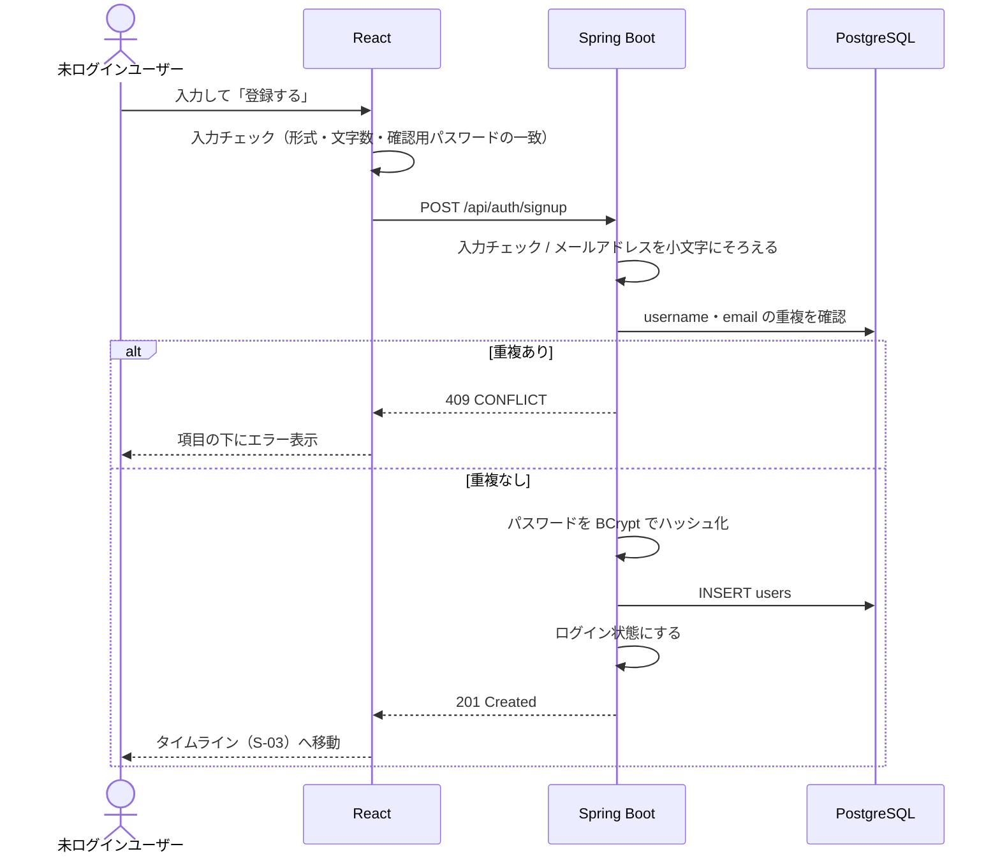

# F-01 新規登録

[← 機能一覧に戻る](../機能一覧.md)

## 概要

名前・@ユーザーID・メールアドレス・パスワードを入力して、自分でアカウントを作る。登録に成功したら、そのままログインした状態になる。

## アクター・前提条件

| 項目 | 内容 |
|---|---|
| アクター | 未ログインユーザー |
| 前提条件 | ログインしていない（ログイン中に新規登録画面を開いたらタイムラインへ移動する） |
| 事後条件 | users テーブルにユーザーが1件増え、ログインした状態になる |

## 対象画面

- S-02 新規登録（S-01 ログイン画面のリンクから開く）

## 入力項目

| 項目 | 必須 | ルール |
|---|---|---|
| 名前 | ○ | 1〜50文字。ほかの人と同じでもよい（表示名のため） |
| @ユーザーID | ○ | 3〜15文字。半角英小文字・数字・`_` のみ。**ほかのユーザーと重複できない**。登録後は変更できない |
| メールアドレス | ○ | メールアドレスの形式、255文字まで。**ほかのユーザーと重複できない** |
| パスワード | ○ | 8〜64文字 |
| パスワード（確認） | ○ | パスワードと一致すること（フロントエンドだけで確認し、API には送らない） |

## 処理の流れ



## 業務ルール

- メールアドレスは小文字にそろえてから保存・照合する（`Taro@Example.com` と `taro@example.com` は同じものとして扱う）
- @ユーザーID は半角英小文字しか使えないため、大文字小文字の違いによる重複は起きない
- パスワードは BCrypt でハッシュ化して保存する
- 重複チェックはアプリ側でも行うが、同時に登録された場合に備えて DB の UNIQUE 制約でも防ぐ（UNIQUE 制約違反が起きたら 409 を返す）
- 登録直後は誰もフォローしていないため、タイムラインには空の状態のメッセージを表示する

## API

### POST `/api/auth/signup`

リクエスト

```json
{
  "name": "山田太郎",
  "username": "taro_dev",
  "email": "taro@example.com",
  "password": "password123"
}
```

レスポンス `201 Created`

```json
{
  "username": "taro_dev",
  "name": "山田太郎"
}
```

## エラー

| 状況 | ステータス | 表示するメッセージ |
|---|---|---|
| 入力ルール違反 | 400 | 項目ごとのメッセージ（例：「@ユーザーIDは3〜15文字の半角英小文字・数字・_で入力してください」） |
| @ユーザーID が使われている | 409 | 「この@ユーザーIDはすでに使われています」 |
| メールアドレスが使われている | 409 | 「このメールアドレスはすでに登録されています」 |

## 使用テーブル

| テーブル | 操作 |
|---|---|
| users | 読む（重複確認）・書く（INSERT） |
