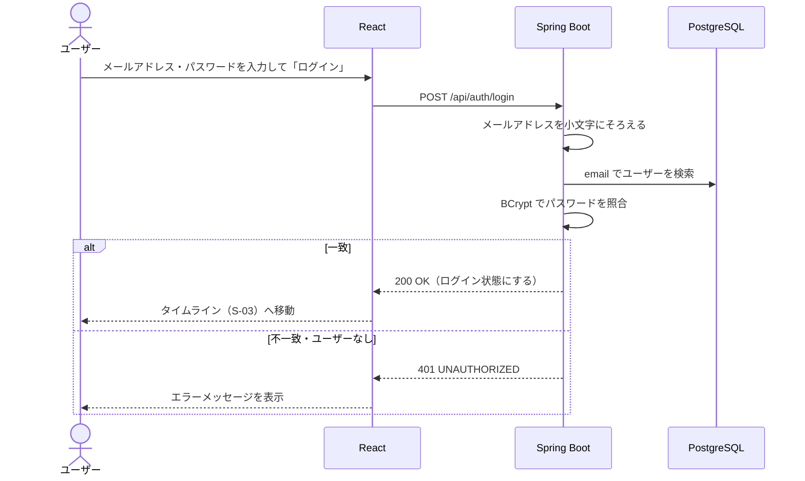

# F-02 ログイン・ログアウト

[← 機能一覧に戻る](../機能一覧.md)

## 概要

メールアドレスとパスワードでログインする。ヘッダーのボタンでログアウトする。

## アクター・前提条件

| 項目 | 内容 |
|---|---|
| アクター | ログイン：未ログインユーザー / ログアウト：ログインユーザー |
| 前提条件 | ログイン：F-01 でアカウントを作ってある |
| 事後条件 | ログイン：ログインした状態になる / ログアウト：ログインしていない状態に戻る |

## 対象画面

- S-01 ログイン
- 共通ヘッダー（ログアウトボタン）

## 入力項目

| 項目 | 必須 | ルール |
|---|---|---|
| メールアドレス | ○ | 空でないこと |
| パスワード | ○ | 空でないこと |

> ログインでは形式や文字数の細かいチェックはしない。間違っていれば「ログイン失敗」になるだけのため。

## 処理の流れ



## 業務ルール

- ログインに失敗したときは「メールアドレスまたはパスワードが正しくありません」と表示する。**どちらが間違っているかは伝えない**（登録済みのメールアドレスを他人に知られないようにするため）
- ログインしていない状態で、ログイン画面・新規登録画面以外を開いたら、ログイン画面へ移動させる
- ログイン中にログイン画面・新規登録画面を開いたら、タイムラインへ移動させる
- 画面を開いたとき（リロードしたとき）は、まず `GET /api/auth/csrf` で CSRF トークンの Cookie を受け取り、次に `GET /api/auth/me` でログイン中かどうかを確認する
- ログイン状態は **JWT** で持つ（[要件定義 14章](../要件定義.md#14-未決事項) の決定済み No.1）。サーバーはセッションを持たない
- ログインに成功したら、次の2つのトークンを **HttpOnly Cookie**（JavaScript から読めない）で渡す

| トークン | 中身 | 有効期限 | Cookie | 送られる先 |
|---|---|---|---|---|
| アクセストークン | JWT（HS256 で署名。`sub`＝ユーザーの id、`username`、`name`、`iat`、`exp`、`iss`＝`raisetime`） | **15分** | `access_token`（SameSite=Lax） | `/api` 全体 |
| リフレッシュトークン | ランダムな値（32バイト） | **7日** | `refresh_token`（SameSite=Strict） | `/api/auth` だけ |

- アクセストークンの期限が切れて API が 401 を返したら、画面は `POST /api/auth/refresh` を呼び、新しいトークンを受け取ってから元の API を呼び直す
- リフレッシュトークンは **使うたびに新しいものに交換する**（ローテーション）。DB にはトークンそのものではなく SHA-256 のハッシュだけを保存する
- **使用済みのリフレッシュトークンがもう一度使われたら**、盗まれた可能性があるとみなし、同じログインから続く系列（family）のトークンをまとめて無効にする。その場合はもう一度ログインしてもらう
- 7日間 refresh が呼ばれなければ（＝操作がなければ）、ログインし直しになる
- ログイン・新規登録に成功したら、CSRF トークンも新しくする
- ログインに失敗したときは、トークンを発行しない
- ログアウトすると、リフレッシュトークンを系列ごと無効にし、両方のトークンの Cookie を消す。アクセストークン（JWT）はサーバーで取り消せないため、盗まれていた場合は最長15分使えてしまう（有効期限を短くしている理由）
- 期限切れのリフレッシュトークンは、毎日4時（UTC）に DB から削除する
- 本番では、トークンの Cookie に `Secure`（HTTPS でだけ送る）を付ける
- ログインしていない状態で、ログインが必要な API を呼ぶと 401 を JSON で返す（ログイン画面へのリダイレクトはしない。画面の切り替えは React が行う）

## API

### GET `/api/auth/csrf`

CSRF トークンを `XSRF-TOKEN` Cookie で発行する。ログインしていなくても呼べる。

レスポンス `204 No Content`（`Set-Cookie: XSRF-TOKEN=...`）

### POST `/api/auth/login`

`X-XSRF-TOKEN` ヘッダーが必要（[共通仕様 2章](./00_共通仕様.md#2-api-の共通ルール)）。

リクエスト

```json
{ "email": "taro@example.com", "password": "password123" }
```

レスポンス `200 OK`

```json
{ "username": "taro_dev", "name": "山田太郎" }
```

### POST `/api/auth/refresh`

`X-XSRF-TOKEN` ヘッダーが必要。`refresh_token` Cookie を使うので、アクセストークンの期限が切れていても呼べる。

レスポンス `200 OK`（新しい `access_token`・`refresh_token` の Cookie を返す）

```json
{ "username": "taro_dev", "name": "山田太郎" }
```

リフレッシュトークンが無い・期限切れ・無効・使用済みのときは `401`（両方のトークンの Cookie を消す）

### POST `/api/auth/logout`

`X-XSRF-TOKEN` ヘッダーが必要。アクセストークンの期限が切れていても呼べる。

レスポンス `204 No Content`（リフレッシュトークンを無効にし、両方のトークンの Cookie を消す）

### GET `/api/auth/me`

レスポンス `200 OK`（アクセストークンが無い・期限切れ・改ざんされていれば `401`）

```json
{ "username": "taro_dev", "name": "山田太郎" }
```

## エラー

| 状況 | ステータス | 表示するメッセージ |
|---|---|---|
| 未入力 | 400 | 「メールアドレスを入力してください」など |
| メールアドレスまたはパスワードが違う（登録されていないメールアドレスも同じ） | 401 | 「メールアドレスまたはパスワードが正しくありません」 |
| CSRF トークンが無い・正しくない | 403 | 「CSRF トークンが無効です。画面を再読み込みしてください」 |
| アクセストークンが無い・期限切れ（me などの API） | 401 | `POST /api/auth/refresh` を呼んでから呼び直す。refresh も 401 ならログイン画面へ移動する |
| リフレッシュトークンが使えない（refresh） | 401 | 「ログインの有効期限が切れました。もう一度ログインしてください」→ ログイン画面へ |

## 使用テーブル

| テーブル | 操作 |
|---|---|
| users | 読む |
| refresh_tokens | 読む・書く（発行・交換・無効化） |
