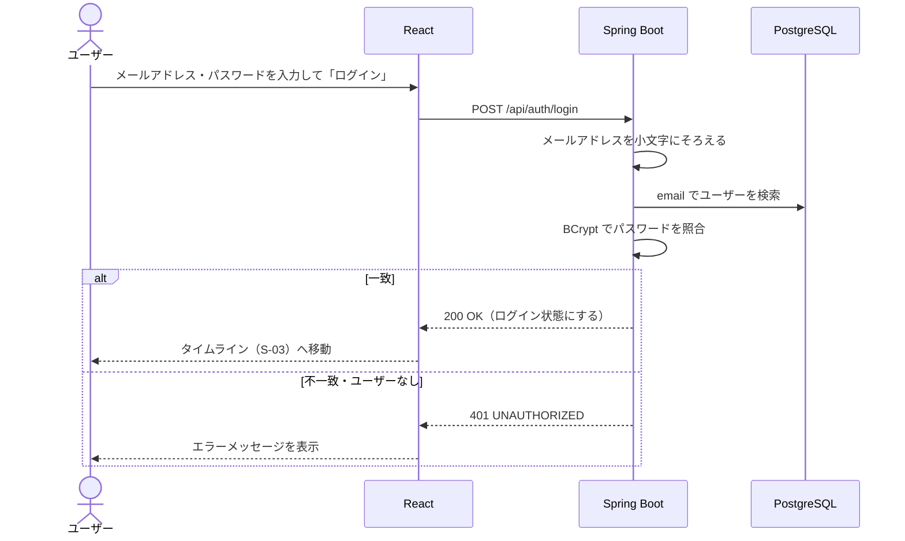

# F-02 ログイン・ログアウト

[← 機能一覧に戻る](../機能一覧.md)

## 概要

メールアドレスとパスワードでログインする。ヘッダーのボタンでログアウトする。

## アクター・前提条件

| 項目 | 内容 |
|---|---|
| アクター | ログイン：未ログインユーザー / ログアウト：ログインユーザー |
| 前提条件 | ログイン：F-01 でアカウントを作ってある |
| 事後条件 | ログイン：ログインした状態になる / ログアウト：ログインしていない状態に戻る |

## 対象画面

- S-01 ログイン
- 共通ヘッダー（ログアウトボタン）

## 入力項目

| 項目 | 必須 | ルール |
|---|---|---|
| メールアドレス | ○ | 空でないこと |
| パスワード | ○ | 空でないこと |

> ログインでは形式や文字数の細かいチェックはしない。間違っていれば「ログイン失敗」になるだけのため。

## 処理の流れ



## 業務ルール

- ログインに失敗したときは「メールアドレスまたはパスワードが正しくありません」と表示する。**どちらが間違っているかは伝えない**（登録済みのメールアドレスを他人に知られないようにするため）
- ログインしていない状態で、ログイン画面・新規登録画面以外を開いたら、ログイン画面へ移動させる
- ログイン中にログイン画面・新規登録画面を開いたら、タイムラインへ移動させる
- 画面を開いたとき（リロードしたとき）は `GET /api/auth/me` でログイン中かどうかを確認する
- ログイン状態はセッション Cookie（HttpOnly）で持つ。セッションは Spring Session JDBC で PostgreSQL に保存する（[要件定義 14章](../要件定義.md#14-未決事項) の決定済み No.1）

## API

### POST `/api/auth/login`

リクエスト

```json
{ "email": "taro@example.com", "password": "password123" }
```

レスポンス `200 OK`

```json
{ "username": "taro_dev", "name": "山田太郎" }
```

### POST `/api/auth/logout`

レスポンス `204 No Content`

### GET `/api/auth/me`

レスポンス `200 OK`（ログインしていなければ `401`）

```json
{ "username": "taro_dev", "name": "山田太郎" }
```

## エラー

| 状況 | ステータス | 表示するメッセージ |
|---|---|---|
| 未入力 | 400 | 「メールアドレスを入力してください」など |
| メールアドレスまたはパスワードが違う | 401 | 「メールアドレスまたはパスワードが正しくありません」 |

## 使用テーブル

| テーブル | 操作 |
|---|---|
| users | 読む |
