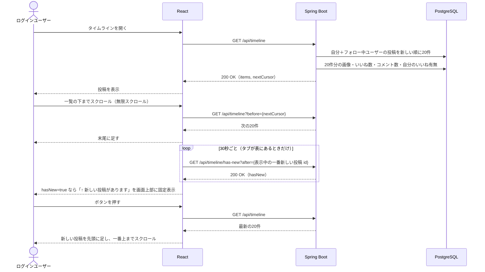

# F-03 タイムライン

[← 機能一覧に戻る](../機能一覧.md)

## 概要

自分の投稿とフォロー中ユーザーの投稿を、新しい順に表示する。ログイン後のトップ画面。

## アクター・前提条件

| 項目 | 内容 |
|---|---|
| アクター | ログインユーザー |
| 前提条件 | ログインしている |

## 対象画面

- S-03 タイムライン

## 入力項目

なし（一覧の下までスクロールしたときは、前回の最後の投稿 id をカーソルとして送る）

## 処理の流れ



## 業務ルール

- 表示するのは**自分の投稿**と**フォロー中ユーザーの投稿**だけ
- 並び順は投稿日時の新しい順。アルゴリズムによる並べ替えはしない
- 1回に20件。古い投稿はカーソル方式で読み込む（[共通仕様 4章](./00_共通仕様.md#4-ページング)）
- **無限スクロール**：一覧の一番下に近づいたら（200px 手前）、自動で次の20件を読み込んで末尾に足す。最後まで読み込んだら「これ以上の投稿はありません」と出す。読み込みに失敗したら自動では読み直さず、「再読み込み」ボタンを出す
- **新しい投稿のお知らせ**：表示中の一番新しい投稿より新しいものがあるかを **30秒ごと** に確かめる
  - あれば「↑ 新しい投稿があります」ボタンを画面上部（ヘッダーのすぐ下）に固定して出す。下にスクロールしていても見える。**件数は出さない**
  - ボタンを出したあとは、押されるまで確かめない。タブが裏にある間は確かめず、表に戻ったらすぐ確かめる
  - 押すと、新しい投稿を先頭に足して一番上までスクロールする。読み込み済みの古い投稿はそのまま残す
  - 新しい投稿が20件より多く、今の一覧とつながらないときは、最新の20件から表示し直す（続きはスクロールで読み込める）
  - 勝手に一覧へ差し込まないのは、読んでいる途中で投稿の位置がずれないようにするため
- 1件の投稿に表示する項目：投稿者名・@ユーザーID・投稿日時（「3分前」などの相対表示）・「編集済み」（編集した投稿のみ）・本文・画像・いいねボタンといいね数・コメント数
- 自分の投稿にだけ「…」メニューを出し、編集（[F-10](./F-10_投稿編集.md)）・削除（[F-11](./F-11_投稿削除.md)）ができるようにする（`isMine` で判定）
- 投稿を編集してもタイムラインの並び順は変わらない（投稿日時の順のまま）
- **インプレッション数とリツイートボタンは表示しない**
- 表示する投稿がないときは「ユーザーを検索してフォローすると、ここに投稿が表示されます」と出し、ユーザー検索（S-07）へのリンクを置く
- いいね数・コメント数は、表示するたびに集計する（20件分をまとめて集計し、N+1 問題を避ける）

## API

### GET `/api/timeline?before={postId}`

| パラメータ | 必須 | 内容 |
|---|---|---|
| before | × | この id より古い投稿を返す。なければ最新から |

レスポンス `200 OK`

```json
{
  "items": [ /* PostResponse（共通仕様 5章） */ ],
  "nextCursor": 1215
}
```

### GET `/api/timeline/has-new?after={postId}`

タイムラインに、指定した id より新しい投稿があるかだけを返す（件数は返さない）。

| パラメータ | 必須 | 内容 |
|---|---|---|
| after | × | この id より新しい投稿があるかを調べる。なければ 0 として扱う |

レスポンス `200 OK`

```json
{ "hasNew": true }
```

## エラー

| 状況 | ステータス | 対応 |
|---|---|---|
| ログインしていない | 401 | ログイン画面へ移動 |
| `before`・`after` が数値でない | 400 | （画面からは起きない） |
| 通信エラー（最初の読み込み・続きの読み込み） | - | 「読み込みに失敗しました」と再読み込みボタンを表示 |
| 通信エラー（新しい投稿の確認） | - | 何も表示しない。30秒後にまた確かめる |

## 使用テーブル

| テーブル | 操作 |
|---|---|
| follows | 読む（フォロー中ユーザーを求める） |
| posts / users / post_images | 読む |
| likes / comments | 読む（件数・自分のいいね有無） |
