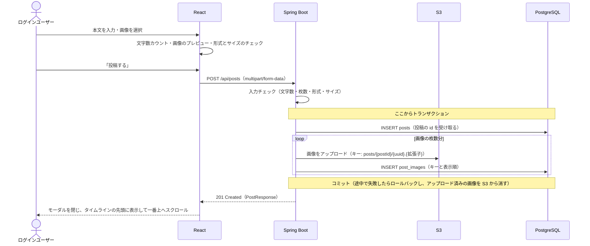

# F-04 投稿作成

[← 機能一覧に戻る](../機能一覧.md)

## 概要

テキストを投稿する。画像を最大4枚まで添付してもよい。画像ファイルは AWS S3 に保存し、DB には S3 のキーだけを保存する。

## アクター・前提条件

| 項目 | 内容 |
|---|---|
| アクター | ログインユーザー |
| 前提条件 | ログインしている |
| 事後条件 | posts に1件、post_images に画像の枚数分が増える。自分のタイムラインの先頭に表示される |

## 対象画面

- S-04 投稿作成・編集（ヘッダーの「投稿」ボタンやタイムライン上部から開くモーダル。作成モードで開く）
- 同じモーダルを編集モードで開くと投稿編集になる（[F-10](./F-10_投稿編集.md)）

## 入力項目

| 項目 | 必須 | ルール |
|---|---|---|
| 本文 | ○ | 1〜280文字（空白だけ・見えない文字だけは不可） |
| 画像 | × | 最大4枚。JPEG / PNG / GIF / WebP。1枚5MBまで |

## 処理の流れ

## 業務ルール

- 画像は、送る前に画面（ブラウザ）で**長い辺を 1600px までに縮めて JPEG にする**（スマホの写真は数MB・数千px あり、そのままだと保存先も表示するときの通信量も大きくなるため）。元の写真が5MBを超えていても、縮めて5MB以下になれば送れる。アニメーション GIF は動きが消えるので縮めずに送る。PNG で、図やスクリーンショットのように JPEG にするとかえって大きくなる画像は、元のファイルを送る（JPEG・WebP は位置情報が入りうるので、必ず作り直す）
- **画像の位置情報（撮影場所の緯度・経度など）は残さない**。保存した画像は誰でもダウンロードできるため、サーバーで保存する前に、JPEG の EXIF・XMP・IPTC・コメント、PNG の eXIf・テキストチャンク、WebP の EXIF・XMP を取り除く（画素のデータは変えない）。画面でも JPEG・WebP は作り直してから送る。GIF は位置情報を入れる仕組みがないのでそのまま。投稿編集（F-10）・プロフィール画像（F-12）も同じ
- 画像の形式は、ファイル名の拡張子だけでなく**ファイルの中身（先頭のバイト）でも確認する**（拡張子を書き換えただけのファイルを弾くため）
- S3 のキーには推測されにくい UUID を使う。元のファイル名は使わない
- キーに投稿の id を入れるため、先に posts に保存して id を受け取ってから、画像を S3 にアップロードし、post_images に保存する。これらは1つのトランザクションで行い、途中で失敗してロールバックされたら、アップロード済みの画像を S3 から消す（S3 にゴミを残さない）
- 入力チェック（文字数・枚数・形式・サイズ）は、DB に保存する前にすべて済ませる
- EC2 から S3 へは IAM ロールでアクセスする（アクセスキーはコードに書かない）
- 開発中は、S3 の代わりに Docker Compose の Adobe S3Mock（`http://localhost:9090`）を使う。画像は `http://localhost:9090/raisetime-images/{キー}` で見られる
- 画像の表示 URL は、S3 のキーから組み立てる（CloudFront 経由。[インフラ構成図](../インフラ構成図.md)）
- 投稿中は「投稿する」ボタンを押せなくして、2重投稿を防ぐ
- 投稿詳細などタイムライン以外の画面で投稿したときは、投稿後にタイムラインへ移る（自分の投稿が見えるように）
- 本文が空、または280文字を超えているときは「投稿する」ボタンを押せなくする
- 文字数は絵文字も1文字と数える（[要件定義 11章](../要件定義.md#11-非機能要件)）
- 改行は1文字と数え、LF（`\n`）にそろえて保存する。ブラウザは multipart/form-data で送るときに改行を CRLF（`\r\n`）に変えるため、サーバーで LF に直してからチェックする（そのままだと、画面では280文字なのにサーバーでは超えてしまう）。投稿編集（F-10）・プロフィール編集（F-12）も同じ
- 「空白だけ」には、改行しないスペース（U+00A0 など）やゼロ幅スペース（U+200B など）といった**見えない文字だけ**の本文も含める（見た目が空の投稿を防ぐ）。画面・バックエンドで同じ判定にする

## API

### POST `/api/posts`

リクエスト（`multipart/form-data`）

| パート | 必須 | 内容 |
|---|---|---|
| body | ○ | 本文 |
| images | × | 画像ファイル（最大4つ。送った順が表示順になる） |

レスポンス `201 Created`：PostResponse（[共通仕様 5章](./00_共通仕様.md#5-投稿の共通レスポンスpostresponse)）

## エラー

| 状況 | ステータス | 表示するメッセージ |
|---|---|---|
| 本文が空・280文字超え | 400 | 「本文は1〜280文字で入力してください」 |
| 画像が5枚以上 | 400 | 「画像は4枚まで添付できます」 |
| 画像の形式が違う | 400 | 「JPEG・PNG・GIF・WebP の画像を選んでください」 |
| 画像が5MBを超える | 413 | 「画像は1枚5MBまでです」 |
| S3 へのアップロード失敗 | 500 | 「投稿に失敗しました。時間をおいてもう一度お試しください」 |
| `body` が無い・multipart 以外の形式で送った | 400 / 415 | - |
| CSRF トークンが無い・正しくない | 403 | 「CSRF トークンが無効です。画面を再読み込みしてください」 |

- 400 のときは、どの項目かを `errors[].field`（`body` / `images`）で返す
- 1回のリクエストの上限は 21MB（5MB × 4枚＋本文）。1枚5MB を超えるファイルは、Spring が読み込む段階で 413 になる

## 使用テーブル

| テーブル | 操作 |
|---|---|
| posts | 書く（INSERT） |
| post_images | 書く（INSERT） |
