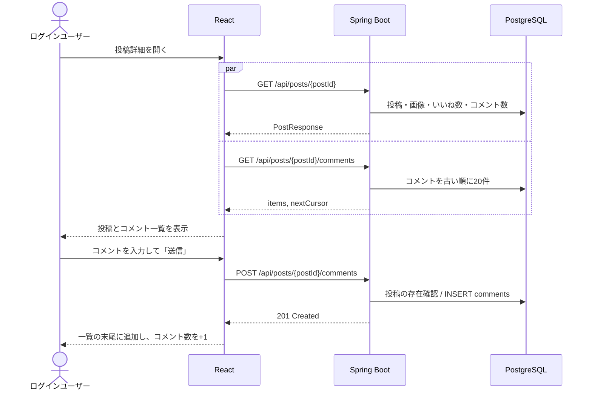

# F-05 コメント

[← 機能一覧に戻る](../機能一覧.md)

## 概要

投稿詳細画面で、投稿1件とそのコメント一覧を表示し、コメントを書き込む。自分の投稿にも他人の投稿にもコメントできる。

## アクター・前提条件

| 項目 | 内容 |
|---|---|
| アクター | ログインユーザー |
| 前提条件 | ログインしている。コメント先の投稿が存在する |
| 事後条件 | comments に1件増え、投稿のコメント数が1増える |

## 対象画面

- S-05 投稿詳細（タイムライン・ユーザーページの投稿本文やコメント数から開く）

## 入力項目

| 項目 | 必須 | ルール |
|---|---|---|
| コメント本文 | ○ | 1〜280文字（空白だけは不可）。テキストのみ（画像は付けられない） |

## 処理の流れ



## 業務ルール

- コメント一覧は**古い順**に表示する（会話の流れで読めるように）。21件目以降は「もっと見る」で読み込む
- 1件のコメントに表示する項目：コメントした人の名前・@ユーザーID・日時・本文
- コメントした人の名前を押すと、その人のユーザーページ（S-06）へ移動する
- コメントへの返信（スレッド）やコメントへのいいねは作らない
- コメントの編集・削除は作らない（今後の検討事項）。コメントが付いた投稿が削除されると、コメントも一緒に消える（[F-11](./F-11_投稿削除.md)）
- 投稿詳細画面の投稿が自分のものなら「…」メニューを出し、編集・削除ができるようにする。ここで削除したらタイムラインへ戻る
- 送信中は「送信」ボタンを押せなくして、2重送信を防ぐ

## API

### GET `/api/posts/{postId}`

レスポンス `200 OK`：PostResponse（[共通仕様 5章](./00_共通仕様.md#5-投稿の共通レスポンスpostresponse)）

### GET `/api/posts/{postId}/comments?after={commentId}`

コメントは古い順のため、カーソルは「この id より新しいもの」（`after`）にする。

レスポンス `200 OK`

```json
{
  "items": [
    {
      "id": 88,
      "body": "おつかれさま！",
      "createdAt": "2026-09-26T11:40:00Z",
      "author": { "username": "hanako", "name": "佐藤花子" }
    }
  ],
  "nextCursor": null
}
```

### POST `/api/posts/{postId}/comments`

リクエスト

```json
{ "body": "おつかれさま！" }
```

レスポンス `201 Created`：作成したコメント（上の items の1件と同じ形）

## エラー

| 状況 | ステータス | 表示するメッセージ |
|---|---|---|
| 本文が空・280文字超え | 400 | 「コメントは1〜280文字で入力してください」 |
| 投稿が存在しない | 404 | 「投稿が見つかりません」 |

## 使用テーブル

| テーブル | 操作 |
|---|---|
| posts / post_images / likes | 読む |
| comments | 読む・書く（INSERT） |
| users | 読む（コメントした人の名前） |
