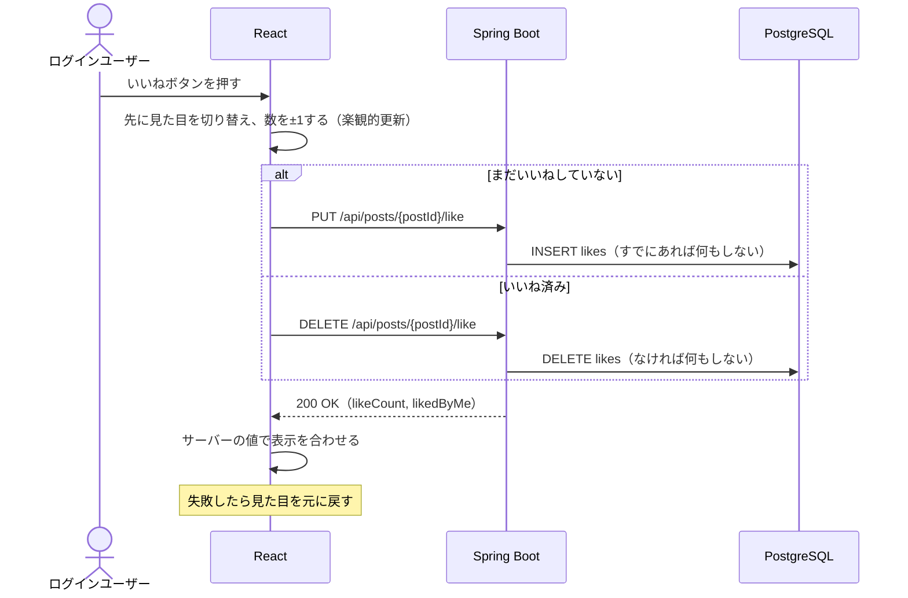

# F-06 いいね

[← 機能一覧に戻る](../機能一覧.md)

## 概要

投稿にいいね／いいね解除をする。いいね数は誰にでも見える。

## アクター・前提条件

| 項目 | 内容 |
|---|---|
| アクター | ログインユーザー |
| 前提条件 | ログインしている。対象の投稿が存在する |
| 事後条件 | いいね：likes に1件増える / 解除：likes から1件消える |

## 対象画面

- S-03 タイムライン
- S-05 投稿詳細
- S-06 ユーザーページ

## 入力項目

なし（いいねボタンを押すだけ）

## 処理の流れ



## 業務ルール

- 1人のユーザーが1つの投稿にいいねできるのは**1回だけ**（DB の UNIQUE 制約でも防ぐ）
- いいね済みの投稿でボタンを押すと、いいねを解除する（トグル）
- いいね済みかどうかがボタンの見た目で分かるようにする（例：塗りつぶしたハート）
- 自分の投稿にもいいねできる
- 誰がいいねしたかの一覧は作らない（数だけ表示する）
- `PUT` / `DELETE` を使い、何度送っても結果が同じ（冪等）になるようにする。連打や通信の再送があっても数がずれない
- ボタンを押したらすぐに見た目を変える（楽観的更新）。失敗したら元に戻し、「いいねできませんでした」と表示する

## API

### PUT `/api/posts/{postId}/like`

### DELETE `/api/posts/{postId}/like`

レスポンス（どちらも） `200 OK`

```json
{ "likeCount": 13, "likedByMe": true }
```

## エラー

| 状況 | ステータス | 表示するメッセージ |
|---|---|---|
| 投稿が存在しない | 404 | 「投稿が見つかりません」 |
| 通信エラー | - | 見た目を元に戻し、「いいねできませんでした」 |

## 使用テーブル

| テーブル | 操作 |
|---|---|
| posts | 読む（存在確認） |
| likes | 読む・書く（INSERT / DELETE） |
