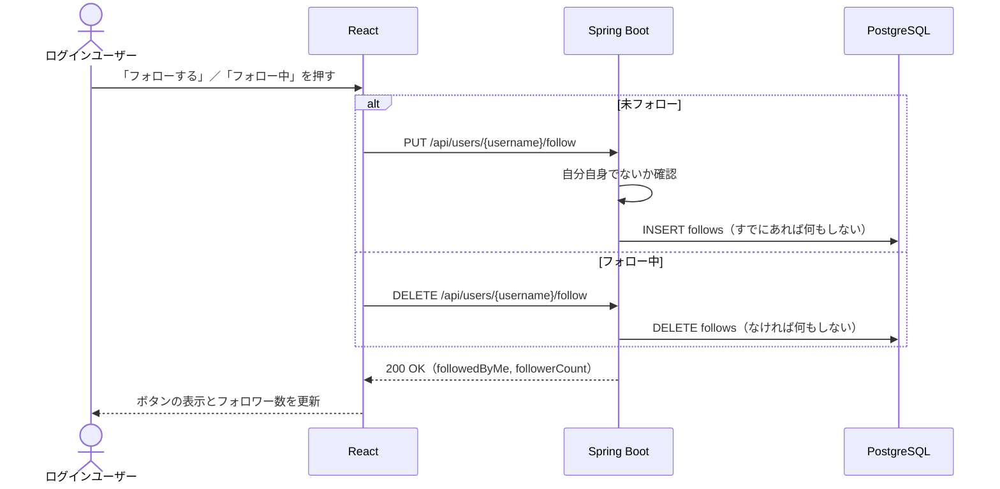

# F-07 フォロー

[← 機能一覧に戻る](../機能一覧.md)

## 概要

他のユーザーをフォロー／フォロー解除する。フォローしたユーザーの投稿は、自分のタイムラインに表示されるようになる。

## アクター・前提条件

| 項目 | 内容 |
|---|---|
| アクター | ログインユーザー |
| 前提条件 | ログインしている。フォローする相手が存在する |
| 事後条件 | フォロー：follows に1件増え、相手の投稿がタイムラインに出る / 解除：follows から1件消え、相手の投稿がタイムラインから消える |

## 対象画面

- S-06 ユーザーページ
- S-07 ユーザー検索（検索結果の各行）

フォローしたい相手は、ユーザー検索（[F-09](./F-09_ユーザー検索.md)）や、投稿・コメントの名前から探す。

## 入力項目

なし（フォローボタンを押すだけ）

## 処理の流れ



## 業務ルール

- **自分自身はフォローできない**（自分のページ・自分の検索結果にはフォローボタンを出さない。API でも拒否し、DB の CHECK 制約でも防ぐ）
- 同じユーザーを2回フォローできない（DB の UNIQUE 制約でも防ぐ）
- フォローに相手の承認はいらない（鍵アカウントの機能はない）
- ボタンの表示：未フォローなら「フォローする」、フォロー中なら「フォロー中」。フォロー中のボタンにマウスを乗せると「フォロー解除」と表示する
- フォロー解除は確認なしですぐ行う（また押せばフォローし直せるため）
- `PUT` / `DELETE` で冪等にする（[F-06](./F-06_いいね.md) と同じ考え方）
- フォロー／フォロワーの一覧画面は作らない（数だけ表示する）

## API

### PUT `/api/users/{username}/follow`

### DELETE `/api/users/{username}/follow`

レスポンス（どちらも） `200 OK`

```json
{ "followedByMe": true, "followerCount": 16 }
```

## エラー

| 状況 | ステータス | 表示するメッセージ |
|---|---|---|
| 自分自身をフォロー（またはフォロー解除）しようとした | 400 | 「自分自身はフォローできません」 |
| CSRF トークンが無い・正しくない | 403 | 「CSRF トークンが無効です。画面を再読み込みしてください」 |
| ユーザーが存在しない | 404 | 「ユーザーが見つかりません」 |

## 使用テーブル

| テーブル | 操作 |
|---|---|
| users | 読む（username から id を求める） |
| follows | 読む・書く（INSERT / DELETE） |
