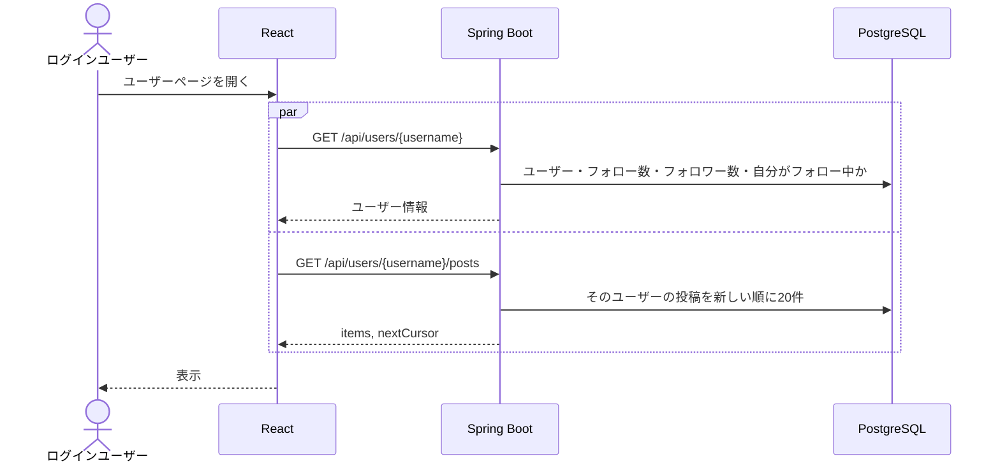

# F-08 ユーザーページ

[← 機能一覧に戻る](../機能一覧.md)

## 概要

特定ユーザーの名前・@ユーザーID・フォロー数・フォロワー数と、そのユーザーの投稿一覧を表示する。他人のページではフォローボタンを出す。

## アクター・前提条件

| 項目 | 内容 |
|---|---|
| アクター | ログインユーザー |
| 前提条件 | ログインしている。表示するユーザーが存在する |

## 対象画面

- S-06 ユーザーページ（URL：`/users/{username}`）

開き方

- タイムライン・投稿詳細の投稿者名
- 投稿詳細のコメントした人の名前
- ユーザー検索の結果
- ヘッダーの「マイページ」（自分のページ）

## 入力項目

なし

## 処理の流れ



## 業務ルール

- 表示する項目：名前・@ユーザーID・フォロー数・フォロワー数・フォローボタン・投稿一覧
- フォローボタンは**他人のページにだけ**出す（自分のページには出さない）
- 投稿一覧の並び順と表示項目はタイムライン（[F-03](./F-03_タイムライン.md)）と同じ。自分のページでは各投稿に「…」メニュー（編集・削除）を出す
- フォローしていないユーザーのページも見られる（投稿は公開されている）
- 存在しない @ユーザーID の URL を開いたら「ユーザーが見つかりません」と表示する

## API

### GET `/api/users/{username}`

レスポンス `200 OK`

```json
{
  "username": "taro_dev",
  "name": "山田太郎",
  "followingCount": 8,
  "followerCount": 15,
  "followedByMe": false,
  "isMe": false
}
```

### GET `/api/users/{username}/posts?before={postId}`

レスポンス `200 OK`

```json
{
  "items": [ /* PostResponse（共通仕様 5章） */ ],
  "nextCursor": 530
}
```

## エラー

| 状況 | ステータス | 表示するメッセージ |
|---|---|---|
| ユーザーが存在しない | 404 | 「ユーザーが見つかりません」 |

## 使用テーブル

| テーブル | 操作 |
|---|---|
| users | 読む |
| follows | 読む（フォロー数・フォロワー数・自分がフォロー中か） |
| posts / post_images / likes / comments | 読む |
