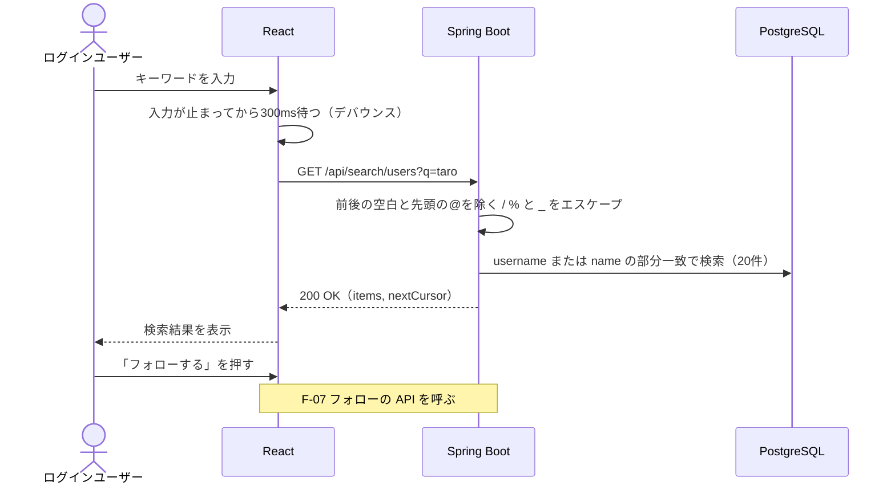

# F-09 ユーザー検索

[← 機能一覧に戻る](../機能一覧.md)

## 概要

@ユーザーID または名前の部分一致で、フォローしたいユーザーを探す。検索結果からそのままフォローしたり、ユーザーページを開いたりできる。

## アクター・前提条件

| 項目 | 内容 |
|---|---|
| アクター | ログインユーザー |
| 前提条件 | ログインしている |

## 対象画面

- S-07 ユーザー検索（ヘッダーの「検索」、タイムラインが空のときのリンクから開く）

## 入力項目

| 項目 | 必須 | ルール |
|---|---|---|
| 検索キーワード | ○ | 前後の空白を除いて1〜50文字。先頭の `@` は取り除いて検索する（`@taro` でも `taro` でも同じ結果）。見えない文字だけ（ゼロ幅スペースなど）・制御文字（NUL 文字・改行・タブなど）を含むキーワードは不可 |

## 処理の流れ



## 業務ルール

- 検索の対象は **@ユーザーID（username）と名前（name）**。どちらかに部分一致すれば結果に出す
- 大文字・小文字は区別しない（`ILIKE` を使う。@ユーザーID は小文字だけなので、キーワードも小文字にそろえて比べる）
- 並び順：
  1. @ユーザーID が完全に一致するもの
  2. @ユーザーID が前方一致するもの
  3. それ以外（@ユーザーID の部分一致、または名前の部分一致）
  - 同じ順位の中では @ユーザーID の昇順（文字コード順。DB の照合順序によって「_」の位置が変わらないよう `COLLATE "C"` で固定する）
- 1回に20件。21件目以降は**無限スクロール**で読み込む（下までスクロールすると自動で次の20件。タイムラインなどと同じ）
- 検索結果の1行に表示する項目：アイコン・名前・@ユーザーID・フォローボタン
  - 自分も検索結果に出すが、フォローボタンは出さず「あなた」と表示する
- 名前か @ユーザーID を押すと、ユーザーページ（S-06）へ移動する
- キーワード中の `%` と `_`（と、エスケープに使う `\`）は、LIKE の特殊文字として扱われないようにエスケープする（例：`_` で検索すると全員がヒットしてしまうのを防ぐ）
- 入力のたびに API を呼ぶと負荷が高いため、入力が300ミリ秒止まってから検索する（デバウンス）
- 該当者がいないときは「該当するユーザーが見つかりません」と表示する
- 投稿本文の検索は作らない（今後の検討事項）

> 並び順に順位を付けるため、この検索のページングは id のカーソルではなく「何件目から」（`offset`）で行う。検索結果は投稿のように次々と増えないため、ずれはほとんど起きない。

## API

### GET `/api/search/users?q={keyword}&offset={n}`

> 仕様を決めた当初は `/api/users/search` だったが、ユーザー情報の `GET /api/users/{username}` とぶつかり、@ユーザーID が「search」の人のページが開けなくなるため、`/api/search/users` にした。

| パラメータ | 必須 | 内容 |
|---|---|---|
| q | ○ | 検索キーワード |
| offset | × | 何件目から返すか（既定値 0） |

レスポンス `200 OK`

```json
{
  "items": [ /* UserSummary（共通仕様 6章） */ ],
  "nextOffset": 20
}
```

- `nextOffset` が `null` なら、それ以上結果はない

## エラー

| 状況 | ステータス | 表示するメッセージ |
|---|---|---|
| キーワードが空・50文字超え・見えない文字だけ・制御文字を含む | 400 | 検索はせず、入力欄はそのまま（空なら結果欄に何も出さない） |
| `offset` が数値でない・負 | 400 | （画面からは起きない） |
| ログインしていない | 401 | ログイン画面へ移動 |

## 使用テーブル

| テーブル | 操作 |
|---|---|
| users | 読む（username / name の部分一致） |
| follows | 読む（自分がフォロー中か） |

> 部分一致（`ILIKE '%taro%'`）は通常のインデックスが効かないため、PostgreSQL の `pg_trgm` 拡張の GIN インデックスを使う（[ER図 3章](../ER図.md#3-インデックス)）。
