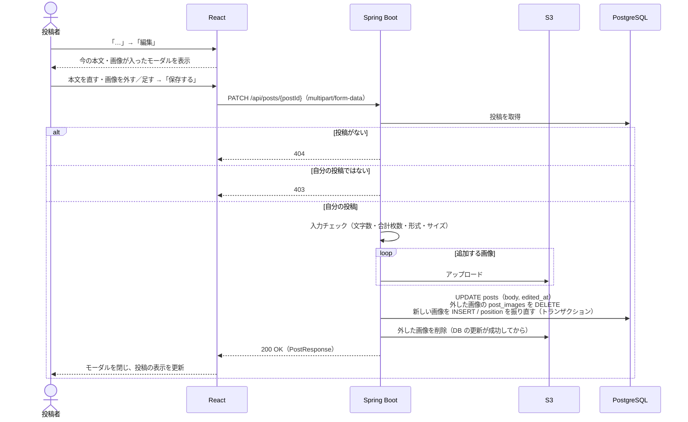

# F-10 投稿編集

[← 機能一覧に戻る](../機能一覧.md)

## 概要

自分の投稿の本文と画像を、あとから変更する。変更した投稿には「編集済み」と表示する。

## アクター・前提条件

| 項目 | 内容 |
|---|---|
| アクター | ログインユーザー（投稿者本人） |
| 前提条件 | ログインしている。編集する投稿が存在し、自分の投稿である |
| 事後条件 | posts の本文と `edited_at` が更新される。画像を変えた場合は post_images と S3 の画像も入れ替わる |

## 対象画面

- S-04 投稿作成・編集（モーダル）を「編集モード」で開く
- 開き方：自分の投稿の「…」メニュー →「編集」（S-03 タイムライン / S-05 投稿詳細 / S-06 ユーザーページ）

## 入力項目

| 項目 | 必須 | ルール |
|---|---|---|
| 本文 | ○ | 1〜280文字（空白だけは不可）。今の本文が入った状態で開く |
| 残す画像 | × | 今付いている画像のうち、残すもの（×で外せる） |
| 追加する画像 | × | JPEG / PNG / GIF / WebP、1枚5MBまで。**残す画像と合わせて最大4枚** |

## 処理の流れ

## 業務ルール

- **編集できるのは投稿者本人だけ**。画面では他人の投稿に「…」メニューを出さず、API でも投稿者かどうかを必ず確認する（画面を隠すだけでは、API を直接呼ばれると編集できてしまうため）
- 編集できるのは本文と画像。投稿日時（`created_at`）は変えない。タイムラインの並び順も変わらない
- 編集した投稿には、投稿日時の横に「編集済み」と表示する（`edited_at` に値があるとき）
- 本文も画像も変わっていないときは「保存する」ボタンを押せなくする
- 編集できる期間・回数に制限は設けない。編集履歴は残さない（最新の内容だけ持つ）
- いいね・コメントは編集後もそのまま残す
- 画像の入れ替えは、**DB の更新が成功してから** S3 の古い画像を消す。S3 の削除に失敗しても投稿の編集は成功扱いにし、ログに残す（画面には影響しないため）
- 追加した画像のアップロード後に DB の更新が失敗したら、アップロードした画像を S3 から消す
- 保存中は「保存する」ボタンを押せなくして、2重送信を防ぐ

## API

### PATCH `/api/posts/{postId}`

リクエスト（`multipart/form-data`）

| パート | 必須 | 内容 |
|---|---|---|
| body | ○ | 編集後の本文 |
| keepImageIds | × | 残す画像の id（複数可）。送らなかった既存の画像は削除する |
| images | × | 追加する画像ファイル |

- 表示順は「残す画像（送った順）→ 追加する画像（送った順）」で 1〜4 に振り直す

レスポンス `200 OK`：PostResponse（[共通仕様 5章](./00_共通仕様.md#5-投稿の共通レスポンスpostresponse)。`editedAt` に日時が入る）

## エラー

| 状況 | ステータス | 表示するメッセージ |
|---|---|---|
| 本文が空・280文字超え | 400 | 「本文は1〜280文字で入力してください」 |
| 画像が合計5枚以上 | 400 | 「画像は4枚まで添付できます」 |
| 画像の形式が違う | 400 | 「JPEG・PNG・GIF・WebP の画像を選んでください」 |
| 画像が5MBを超える | 413 | 「画像は1枚5MBまでです」 |
| 自分の投稿ではない | 403 | 「この投稿は編集できません」 |
| 投稿が存在しない（編集中に削除された など） | 404 | 「投稿が見つかりません」 |

## 使用テーブル

| テーブル | 操作 |
|---|---|
| posts | 読む・書く（UPDATE） |
| post_images | 読む・書く（INSERT / DELETE / UPDATE） |
