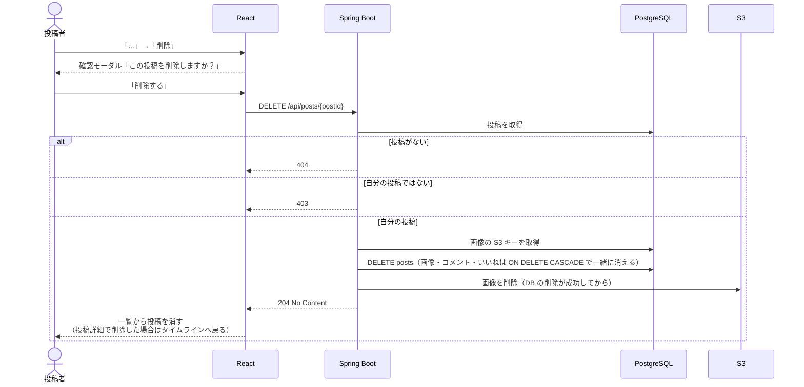

# F-11 投稿削除

[← 機能一覧に戻る](../機能一覧.md)

## 概要

自分の投稿を削除する。削除した投稿は、付いていた画像・コメント・いいねと一緒に消え、元に戻せない。

## アクター・前提条件

| 項目 | 内容 |
|---|---|
| アクター | ログインユーザー（投稿者本人） |
| 前提条件 | ログインしている。削除する投稿が存在し、自分の投稿である |
| 事後条件 | posts から1件消え、その投稿の post_images・comments・likes も消える。S3 の画像ファイルも消える |

## 対象画面

- S-08 投稿削除の確認（モーダル）
- 開き方：自分の投稿の「…」メニュー →「削除」（S-03 タイムライン / S-05 投稿詳細 / S-06 ユーザーページ）

## 入力項目

なし（確認モーダルで「削除する」を押すだけ）

## 処理の流れ

## 業務ルール

- **削除できるのは投稿者本人だけ**。画面では他人の投稿に「…」メニューを出さず、API でも投稿者かどうかを必ず確認する
- 削除する前に必ず確認モーダルを出す（元に戻せないため）
- DB からは完全に消す（物理削除）。「削除済み」のフラグを立てて残す方法（論理削除）は採用しない
- 他の人が付けたコメント・いいねも一緒に消える。確認モーダルにもそのことを書く
- S3 の画像は、**DB の削除が成功してから**消す。S3 の削除に失敗しても投稿の削除は成功扱いにし、消せなかったキーをログに残す（画面からは見えなくなるため）
- すでに削除された投稿を開いたり、いいね・コメントしようとしたりしたら 404 を返し、「投稿が見つかりません」と表示する
- 削除中は「削除する」ボタンを押せなくする

## API

### DELETE `/api/posts/{postId}`

レスポンス `204 No Content`

## エラー

| 状況 | ステータス | 表示するメッセージ |
|---|---|---|
| 自分の投稿ではない | 403 | 「この投稿は削除できません」 |
| 投稿が存在しない（すでに削除されている など） | 404 | 「投稿が見つかりません」（画面からもその投稿を消す） |

## 使用テーブル

| テーブル | 操作 |
|---|---|
| posts | 読む・書く（DELETE） |
| post_images | 読む（S3 キー）・書く（CASCADE で DELETE） |
| comments / likes | 書く（CASCADE で DELETE） |
