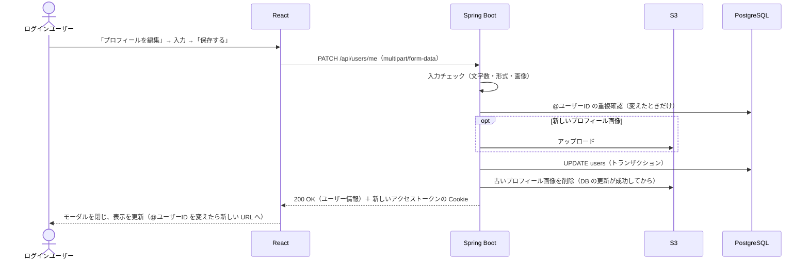

# F-12 プロフィール編集

[← 機能一覧に戻る](../機能一覧.md)

## 概要

自分のプロフィール（表示名・@ユーザーID・自己紹介文・プロフィール画像）を変更する。プロフィール画像は、アイコンが出る場所（ユーザーページ・投稿・コメント・投稿欄）すべてに表示する。

## アクター・前提条件

| 項目 | 内容 |
|---|---|
| アクター | ログインユーザー（本人） |
| 前提条件 | ログインしている |
| 事後条件 | users の name・username・bio・avatar_key が更新される。プロフィール画像を変えた・外した場合は、古い画像が S3 から消える |

## 対象画面

- S-09 プロフィール編集（モーダル）。開き方：自分のユーザーページ（S-06）の「プロフィールを編集」

## 入力項目

| 項目 | 必須 | ルール |
|---|---|---|
| 表示名 | ○ | 1〜50文字（前後の空白は取り除く。空白・見えない文字だけは不可）。重複してもよい（[F-01](./F-01_新規登録.md) と同じ） |
| @ユーザーID | ○ | 3〜15文字。半角英小文字・数字・`_` のみ。**ほかのユーザーと重複できない**（F-01 と同じ） |
| 自己紹介文 | × | 160文字まで（絵文字も1文字、改行も1文字）。改行してよい。空でもよい。改行は LF にそろえて保存する（[F-04](./F-04_投稿作成.md) と同じ） |
| プロフィール画像 | × | JPEG / PNG / GIF / WebP、5MBまで（投稿の画像と同じく、ファイルの中身で判定する）。外すこともできる |

## 処理の流れ



## 業務ルール

- 編集できるのは自分のプロフィールだけ（API は `/api/users/me` で、ログイン中のユーザーを対象にする）
- **@ユーザーID も変更できる**（F-01 の「登録後は変更できない」を変更した）。変えると、古い @ユーザーID の URL（`/users/古いID`）は「ユーザーが見つかりません」になる。投稿・コメント・フォローはそのまま引き継がれる（DB は内部の id でつながっているため）
- アクセストークン（JWT）には @ユーザーID と表示名が入っているので、変更後は新しい値でアクセストークンを作り直し、Cookie を差し替える
- プロフィール画像の S3 のキーは `avatars/{user_id}/{UUID}.{拡張子}`。元のファイル名は使わない
- 古いプロフィール画像は、**DB の更新が成功してから** S3 から消す。消せなくても編集は成功扱いにし、ログに残す。アップロードしたあとに DB の更新が失敗したら、アップロードした画像を消す
- プロフィール画像を設定していない人は、これまでどおり名前の1文字目を色つきの丸で表示する
- 投稿・コメントの投稿者の名前・プロフィール画像は、表示するたびに users から取る（変更すると過去の投稿・コメントにも反映される）

## API

### PATCH `/api/users/me`

リクエスト（`multipart/form-data`）

| パート | 必須 | 内容 |
|---|---|---|
| name | ○ | 表示名 |
| username | ○ | @ユーザーID |
| bio | × | 自己紹介文（送らなければ空） |
| avatar | × | 新しいプロフィール画像 |
| removeAvatar | × | `true` ならプロフィール画像を外す（avatar を送ったときは avatar が優先） |

レスポンス `200 OK`（ユーザーページと同じ形。[F-08](./F-08_ユーザーページ.md)）

```json
{
  "username": "taro_dev",
  "name": "山田太郎",
  "bio": "Spring Boot と React を勉強中",
  "avatarUrl": "https://example.com/images/avatars/1/3f2a....png",
  "followingCount": 8,
  "followerCount": 15,
  "followedByMe": false,
  "isMe": true
}
```

## エラー

| 状況 | ステータス | 表示するメッセージ |
|---|---|---|
| 表示名が空・50文字超え | 400 | 「名前は1〜50文字で入力してください」 |
| @ユーザーID の形式が違う | 400 | 「@ユーザーIDは3〜15文字の半角英小文字・数字・_で入力してください」 |
| 自己紹介文が160文字超え | 400 | 「自己紹介は160文字以内で入力してください」 |
| 画像の形式が違う | 400 | 「JPEG・PNG・GIF・WebP の画像を選んでください」 |
| 画像が5MBを超える | 413 | 「画像は1枚5MBまでです」 |
| @ユーザーID がほかの人と重複 | 409 | 「この@ユーザーIDはすでに使われています」 |
| ログインしていない | 401 | ログイン画面へ移動 |

## 使用テーブル

| テーブル | 操作 |
|---|---|
| users | 読む・書く（UPDATE） |
