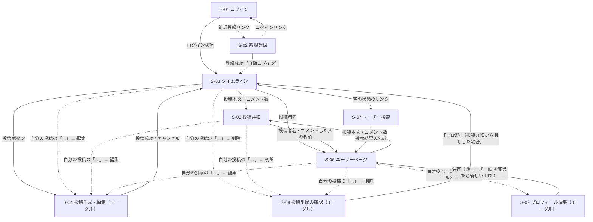

# 画面設計

[← 要件定義に戻る](./要件定義.md)

ログイン前の2画面と、ログイン後の6画面（うち投稿作成・編集と投稿削除の確認はモーダル）で構成する。

## 1. 画面一覧

| No | 画面ID | 画面名 | 種別 | URL | 内容 | 関連機能 | ログイン |
|---|---|---|---|---|---|---|---|
| 1 | S-01 | ログイン | メイン画面 | `/login` | メールアドレスとパスワードでログインする | F-02 | 不要 |
| 2 | S-02 | 新規登録 | メイン画面 | `/signup` | 名前・@ユーザーID・メールアドレス・パスワードでアカウントを作る | F-01 | 不要 |
| 3 | S-03 | タイムライン | メイン画面 | `/` | 自分とフォロー中ユーザーの投稿一覧（ログイン後のトップ） | F-03, F-06 | 必要 |
| 4 | S-04 | 投稿作成・編集 | モーダル | （開いている画面の上に表示） | テキストと画像を入力して投稿する。自分の投稿を編集するときも同じモーダルを使う | F-04, F-10 | 必要 |
| 5 | S-05 | 投稿詳細 | メイン画面 | `/posts/{postId}` | 投稿1件と、そのコメント一覧・コメント入力欄 | F-05, F-06 | 必要 |
| 6 | S-06 | ユーザーページ | メイン画面 | `/users/{username}` | 特定ユーザーのプロフィール・投稿一覧とフォローボタン（自分のページでは「プロフィールを編集」） | F-06, F-07, F-08, F-12 | 必要 |
| 7 | S-07 | ユーザー検索 | メイン画面 | `/search` | @ユーザーID・名前でユーザーを探してフォローする | F-07, F-09 | 必要 |
| 8 | S-08 | 投稿削除の確認 | モーダル | （開いている画面の上に表示） | 自分の投稿を削除する前に確認する | F-11 | 必要 |
| 9 | S-09 | プロフィール編集 | モーダル | （ユーザーページの上に表示） | 自分の表示名・@ユーザーID・自己紹介文・プロフィール画像を変更する | F-12 | 必要 |

## 2. 画面遷移図



- 点線は自分の投稿にだけ出る「…」メニューからの操作。編集・削除が終わったら、開いていた画面に戻る（投稿詳細で削除した場合だけタイムラインへ戻る）

ヘッダー（ホーム／検索／マイページ／投稿／ログアウト）はログイン後の全画面に共通で表示するため、図には書いていない。ヘッダーからは次の画面へ移動できる。

| ヘッダーの項目 | 移動先 |
|---|---|
| ホーム | S-03 タイムライン |
| 検索 | S-07 ユーザー検索 |
| マイページ | S-06 ユーザーページ（自分） |
| 投稿 | S-04 投稿作成・編集（モーダル） |
| ログアウト | S-01 ログイン |

## 3. 共通ヘッダー

```
+----------------------------------------------------------------+
| [ロゴ]      [ホーム] [検索] [マイページ] [投稿] [ログアウト]           |
+----------------------------------------------------------------+
```

- 「検索」はユーザー検索（F-09）を作るときに足す。現在は ホーム・マイページ・投稿・ログアウト の4つ
- 「マイページ」は自分のユーザーページ（S-06、`/users/{自分の@ユーザーID}`）へのリンク
- 今いるページ（ホーム・マイページ）のボタンは太字にする（他の人のユーザーページではマイページは太字にしない）
- スマートフォンでも画面上部に表示する。狭い画面（〜420px）では文字と余白を小さくし、さらに狭い画面（〜360px）ではロゴを隠して、ボタンが横にはみ出さないようにする（画面下部のアイコンナビゲーションは今後の検討）

## 4. 各画面の設計

### S-01 ログイン

```
+-----------------------------+
|           [ロゴ]            |
|                             |
|  メールアドレス              |
|  [_______________________]  |
|  パスワード                  |
|  [_______________________]  |
|                             |
|  (エラーメッセージ)          |
|        [ ログイン ]          |
|                             |
|  アカウントをお持ちでない方は  |
|        新規登録              |
+-----------------------------+
```

| 要素 | 種類 | 内容 |
|---|---|---|
| メールアドレス | 入力 | 必須 |
| パスワード | 入力（伏せ字） | 必須 |
| エラーメッセージ | テキスト | 「メールアドレスまたはパスワードが正しくありません」 |
| ログインボタン | ボタン | 成功したら S-03 へ |
| 新規登録 | リンク | S-02 へ |

### S-02 新規登録

```
+-----------------------------+
|           [ロゴ]            |
|        アカウント作成         |
|                             |
|  名前                        |
|  [_______________________]  |
|  @ユーザーID（3〜15文字）     |
|  [@______________________]  |
|  (この@ユーザーIDはすでに     |
|   使われています)            |
|  メールアドレス              |
|  [_______________________]  |
|  パスワード（8〜64文字）      |
|  [_______________________]  |
|  パスワード（確認）           |
|  [_______________________]  |
|                             |
|        [ 登録する ]          |
|                             |
|  すでにアカウントをお持ちの方は |
|        ログイン              |
+-----------------------------+
```

| 要素 | 種類 | 内容 |
|---|---|---|
| 名前 | 入力 | 必須、1〜50文字 |
| @ユーザーID | 入力 | 必須、3〜15文字、半角英小文字・数字・`_`、重複不可、登録後は変更不可 |
| メールアドレス | 入力 | 必須、メールアドレスの形式、重複不可 |
| パスワード | 入力（伏せ字） | 必須、8〜64文字 |
| パスワード（確認） | 入力（伏せ字） | 必須、パスワードと一致すること |
| エラーメッセージ | テキスト | 各項目の下に表示する |
| 登録するボタン | ボタン | 成功したら自動でログインして S-03 へ |
| ログイン | リンク | S-01 へ |

### S-03 タイムライン

```
+------------------------------------------------------+
| (共通ヘッダー)                                         |
|            ( ↑ 新しい投稿があります )   ← 画面上部に固定 |
+------------------------------------------------------+
|  [ いまどうしてる？  →  投稿する ]                        |
+------------------------------------------------------+
|  山田太郎 @taro_dev · 3分前                       […]  |
|  Spring BootでAPIを作ってみた！                          |
|  [画像]                                               |
|  ♡ 12    💬 3                                         |
+------------------------------------------------------+
|  佐藤花子 @hanako · 1時間前 · 編集済み                   |
|  ER図むずかしい…                                       |
|  ♥ 5     💬 1                                         |
+------------------------------------------------------+
|        （下までスクロールすると次の20件を自動で読み込む）     |
+------------------------------------------------------+
```

| 要素 | 種類 | 内容・操作 |
|---|---|---|
| 新しい投稿のお知らせ | ボタン | 30秒ごとに確かめ、新しい投稿があればヘッダーのすぐ下に固定して出す（スクロールしても見える。件数は出さない）。押すと新しい投稿を先頭に足して一番上へ戻る |
| 投稿ボタン | ボタン | S-04 を開く |
| アバター・投稿者名・@ユーザーID | リンク | S-06 へ |
| 投稿日時 | テキスト | 相対表示（例：3分前） |
| 編集済み | テキスト | 編集した投稿にだけ表示する（F-10） |
| 「…」メニュー | ボタン | **自分の投稿にだけ**表示する。「編集」で S-04（編集モード）、「削除」で S-08 を開く |
| 本文 | テキスト / リンク | 押すと S-05 へ（マウスを乗せると投稿全体の背景色が変わる） |
| 添付画像 | 画像 | 最大4枚を並べて表示 |
| いいねボタン・いいね数 | ボタン | 未いいねは「♡ 数」、いいね済みは「♥ 数」（ピンク）。押すとすぐ切り替え、数を ±1 する（楽観的更新）。失敗したら元に戻し「いいねできませんでした」と出す |
| コメント数 | リンク | 「💬 数」。押すと S-05 へ |
| 無限スクロール | - | 一覧の下に近づくと次の20件を自動で読み込む。最後まで読んだら「これ以上の投稿はありません」。失敗したら「再読み込み」ボタン |
| 空の状態 | テキスト＋リンク | 「ユーザーを検索してフォローすると、ここに投稿が表示されます」＋ S-07 へのリンク |

**置かないもの**：インプレッション数、リツイート／引用ボタン、トレンド欄

### S-04 投稿作成・編集（モーダル）

新しく投稿するときの「作成モード」と、自分の投稿を直すときの「編集モード」で同じモーダルを使う。

```
作成モード                                 編集モード
+-----------------------------------+    +-----------------------------------+
|  新しい投稿                    [×] |    |  投稿を編集                    [×] |
|  +-----------------------------+  |    |  +-----------------------------+  |
|  | いまどうしてる？              |  |    |  | Spring BootでAPIを作って     |  |
|  |                             |  |    |  | みた！                       |  |
|  +-----------------------------+  |    |  +-----------------------------+  |
|  [画像プレビュー×] [画像プレビュー×] |    |  [今の画像×] [追加した画像×]       |
|  [🖼 画像を追加]        25 / 280   |    |  [🖼 画像を追加]        22 / 280   |
|  (エラーメッセージ)                 |    |  (エラーメッセージ)                 |
|                      [ 投稿する ]  |    |                      [ 保存する ]  |
+-----------------------------------+    +-----------------------------------+
```

| 要素 | 種類 | 内容・操作 |
|---|---|---|
| タイトル | テキスト | 作成モード：「新しい投稿」／編集モード：「投稿を編集」 |
| 本文 | テキストエリア | 必須、1〜280文字。編集モードでは今の本文が入った状態で開く |
| 文字数カウンター | テキスト | 入力中の文字数と上限を表示。超えたら警告の色にする |
| 画像を追加 | ファイル選択 | JPEG / PNG / GIF / WebP、1枚5MBまで。編集モードでは今の画像と合わせて最大4枚 |
| 画像プレビュー | 画像 | 選んだ画像（編集モードでは今の画像も）を表示し、×で外せる |
| 投稿する／保存するボタン | ボタン | 作成モード：成功したらモーダルを閉じ、タイムラインの先頭に表示して一番上へスクロールする（下までスクロールしていても自分の投稿が見えるように）／編集モード：成功したらモーダルを閉じ、投稿の表示を更新。本文が空・文字数超過・送信中のときは押せない。編集モードでは何も変えていないときも押せない |
| × | ボタン | 何もせずに閉じる。編集モードで変更があるときは「変更を破棄しますか？」と確認する |

### S-05 投稿詳細

```
+------------------------------------------------------+
| (共通ヘッダー)                                         |
+------------------------------------------------------+
|  [← 戻る]                                             |
|  山田太郎 @taro_dev · 2026/09/26 20:30           […]  |
|  Spring BootでAPIを作ってみた！                          |
|  [画像]                                               |
|  ♡ 12    💬 3                                         |
+------------------------------------------------------+
|  コメント                                              |
|  [ コメントを書く____________________ ] [送信]           |
+------------------------------------------------------+
|  佐藤花子 @hanako · 10分前                              |
|  おつかれさま！                                         |
+------------------------------------------------------+
|  鈴木一郎 @ichiro · 5分前                               |
|  自分も明日やってみます                                  |
+------------------------------------------------------+
```

| 要素 | 種類 | 内容・操作 |
|---|---|---|
| 戻るボタン | ボタン | 「← 戻る」。前の画面へ戻る。URL を直接開いたなど戻る先が無いときはタイムライン（S-03）へ |
| 投稿本体 | 表示 | 表示項目は S-03 の投稿と同じ。日時は絶対表示、本文は大きめにする。編集済みなら最終編集日時も出す（例：「編集済み 2026/09/26 21:05」） |
| 「…」メニュー | ボタン | 自分の投稿にだけ表示。S-03 と同じ。この画面で削除したらタイムライン（S-03）へ戻る |
| いいねボタン・いいね数 | ボタン | S-03 と同じ |
| コメント入力欄 | テキストエリア | 必須、1〜280文字。「コメントを書く」と表示し、下に「0 / 280」の文字数（超えたら赤）を出す |
| 送信ボタン | ボタン | コメントを登録し、一覧の末尾に追加（まだ続きがあるときは、スクロールで最後まで読むと出る）。コメント数も更新する。空・280文字超え・送信中は押せない |
| コメント一覧 | リスト | 古い順。名前・@ユーザーID・日時・本文。21件目以降は下までスクロールすると自動で読み込む（無限スクロール）。0件なら「まだコメントはありません」 |
| コメントした人のアバター・名前・@ユーザーID | リンク | S-06 へ |
| 投稿が見つからない | テキスト＋リンク | 「投稿が見つかりません」＋タイムラインへのリンク |

### S-06 ユーザーページ

```
+------------------------------------------------------+
| (共通ヘッダー)                                         |
+------------------------------------------------------+
|  (アイコン)                         [ フォローする ]      |
|  山田太郎                                              |
|  @taro_dev                                            |
|  Spring Boot と React を勉強中（自己紹介）               |
|  8 フォロー   15 フォロワー                              |
+------------------------------------------------------+
|  (このユーザーの投稿一覧：S-03 と同じ表示)                 |
+------------------------------------------------------+
```

| 要素 | 種類 | 内容・操作 |
|---|---|---|
| 名前・@ユーザーID | テキスト | |
| 自己紹介文 | テキスト | 設定していれば @ユーザーID の下に出す。改行はそのまま表示する（F-12） |
| フォロー数・フォロワー数 | テキスト | 数だけ表示する（一覧画面は作らない） |
| アバター | 表示 | 大きめ（72px）。プロフィール画像があれば画像、無ければ名前の1文字目の丸。右側にフォローボタン |
| プロフィールを編集 | ボタン | **自分のページにだけ**、フォローボタンの代わりに出す（白いボタン）。S-09 を開く |
| フォローボタン | ボタン | 未フォローなら「フォローする」（青）、フォロー中なら「フォロー中」（白。マウスを乗せると赤枠の「フォロー解除」）。押すとすぐ切り替わり、フォロワー数も変わる。**自分のページには出さない**。読み上げソフト向けに、フォロー中のボタンの名前は「フォロー中（押すと @ユーザーID のフォローを解除）」にする |
| 投稿一覧 | リスト | このユーザーの投稿を新しい順に表示。表示項目は S-03 と同じ（自分のページなら「…」メニューも出る）。21件目以降は下までスクロールすると自動で読み込む（無限スクロール）。0件なら「まだ投稿がありません」 |
| ユーザーが見つからない | テキスト | タイトル「ユーザー」と「ユーザーが見つかりません」 |

### S-07 ユーザー検索

```
+------------------------------------------------------+
| (共通ヘッダー)                                         |
+------------------------------------------------------+
|  [ 🔍 @ユーザーID または 名前で検索________________ ]     |
+------------------------------------------------------+
|  山田太郎   @taro_dev                  [ フォローする ]  |
+------------------------------------------------------+
|  たろう     @taro0123                  [ フォロー中 ]    |
+------------------------------------------------------+
|  Taro S.   @s_taro                     (あなた)        |
+------------------------------------------------------+
|                 [ もっと見る ]                          |
+------------------------------------------------------+
```

| 要素 | 種類 | 内容・操作 |
|---|---|---|
| 検索欄 | 入力 | 1〜50文字。入力が300ミリ秒止まったら自動で検索する。先頭の `@` はあってもなくてもよい |
| 検索結果 | リスト | 名前・@ユーザーID・フォローボタン。@ユーザーID の完全一致 → 前方一致 → その他の順 |
| 名前・@ユーザーID | リンク | S-06 へ |
| フォローボタン | ボタン | S-06 と同じ。自分の行は「あなた」と表示し、ボタンを出さない |
| もっと見る | ボタン | 次の20件を読み込む |
| 空の状態 | テキスト | 入力前：「@ユーザーID または名前で、フォローしたいユーザーを探せます」／該当なし：「該当するユーザーが見つかりません」 |

### S-08 投稿削除の確認（モーダル）

```
+-----------------------------------------+
|  この投稿を削除しますか？                  |
|                                         |
|  削除すると元に戻せません。                 |
|  付いているコメントといいねも削除されます。   |
|                                         |
|              [ キャンセル ] [ 削除する ]   |
+-----------------------------------------+
```

| 要素 | 種類 | 内容・操作 |
|---|---|---|
| メッセージ | テキスト | 元に戻せないこと、コメント・いいねも消えることを伝える |
| キャンセル | ボタン | 何もせずに閉じる |
| 削除する | ボタン | 危険な操作と分かる色（赤）にする。成功したらモーダルを閉じ、一覧から投稿を消す。投稿詳細から開いた場合はタイムライン（S-03）へ戻る。削除中は押せない |

### S-09 プロフィール編集（モーダル）

プロトタイプには無い画面のため、見た目は投稿モーダル（S-04）と新規登録（S-02）の入力欄に合わせる。

```
+------------------------------------+
|  プロフィールを編集             [×] |
|  (アイコン)  [画像を変更] [画像を外す] |
|  名前（1〜50文字）                   |
|  [ 山田太郎___________________ ]     |
|  @ユーザーID（3〜15文字・…）          |
|  [ @taro_dev__________________ ]    |
|  自己紹介                            |
|  [ ________________________ ]       |
|                          12 / 160   |
|                      [ 保存する ]   |
+------------------------------------+
```

| 要素 | 種類 | 内容・操作 |
|---|---|---|
| アイコン | 表示 | 今のプロフィール画像（選んだら新しい画像のプレビュー、外したら名前の1文字目の丸） |
| 画像を変更 | ファイル選択 | JPEG / PNG / GIF / WebP、5MBまで。表示できない画像は外してメッセージを出す |
| 画像を外す | ボタン | プロフィール画像があるときだけ出す |
| 名前 | 入力 | 必須、1〜50文字 |
| @ユーザーID | 入力 | 新規登録と同じく先頭に「@」。変えると「@ユーザーIDを変えると、今のページの URL は使えなくなります」と出す。ほかの人と重なっていたら、保存したときに項目の下に「この@ユーザーIDはすでに使われています」 |
| 自己紹介 | テキストエリア | 160文字まで。下に「0 / 160」の文字数（超えたら赤） |
| 保存する | ボタン | 何も変えていないとき・保存中は押せない。入力が正しくなければ項目の下にメッセージを出して送らない。保存したらモーダルを閉じ、ページ・自分の投稿の名前とアイコン・ヘッダーの「マイページ」を更新する。@ユーザーID を変えたら新しい URL へ移る |
| × | ボタン | 変更があるときは「変更を破棄しますか？」と確認する（S-04 の編集モードと同じ） |

アイコンは、プロフィール画像があれば画像を、無ければ名前の1文字目の丸を、アイコンが出る場所すべて（ユーザーページ・投稿・コメント・投稿欄）で表示する。

## 5. 機能と画面の対応

| 機能 \ 画面 | S-01 | S-02 | S-03 | S-04 | S-05 | S-06 | S-07 | S-08 | S-09 |
|---|:-:|:-:|:-:|:-:|:-:|:-:|:-:|:-:|:-:|
| F-01 新規登録 | △（リンク） | ○ | | | | | | | |
| F-02 ログイン・ログアウト | ○ | | △（ヘッダー） | | | | | | |
| F-03 タイムライン | | | ○ | | | | | | |
| F-04 投稿作成 | | | | ○ | | | | | |
| F-05 コメント | | | △（数） | | ○ | △（数） | | | |
| F-06 いいね | | | ○ | | ○ | ○ | | | |
| F-07 フォロー | | | | | | ○ | ○ | | |
| F-08 ユーザーページ | | | | | | ○ | | | |
| F-09 ユーザー検索 | | | △（リンク） | | | | ○ | | |
| F-10 投稿編集 | | | △（メニュー） | ○ | △（メニュー） | △（メニュー） | | | |
| F-11 投稿削除 | | | △（メニュー） | | △（メニュー） | △（メニュー） | | ○ | |
| F-12 プロフィール編集 | | △（文言） | △（アイコン） | | △（アイコン） | ○ | | | ○ |
